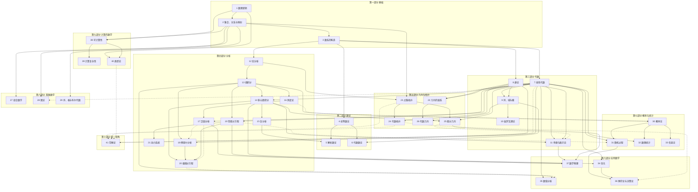

# 《数学大观：AI 时代的数学认知地图》路线大纲

> 不为证明，而为看见全貌；不为解题，而为读懂语言。
> 为现代数学的每个主要领域搭一副“认知脚手架”：它研究什么、核心概念是什么、用什么符号说话、与其他领域如何相连。

---

## 0. 写作定位

> 本节编号 0.1–0.7 只用于写作定位，与正文的“序章”无关。

### 0.1 这本书是什么

- **一张地图**：覆盖现代数学的十个部分（基础、数论、代数、分析、几何与拓扑、离散数学、概率与统计、应用数学、计算的数学、统一视角），让读者知道数学“有哪些地方、彼此怎么连接”。
- **一套脚手架**：每个领域只讲最核心的 5–10 个概念。理解够用即可，不做证明，不做大量计算。
- **一本符号词典**：每个领域都配有完整的符号体系，读者学完能看懂这个领域的式子，也能用这些符号向 AI 精确地表达意图。

### 0.2 为什么在 AI 时代需要它

- 证明和计算可以交给 AI；人要做的是**提出正确的问题、选对数学框架、读懂并检验结果**。
- 有了全局地图，才知道一个现实问题“属于哪片数学”，进而用那片数学的语言去描述它。
- 符号是数学的压缩表达。读懂符号，就能直接阅读论文、文档和 AI 的推导。

### 0.3 目标读者

- 想建立数学全局观的工程师、研究者、产品人和学生。
- 前提：有高中数学的基本印象即可。

### 0.4 三层阅读深度

每章都按三个深度来写，读者可以按需取用：

| 层次       | 时间     | 收获                                             |
| ---------- | -------- | ------------------------------------------------ |
| **速览层** | 15 分钟  | 知道这个领域研究什么、在地图上的位置，能认出它的核心符号 |
| **标准层** | 2–3 小时 | 理解核心概念与直觉，能读懂典型的式子和标志性结果的陈述 |
| **延伸层** | 按需     | 标志性结果的背景与前沿、主要子领域、进一步阅读的指引 |

各段内容属于哪一层，见 0.5 模板表的最后一列。

### 0.5 每章统一模板

第 1–41 章是**领域章**，统一使用下表的十段结构。序章（导论）、第 42–43 章（综合章）和终章另有结构，不套用此模板。

| 段  | 名称                 | 内容                                                                                             | 所属层次                                 |
| --- | -------------------- | ------------------------------------------------------------------------------------------------ | ---------------------------------------- |
| 1   | 一句话               | 这个领域研究什么                                                                                 | 速览                                     |
| 2   | 起源问题             | 问题背景与数学史：它为何诞生，又如何逐步发展                                                     | 标准                                     |
| 3   | 核心对象与概念       | 先用观察框架（0.6）概括对象、结构、映射、不变量、分类，再给出 5–10 张概念卡：名称、直觉、形式定义的读法 | 速览：框架与概念名称；标准：概念卡       |
| 4   | 符号体系             | 符号、LaTeX、读法（中/英）、含义；与其他章节含义冲突的符号须注明区别                             | 速览：核心符号；标准：完整符号表         |
| 5   | 标志性结果与著名问题 | 已证明的结果只读陈述，用人话解释，不做证明；未解决的问题明确标注“猜想”或“未解决”                 | 标准：陈述与解释；延伸：背景、意义与进展 |
| 6   | 直觉与图像           | 可视化、类比                                                                                     | 标准                                     |
| 7   | 地图位置             | 前置章节、后续章节、横向联系                                                                     | 速览                                     |
| 8   | 主要子领域           | 子领域名称（英文名）、研究对象与核心问题、彼此的区别与联系                                       | 延伸                                     |
| 9   | 主要实际应用         | 应用场景、解决什么实际问题、用到本领域的哪些概念或方法                                           | 标准                                     |
| 10  | 延伸阅读             | 进一步阅读的书目、课程与资源                                                                     | 延伸                                     |

- **起源问题**：从催生本领域的实际需求或数学内部难题切入，穿插一条简明的数学史脉络：什么时代、哪些关键人物面对什么困难，提出了什么新概念或方法，又经历了哪些重要转折，逐步形成今天的研究视角。重点展现认识的演进（如从特例到一般、从直觉到严格化、旧框架的局限与突破），而非堆砌年代与轶事。关键人物按下面“人名与译名”的格式标注；史实与归属须核实，有争议时说明，不确定的细节宁可省略。篇幅以帮助理解本领域为度，不展开证明。
- **主要子领域**：介绍本领域内部的主要研究分支，各用简短说明交代“研究什么、为什么单独成为一个方向”，帮助读者建立领域内部的地图；与“地图位置”侧重领域之间的联系相区分。
- **主要实际应用**：选取当前有代表性的实际应用，说明从现实问题到数学方法的连接，而不只罗列行业名称。应用不限于 AI；区分成熟应用与探索性方向，没有直接应用时如实说明其间接作用，不牵强附会。
- **章节粒度**：模板以“章”为单位。若一章本身是某个领域的子领域（如第 4–6 章同属数论，第 10 章属于代数），“主要子领域”写本章内部的研究方向，“地图位置”说明它在上级领域中的位置。
- **前向依赖**：章节大体按依赖顺序排列，但第 5、6、11 章的标准层要用到后面部分的知识。这几章的速览层可以按顺序读，标准层在“地图位置”中注明需要先读的章节。
- **人名与译名**：人物在每章正文首次出现时写作“中文名（英文名）”，英文名用英文文献中的通行写法（一般为全名），如“高斯（Carl Friedrich Gauss）”“哥德尔（Kurt Gödel）”，之后只写中文名；不标生卒年。以人名命名的定理用通行中文译名，中文文献中通常保留原文的（如 Plancherel、Knaster–Tarski、Lax、Cook–Levin）保留原文。

下文各章条目是模板的提要，统一列出：核心问题、核心概念、关键符号、标志性结果（有未解决的问题时另列“著名问题”）、应用、地图位置。

### 0.6 贯穿全书的观察框架

每进入一个新领域，都用同一组问题去看它：

> **对象**是什么？ → 对象上有什么**结构**？ → 什么**映射**保持这种结构？ → 映射下什么东西**不变**？ → 怎样**分类**所有对象？

这组问题写在每章“核心对象与概念”一段的开头。并非每个领域都能五问齐全（例如在概率论、计算复杂性中，“映射”和“不变量”的角色不那么直接），写作时如实说明哪一环不适用，不牵强套用。

### 0.7 读符号之前：字母从哪来、先学哪些

数学符号看着乱，其实只用了三套字母（拉丁字母、希腊字母、希伯来字母），再加上同一字母的不同字体。不必一次背完，按下面的优先级学，遇到不认识的再查。

| 优先级 | 类别       | 需要掌握的范围                                                                                                   | 读法要点                                                                                  | 搜索关键词                                                      |
| ------ | ---------- | ---------------------------------------------------------------------------------------------------------------- | ----------------------------------------------------------------------------------------- | --------------------------------------------------------------- |
| 1      | 拉丁字母   | a–z、A–Z                                                                                                         | 按英文字母念（x 念 /eks/），不按汉语拼音念                                                | —                                                               |
| 2      | 希腊字母   | 先学常用的小写 α β γ δ ε ζ η θ κ λ μ ξ π ρ σ τ φ χ ψ ω 和大写 Γ Δ Θ Λ Π Σ Φ Ω，其余用到再查                      | 用英文读法；LaTeX 命令名基本就是读法（`\alpha` 念 alpha）                                 | 希腊字母 读音、Greek letters used in mathematics                |
| 3      | 字体变体   | 黑板粗体 ℕ ℤ ℚ ℝ ℂ、花体 𝒜 ℱ 𝒪、哥特体 𝔤 𝔽、粗体 **v**                                                          | 念“字体名 + 字母”，或直接念含义：ℝ 念“R”或“实数集”，𝔤 念“fraktur g”                      | blackboard bold、calligraphic letters、Fraktur math             |
| 4      | 希伯来字母 | 基本只有 ℵ（aleph），偶尔见 ℶ（beth）                                                                            | ℵ₀ 念“aleph-null”或“aleph zero”                                                           | aleph number                                                    |

另外两点值得一起了解：

- **修饰记号的读法**：同一个字母加上修饰，读法有固定说法，如 x̂“x hat”、x̄“x bar”、x̃“x tilde”、ẋ“x dot”、f′“f prime”、xᵢ“x sub i”、x²“x squared”。搜索关键词：how to read math notation hat bar tilde。
- **形近易混**：ε 与 ∈、ν 与 v、ρ 与 p、ω 与 w、χ 与 x 形状相近但含义不同；ε/ϵ、φ/ϕ、θ/ϑ 是同一字母的两种写法。∂（partial）和 ∇（nabla）不是字母，但常被当成字母问读法。

遇到不认识的符号，可以这样查：

- [希腊字母（中文维基）](https://zh.wikipedia.org/wiki/希腊字母)：24 个字母的大小写与读音。
- [Greek letters used in mathematics, science, and engineering](https://en.wikipedia.org/wiki/Greek_letters_used_in_mathematics,_science,_and_engineering)：每个希腊字母在各领域的惯用含义。
- [Glossary of mathematical symbols](https://en.wikipedia.org/wiki/Glossary_of_mathematical_symbols)：常见数学符号的名称与含义，含字体变体。
- [Detexify](https://detexify.kirelabs.org/classify.html)：手绘一个符号，查出它的 LaTeX 命令，命令名通常就是它的英文名。
- 直接把符号或截图发给 AI，问“这个符号怎么读、在这里是什么意思”。

完整的字母表与字体约定放在附录 B；同一符号在不同章节的不同含义汇总在附录 E。

---

## 序章　数学是什么

> 导论章，不套用领域章模板。

- 数学研究的六类对象：**数、形、结构、变化、不确定性、计算**
- 数学地图：纯数学与应用数学；国际数学分类（MSC）简介
- 三大主干（代数、分析、几何/拓扑）与它们的交汇
- 数学语言的特点：定义、公理、定理、证明；精确性与抽象性
- 本书用法与阅读路线

---

## 第一部分　基础：数学的地基与语法

### 第 1 章　数理逻辑
- **核心问题**：什么是正确的推理？证明到底是什么？
- **核心概念**：命题、谓词、量词、推理规则、证明方法（直接证明、反证法、归纳法、构造法）、公理系统、一致性、完备性
- **关键符号**：`¬ ∧ ∨ ⇒ ⇔ ∀ ∃ ∃! ⊢ ⊨ ∎`
- **标志性结果**：哥德尔完备性定理、哥德尔不完备定理
- **应用**：程序验证与形式化方法、SAT/SMT 求解器、数据库查询语言（关系演算）
- **地图位置**：前置：无（序章之后的起点）；通向第 2、38、40 章；横向：第 29 章（布尔代数是命题逻辑的代数形式）

### 第 2 章　集合、关系与映射
- **核心问题**：如何用最少的原料搭建出全部数学？
- **核心概念**：集合与运算、笛卡尔积、关系（等价关系、序关系）、函数（单射、满射、双射）、基数、可数与不可数、公理化集合论（ZFC 与选择公理）
- **关键符号**：`∈ ⊆ ∪ ∩ ∖ ∅ {x | P(x)} × 𝒫(A) f: A→B ↦ ∘ f⁻¹ |A| ℵ₀ ∼ [x] A/∼`
- **标志性结果**：康托尔对角线论证（ℝ 不可数）、康托尔定理（`|𝒫(A)| > |A|`）、罗素悖论、连续统假设独立于 ZFC（哥德尔 1940、科恩 1963）
- **应用**：关系数据库的数学模型（关系即笛卡尔积的子集）；间接作用：为全书提供通用语言
- **地图位置**：前置第 1 章；通向第 3、23、27、28、29、38 章

### 第 3 章　数系的构造
- **核心问题**：数是怎样一步步“长”出来的？每一次扩张解决了什么问题？
- **核心概念**：自然数（皮亚诺公理）→ 整数 → 有理数 → 实数（完备性）→ 复数 → 四元数
- **关键符号**：`ℕ ℤ ℚ ℝ ℂ ℍ  i  |z|  z̄  e^{iθ}  ∞`
- **标志性结果**：√2 是无理数、实数的完备性（ℝ 是同构意义下唯一的完备有序域）、代数基本定理、欧拉恒等式 `e^{iπ} + 1 = 0`
- **应用**：计算机中的整数与浮点数表示（与实数的差别见第 35 章）、复数在交流电路与信号处理中的应用、四元数表示三维旋转（图形学、机器人、航天器姿态）
- **地图位置**：前置第 2 章；通向第 4、7、8、12 章；复指数 `e^{iθ}` 的严格定义见第 13、15 章

---

## 第二部分　数论：整数的奥秘

### 第 4 章　初等数论
- **核心问题**：整数有什么内在规律？
- **核心概念**：整除、素数、最大公约数、同余、模运算、欧拉函数
- **关键符号**：`a | b  gcd(a, b)  lcm(a, b)  a ≡ b (mod n)  ℤ/nℤ  φ(n)`
- **标志性结果**：算术基本定理、素数有无穷多个、费马小定理与欧拉定理、中国剩余定理、二次互反律
- **应用**：RSA 密码、哈希、校验码
- **地图位置**：前置第 3 章；通向第 5、6 章；横向：第 9 章（本章把 `ℤ/nℤ` 当作剩余类的集合使用，它的环结构在第 9 章系统讲）

### 第 5 章　解析数论
- **核心问题**：素数是如何分布的？
- **核心概念**：素数计数函数、算术函数与狄利克雷级数、黎曼 ζ 函数、欧拉乘积、解析延拓与非平凡零点、渐近估计
- **关键符号**：`π(x)  ζ(s) = Σ n⁻ˢ  ∏_p  ∼  O(·)  Re(s)`
- **标志性结果**：欧拉乘积公式、素数定理 `π(x) ∼ x / ln x`（阿达马与德拉瓦莱普桑 1896）、狄利克雷算术级数定理
- **著名问题**：黎曼猜想（千禧年难题之一）
- **应用**：直接应用很少；素数定理给出大数附近素数的密度约为 `1 / ln x`，可用来估计密码学中随机生成大素数的效率
- **地图位置**：前置第 4 章；标准层还需第 15 章（复分析），渐近记号 `∼`、`O(·)` 见第 12 章（前向依赖）；通向第 43 章

### 第 6 章　代数数论与丢番图方程
- **核心问题**：方程有没有整数解？整数的概念能推广到哪里？
- **核心概念**：代数数、代数整数、数域、理想与唯一分解的失效、椭圆曲线
- **关键符号**：`ℚ(√2)  ℤ[i]  𝒪_K  E: y² = x³ + ax + b`
- **标志性结果**：费马大定理（怀尔斯 1994 年完成证明）、莫德尔定理（ℚ 上椭圆曲线的有理点构成有限生成阿贝尔群）
- **著名问题**：BSD 猜想（Birch–Swinnerton-Dyer 猜想，千禧年难题之一）
- **应用**：椭圆曲线密码
- **地图位置**：前置第 4 章；标准层还需第 9 章（理想）（前向依赖）；横向：第 26 章（两者交汇为算术几何）；通向第 43 章（朗兰兹纲领）

---

## 第三部分　代数：结构与对称

### 第 7 章　线性代数
- **核心问题**：什么是“线性”？为什么线性的东西都能用矩阵描述？
- **核心概念**：向量空间、基与维数、线性映射、矩阵、行列式、特征值与特征向量、内积与正交、矩阵分解
- **关键符号**：`V  dim V  span  ker  im  rank  Aᵀ  A⁻¹  det  tr  λ  ⟨·,·⟩  ‖·‖  ⊕  ⊗`
- **标志性结果**：秩–零化度定理、谱定理（实对称矩阵可正交对角化）、奇异值分解
- **应用**：几乎全部 AI 与科学计算的底层语言
- **地图位置**：前置第 3 章；通向第 9、11、14、17、18、19、22、25、31、32、34、35 章；横向：第 28 章（谱图论）、第 41 章（向量空间是范畴论的常用例子）

### 第 8 章　群论：对称的语言
- **核心问题**：如何精确地描述“对称”？
- **核心概念**：群、子群、陪集、正规子群、商群、同态与同构、群作用、置换群、循环群
- **关键符号**：`(G, ·)  e  g⁻¹  H ≤ G  N ⊴ G  G/N  ≅  ker φ  Sₙ  ℤ/nℤ  |G|  gH  Orb(x)  Stab(x)`
- **标志性结果**：拉格朗日定理、同构定理、轨道–稳定子定理、有限单群分类
- **应用**：晶体学、魔方、粒子物理、等变神经网络
- **地图位置**：前置第 3 章；通向第 9、11、22、24、41 章

### 第 9 章　环、域与模
- **核心问题**：能做加法和乘法的结构有哪些？
- **核心概念**：环、理想、多项式环、整环、域、域扩张、有限域、模
- **关键符号**：`R[x]  (a)  I ⊴ R  R/I  𝔽_q  [K : F]  char F`
- **标志性结果**：主理想整环中的唯一分解、有限域分类（元素个数必为素数幂 q，且每个 q 在同构意义下恰有一个 q 元域）
- **应用**：纠错码、密码学
- **地图位置**：前置第 7、8 章；通向第 6、10、26 章；横向：第 4 章（`ℤ/nℤ` 是环的原型）

### 第 10 章　伽罗瓦理论
- **核心问题**：为什么一般的五次方程没有求根公式？
- **核心概念**：域扩张与扩张次数、分裂域、域自同构、伽罗瓦群、伽罗瓦对应、可解群
- **关键符号**：`Gal(K/F)  Aut(K)  K^H  [K : F]`
- **标志性结果**：伽罗瓦基本定理；根式可解判据（在特征为 0 的域上，多项式方程可用根式求解当且仅当其伽罗瓦群是可解群），由此得到阿贝尔–鲁菲尼定理（一般的五次及以上方程没有根式求根公式）；倍立方与三等分任意角不能用尺规完成（化圆为方的不可能性另需 π 的超越性，林德曼 1882）
- **应用**：直接应用很少；有限域的伽罗瓦理论是编码与密码学中有限域运算的基础，“用对称性判断可解性”的思想影响了整个现代代数
- **地图位置**：前置第 9 章；横向：第 6 章（数域的伽罗瓦群）、第 43 章（朗兰兹纲领）

### 第 11 章　李群、李代数与表示论
- **核心问题**：如何描述连续的对称？如何把抽象的群“翻译”成矩阵？
- **核心概念**：李群、李代数、指数映射、表示、不可约表示、特征标
- **关键符号**：`GL(n)  SO(3)  SU(2)  𝔤  [X, Y]  exp  ρ: G → GL(V)  χ`
- **标志性结果**：舒尔引理、彼得–外尔定理
- **应用**：量子力学、粒子物理的标准模型、广义傅里叶分析
- **地图位置**：前置第 7、8 章；标准层还需第 14 章（指数映射与切空间要用微积分）（前向依赖），李群作为流形的严格处理见第 25 章；通向第 37 章；横向：第 18 章（表示论是傅里叶分析的推广）、第 43 章（朗兰兹纲领）

---

## 第四部分　分析：极限、变化与无穷

### 第 12 章　实分析：极限与连续
- **核心问题**：如何严格地谈论“无限接近”？
- **核心概念**：数列极限、ε–δ 语言、连续、一致连续、一致收敛、上确界、完备性
- **关键符号**：`lim  →  ε  δ  sup  inf  limsup  O(·)  o(·)  ∼`
- **标志性结果**：介值定理、最值定理、波尔查诺–魏尔斯特拉斯定理
- **应用**：间接作用：为算法的收敛性与误差估计提供严格语言（如证明迭代算法收敛、估计近似误差的量级）
- **地图位置**：前置第 3 章；通向第 13、23 章

### 第 13 章　微积分：微分与积分
- **核心问题**：如何描述变化率与累积量？
- **核心概念**：导数、积分、微积分基本定理、泰勒展开、无穷级数
- **关键符号**：`f'(x)  df/dx  ∫ₐᵇ f(x) dx  Σ  n!  e  ln`
- **标志性结果**：微积分基本定理、泰勒定理、中值定理
- **应用**：物理中的运动与变化建模、经济学中的边际分析、用泰勒展开做近似计算
- **地图位置**：前置第 12 章；通向第 14、16、18、19、30、35 章

### 第 14 章　多元微积分与向量分析
- **核心问题**：在多维空间中如何描述变化与累积？
- **核心概念**：偏导数、梯度、雅可比矩阵、黑塞矩阵、多重积分、散度、旋度、曲线与曲面积分
- **关键符号**：`∂  ∇  ∇·  ∇×  Δ (∇²)  ∬  ∮  J  H  dV`
- **标志性结果**：格林公式、斯托克斯定理、高斯散度定理（它们在第 25 章统一为 `∫_{∂M} ω = ∫_M dω`）
- **应用**：反向传播（多元链式法则）、梯度下降、电磁学与流体力学（散度、旋度）
- **地图位置**：前置第 7、13 章；通向第 11、15、20、25、34 章

### 第 15 章　复分析
- **核心问题**：把微积分搬到复数上会发生什么“奇迹”？
- **核心概念**：全纯函数、柯西–黎曼方程、围道积分、留数、解析延拓、共形映射
- **关键符号**：`z  z̄  Re  Im  arg  ∮_γ  Res  f⁽ⁿ⁾`
- **标志性结果**：柯西积分公式、留数定理、刘维尔定理、黎曼映射定理
- **应用**：交流电路与控制理论（传递函数的零点与极点）、二维流体与静电场中的共形映射、用留数计算实积分
- **地图位置**：前置第 14 章；通向第 5 章（解析数论的主要工具）

### 第 16 章　测度论与勒贝格积分
- **核心问题**：如何给任意集合“测量大小”？如何积分更多的函数？
- **核心概念**：σ-代数、测度、可测函数、几乎处处、勒贝格积分、Lᵖ 空间
- **关键符号**：`(X, 𝒜, μ)  μ(A)  ∫ f dμ  a.e.  Lᵖ  ‖f‖ₚ`（在概率论中对应记作 `(Ω, ℱ, P)`，见第 30 章）
- **标志性结果**：单调收敛定理、控制收敛定理、拉东–尼科迪姆定理
- **应用**：间接作用：现代概率论与随机过程的严格基础；Lᵖ 空间是分析与信号处理的标准工作空间
- **地图位置**：前置第 13 章；通向第 17 章；是第 30 章的严格基础

### 第 17 章　泛函分析
- **核心问题**：当“向量”变成函数，空间变成无穷维时会怎样？
- **核心概念**：赋范空间、巴拿赫空间、希尔伯特空间、有界线性算子、对偶空间、谱
- **关键符号**：`‖·‖  ⟨·,·⟩  ℋ  ℓ²  L²  X*  T*  ⊥  σ(T)`
- **标志性结果**：哈恩–巴拿赫定理、里斯表示定理、谱定理（第 7 章谱定理的无限维推广）
- **应用**：量子力学、核方法、偏微分方程
- **地图位置**：前置第 7、16 章；通向第 37 章；为第 18 章的 L² 理论和第 20 章的弱解提供框架

### 第 18 章　傅里叶分析与调和分析
- **核心问题**：能否把任意信号拆成简单波的叠加？
- **核心概念**：傅里叶级数、傅里叶变换、卷积、频域、小波
- **关键符号**：`f̂(ξ) = ∫ f(x) e^{−2πixξ} dx  ℱ  *  δ(x)`
- **标志性结果**：卷积定理、Plancherel 定理、奈奎斯特–香农采样定理
- **应用**：信号处理、图像压缩、卷积神经网络、位置编码
- **地图位置**：前置第 7、13 章；L² 理论需第 16、17 章；通向第 20 章；横向：第 11 章（表示论把傅里叶分析推广到一般的群）

### 第 19 章　常微分方程
- **核心问题**：如何用“变化规律”预测未来？
- **核心概念**：初值问题、线性系统、相空间、平衡点、稳定性
- **关键符号**：`ẋ  dx/dt = f(x, t)  y''  e^{At}`
- **标志性结果**：存在唯一性定理（皮卡–林德勒夫定理）、线性化稳定性判据
- **应用**：人口与传染病模型（如 SIR 模型）、电路与控制系统、神经常微分方程（Neural ODE）
- **地图位置**：前置第 7、13 章；通向第 20、21、37 章；随机微分方程见第 31 章

### 第 20 章　偏微分方程
- **核心问题**：在空间和时间中同时变化的量遵循什么规律？
- **核心概念**：三类经典方程（椭圆、抛物、双曲）、初值与边值问题、分离变量法、基本解与格林函数、适定性、弱解
- **关键符号**：`uₜ = Δu`（热方程）、`uₜₜ = c²Δu`（波动方程）、`Δu = 0`（拉普拉斯方程）、`iℏ ∂ₜψ = Ĥψ`（薛定谔方程）
- **标志性结果**：极值原理（拉普拉斯方程与热方程）、波动方程的有限传播速度、Lax–Milgram 定理（双线性型连续且强制时，弱解存在且唯一）
- **著名问题**：纳维–斯托克斯方程解的存在性与光滑性（千禧年难题之一）
- **应用**：热传导与流体模拟、天气预报、期权定价（布莱克–斯科尔斯方程）；用物理信息神经网络（PINN）求解偏微分方程属于探索性方向
- **地图位置**：前置第 14、18、19 章；弱解需第 17 章；数值解法见第 35 章

### 第 21 章　动力系统与混沌
- **核心问题**：确定性的规则为何会产生不可预测的行为？
- **核心概念**：迭代、不动点、周期轨道、吸引子、分岔、混沌、遍历性
- **关键符号**：`xₙ₊₁ = f(xₙ)  fⁿ  φₜ  λ`（李雅普诺夫指数）
- **标志性结果**：庞加莱–本迪克松定理（平面上连续时间的自治系统不会出现混沌；离散时间的映射不受此限）、逻辑斯谛映射的倍周期分岔与费根鲍姆常数的普适性、洛伦兹吸引子的存在（塔克 2002 年用计算机辅助证明）
- **应用**：天气预报的可预测性极限、生态系统中的种群振荡、天体轨道力学
- **地图位置**：前置第 19 章；横向：第 16 章（遍历理论用测度论描述长期统计行为）

---

## 第五部分　几何与拓扑：空间与形状

### 第 22 章　几何的谱系：从欧几里得到克莱因
- **核心问题**：“几何”到底在研究什么？
- **核心概念**：欧氏几何、非欧几何（双曲、椭圆）、仿射几何、射影几何；爱尔兰根纲领（几何研究的是变换群作用下的不变量）
- **关键符号**：`ℝⁿ  ℙⁿ  d(x, y)  ∠  ≅  ∼  Isom(X)`
- **标志性结果**：平行公设的独立性、射影几何的对偶原理
- **应用**：计算机视觉中的相机模型与多视图几何、图形学中的齐次坐标、航海与航空中的球面几何
- **地图位置**：前置第 7、8 章；通向第 26 章；横向：第 25 章（黎曼几何把欧氏与非欧几何纳入同一框架）

### 第 23 章　点集拓扑
- **核心问题**：抛开距离与角度之后，“形状”还剩下什么？
- **核心概念**：开集、拓扑空间、连续、同胚、紧致、连通、度量空间、豪斯多夫性
- **关键符号**：`(X, τ)  Ā  int A  ∂A  B(x, r)  d  ≅`
- **标志性结果**：海涅–博雷尔定理、吉洪诺夫定理
- **应用**：间接作用：为分析、几何与概率提供“连续”“收敛”“紧致”的通用语言
- **地图位置**：前置第 2、12 章；通向第 24、25 章

### 第 24 章　代数拓扑
- **核心问题**：如何用代数来数出一个空间里的“洞”？
- **核心概念**：同伦、基本群、覆叠空间、同调群、欧拉示性数
- **关键符号**：`≃  π₁(X)  Hₙ(X)  χ  S¹  S²  T²  Dⁿ`
- **标志性结果**：欧拉多面体公式 `V − E + F = 2`（推广为欧拉示性数是拓扑不变量）、布劳威尔不动点定理、毛球定理、庞加莱猜想（佩雷尔曼 2002–2003 年证明，证明用到里奇流等几何分析工具；它是千禧年难题中唯一已被解决的）
- **应用**：拓扑数据分析（持久同调）
- **地图位置**：前置第 8、23 章；横向：第 28 章（平面图的欧拉公式）、第 36 章（不动点定理用于证明纳什均衡存在）、第 41 章（同调代数是范畴论的来源之一）

### 第 25 章　微分几何与流形
- **核心问题**：如何在弯曲的空间上做微积分？
- **核心概念**：流形、切空间、向量场、微分形式、黎曼度量、联络、曲率、测地线
- **关键符号**：`M  TₚM  TM  g_{ij}  Γᵏ_{ij}  R  dω  ∧`，以及爱因斯坦求和约定
- **标志性结果**：高斯绝妙定理、高斯–博内定理、广义斯托克斯定理 `∫_{∂M} ω = ∫_M dω`
- **应用**：广义相对论、流形学习、信息几何
- **地图位置**：前置第 7、14、23 章；通向第 37 章；横向：第 11 章（李群是带群结构的流形）

### 第 26 章　代数几何
- **核心问题**：多项式方程组的解集长什么样？
- **核心概念**：仿射簇、射影簇、理想与簇的对应、坐标环、概形（只作识别）
- **关键符号**：`𝔸ⁿ  ℙⁿ  V(I)  I(V)  k[x₁, …, xₙ]  Spec R  𝒪_X`
- **标志性结果**：希尔伯特零点定理、贝祖定理
- **著名问题**：霍奇猜想（千禧年难题之一）
- **应用**：椭圆曲线密码、代数几何码（如 Goppa 码）、机器人运动学中的多项式方程组求解（格罗布纳基）
- **地图位置**：前置第 9、22 章；横向：第 6 章（两者交汇为算术几何）；通向第 43 章（朗兰兹纲领）

---

## 第六部分　离散数学：有限与组合

### 第 27 章　组合数学
- **核心问题**：有多少种方式？什么结构必然存在？
- **核心概念**：计数原理、排列组合、二项式定理、容斥原理、生成函数、鸽巢原理、拉姆齐理论
- **关键符号**：`n!  C(n, k) 或 (n choose k)  G(x) = Σ aₙxⁿ  R(s, t)`
- **标志性结果**：二项式定理、拉姆齐定理
- **应用**：算法分析中的计数、实验设计、编码理论、概率方法
- **地图位置**：前置第 2 章；横向：第 28 章（许多计数问题以图为对象）、第 30 章（概率方法）

### 第 28 章　图论
- **核心问题**：如何描述事物之间的连接？
- **核心概念**：图与度、路径与连通、树、二部图与匹配、平面图与着色、网络流、谱图论
- **关键符号**：`G = (V, E)  deg(v)  Kₙ  K_{m,n}  χ(G)  A  L = D − A`
- **标志性结果**：欧拉对哥尼斯堡七桥问题的解答（一笔画判定）、四色定理（1976 年计算机辅助证明）、霍尔婚配定理、最大流最小割定理
- **应用**：社交网络、知识图谱、图神经网络
- **地图位置**：前置第 2 章；谱图论需第 7 章；横向：第 24 章（平面图的欧拉公式）

### 第 29 章　序、格与布尔代数
- **核心问题**：“比较”与“组合”的抽象结构是什么？
- **核心概念**：偏序集与哈斯图、格、完备格、布尔代数、单调映射与不动点
- **关键符号**：`≤  ∨ (join)  ∧ (meet)  ⊤  ⊥`
- **标志性结果**：Knaster–Tarski 不动点定理（完备格上的单调映射必有不动点）
- **应用**：逻辑电路、数据库、程序分析
- **地图位置**：前置第 2 章；横向：第 1 章（布尔代数是命题逻辑的代数形式）

---

## 第七部分　概率与统计：不确定性的数学

### 第 30 章　概率论
- **核心问题**：如何精确地谈论“可能性”？
- **核心概念**：概率空间（柯尔莫哥洛夫公理）、随机变量、分布、期望、方差、条件概率、独立性
- **关键符号**：`(Ω, ℱ, P)  P(A | B)  X ∼ 𝒩(μ, σ²)  𝔼[X]  Var(X)  Cov(X, Y)  i.i.d.  F_X  f_X`
- **标志性结果**：贝叶斯公式、大数定律、中心极限定理
- **应用**：风险评估与保险精算、机器学习中的概率模型、随机算法
- **地图位置**：前置第 13 章；严格基础见第 16 章；通向第 31、32、33 章

### 第 31 章　随机过程
- **核心问题**：随时间演化的随机现象如何描述？
- **核心概念**：马尔可夫链、泊松过程、布朗运动、鞅、随机微分方程
- **关键符号**：`{Xₜ}  Pᵢⱼ  Wₜ  dXₜ = μ dt + σ dWₜ  𝔼[Xₜ | ℱₛ]`
- **标志性结果**：马尔可夫链收敛定理、伊藤引理
- **应用**：金融数学、扩散模型、强化学习
- **地图位置**：前置第 7、30 章；随机微分方程部分需第 19 章；通向第 36 章

### 第 32 章　数理统计
- **核心问题**：如何从数据反推规律？
- **核心概念**：估计量、最大似然、置信区间、假设检验、回归、频率学派与贝叶斯学派
- **关键符号**：`θ̂  L(θ)  H₀  H₁  α  p  β  ε`
- **标志性结果**：克拉美–罗下界、奈曼–皮尔逊引理
- **应用**：A/B 测试、临床试验、计量经济学、机器学习中的模型评估
- **地图位置**：前置第 7、30 章；横向：第 33 章（最大似然等价于最小化 KL 散度）

### 第 33 章　信息论
- **核心问题**：信息能被量化吗？
- **核心概念**：熵、联合熵与条件熵、互信息、KL 散度、信道容量
- **关键符号**：`H(X)  H(X | Y)  I(X; Y)  D_KL(p ‖ q)  C`
- **标志性结果**：香农信源编码定理、信道编码定理
- **应用**：数据压缩、通信、交叉熵损失
- **地图位置**：前置第 30 章；横向：第 32 章

---

## 第八部分　应用数学：从模型到决策

### 第 34 章　优化
- **核心问题**：如何在约束下找到“最好”的解？
- **核心概念**：目标函数、可行域、凸集与凸函数、线性规划、拉格朗日乘子、对偶、梯度方法
- **关键符号**：`min  argmin  s.t.  ∇  ℒ(x, λ)  ⪰`
- **标志性结果**：KKT（卡鲁什–库恩–塔克）条件、强对偶定理
- **应用**：机器学习训练、运筹调度
- **地图位置**：前置第 7、14 章；通向第 36 章；横向：第 35 章（数值求解）

### 第 35 章　数值分析
- **核心问题**：计算机如何近似地求解连续的数学问题？
- **核心概念**：浮点数与舍入误差、条件数、稳定性、插值、数值积分、迭代法
- **关键符号**：`κ(A)  ε_mach  h  O(hᵖ)`
- **标志性结果**：Lax 等价定理（对适定的线性初值问题，相容的差分格式收敛当且仅当它稳定）、牛顿法的局部二次收敛
- **应用**：工程仿真（有限元方法）、科学计算、深度学习中的数值稳定性（如混合精度训练）
- **地图位置**：前置第 7、13 章；Lax 等价定理需第 20 章

### 第 36 章　博弈论与决策论
- **核心问题**：理性的个体会如何选择？
- **核心概念**：策略、支付、纳什均衡、零和博弈、机制设计、马尔可夫决策过程
- **关键符号**：`uᵢ(s)  s₋ᵢ  (S, A, P, R, γ)  V^π  Q(s, a)`
- **标志性结果**：纳什均衡存在定理、冯·诺依曼极小极大定理、贝尔曼最优性原理与贝尔曼方程
- **应用**：拍卖与机制设计（频谱拍卖、广告竞价）、强化学习、多智能体系统
- **地图位置**：前置第 31、34 章；纳什均衡存在性的证明用到第 24 章的不动点定理

### 第 37 章　数学物理一瞥
- **核心问题**：为什么数学能如此有效地描述自然？
- **核心概念**：拉格朗日力学与哈密顿力学、守恒律、麦克斯韦方程、量子力学的希尔伯特空间表述、时空流形
- **关键符号**：`L = T − V  H  {f, g}  |ψ⟩  ⟨ψ|  Ĥ  ℏ  g_{μν}`
- **标志性结果**：诺特定理（连续对称性对应守恒律）
- **著名问题**：杨–米尔斯存在性与质量间隙（千禧年难题之一）
- **应用**：卫星导航的相对论修正、半导体与量子器件设计、量子计算
- **地图位置**：前置第 11、17、19、25 章；横向：第 20 章（经典场方程）

---

## 第九部分　计算的数学

### 第 38 章　可计算性理论
- **核心问题**：什么问题原则上能被算法解决？
- **核心概念**：图灵机、λ 演算、递归函数、丘奇–图灵论题、可判定性
- **关键符号**：`λx. M  M ↓  M ↑  ≤_m`
- **标志性结果**：停机问题不可判定、赖斯定理（程序的任何非平凡语义性质都不可判定）
- **应用**：程序分析的理论极限（由赖斯定理，不存在对所有程序都精确的通用静态分析，实用工具只能近似或限制问题范围）、编译器与静态分析工具的设计取舍
- **地图位置**：前置第 1、2 章；通向第 39、40 章

### 第 39 章　计算复杂性理论
- **核心问题**：什么问题能被高效地解决？
- **核心概念**：时间与空间复杂度、P、NP、NP-完全、多项式归约、随机算法
- **关键符号**：`O  Θ  Ω  P  NP  ≤_p  BPP`
- **标志性结果**：Cook–Levin 定理（SAT 是 NP-完全的）、时间层级定理
- **著名问题**：P vs NP（千禧年难题之一）
- **应用**：密码学安全性的理论基础（单向函数假设）、判断问题能否高效求解，从而决定改用近似算法或启发式算法
- **地图位置**：前置第 38 章；渐近记号见第 12 章

### 第 40 章　类型论与形式化证明
- **核心问题**：程序与证明有什么关系？计算机能验证数学吗？
- **核心概念**：类型与项、简单类型 λ 演算、柯里–霍华德对应（命题即类型）、依赖类型、归纳类型、证明助手
- **关键符号**：`Γ ⊢ t : A  A → B  Π  Σ`
- **标志性结果**：简单类型 λ 演算的强正规化定理（每个良类型项的归约都会终止）；形式化验证的里程碑：四色定理（Coq，2005）、开普勒猜想（Flyspeck 项目，2014）
- **应用**：Lean 与 Mathlib、AI 辅助的自动定理证明
- **地图位置**：前置第 1、38 章；横向：第 41 章（类型论与范畴论相互对应）

---

## 第十部分　统一视角：数学的整体

### 第 41 章　范畴论：数学的数学
- **核心问题**：不同领域中反复出现的模式能否统一描述？
- **核心概念**：对象、态射、函子、自然变换、泛性质、伴随、极限
- **关键符号**：`𝒞  f: A → B  Hom(A, B)  F: 𝒞 → 𝒟  η: F ⇒ G  F ⊣ G`
- **标志性结果**：米田引理
- **应用**：函数式编程、类型系统、组合式系统设计
- **地图位置**：前置第 8 章；第 7、23、24、40 章提供更多例子

### 第 42 章　贯穿数学的大思想

> 综合章，不套用领域章模板；建议读完前十个部分的大部分章节后阅读。

- 对称与不变量
- 线性化：把复杂问题局部近似为线性问题
- 从局部到整体
- 对偶
- 分类
- 逼近与极限
- 抽象与推广：结构与保持结构的映射

### 第 43 章　当代数学的前沿地图

> 综合章，不套用领域章模板。

- 朗兰兹纲领：数论、几何与表示论的大统一（与第 5、6、10、11、26 章呼应）
- 千禧年七大难题概览（与第 5、6、20、24、26、37、39 章呼应）
- AI 与数学：形式化、自动定理证明、AI 辅助发现（与第 40 章、终章呼应）

---

## 终章　带着地图与 AI 对话

> 收束全书，不套用领域章模板。

- **定位**：判断一个现实问题属于哪片数学：先按序章的六类对象（数？形？结构？变化？不确定性？计算？）粗分，再细化到具体领域（如优化、统计推断、图论）
- **翻译**：调用该领域的对象与符号，把需求写成精确的数学描述
- **协作**：让 AI 解释、推导、编程、找反例
- **检验**：量纲检查、边界检查、小例子代入、代码数值验证
- **模板**：各领域常用的提示词模板

---

## 附录

- **A. 符号总表**：按领域分类，每个符号给出 LaTeX、读法（中/英）、含义和出现章节
- **B. 希腊字母与数学字体**：24 个希腊字母的大小写、读音（中/英）与惯用含义；粗体、花体、黑板粗体、哥特体的读法与约定；希伯来字母 ℵ、ℶ（入门指引见 0.7）
- **C. 常见缩写与拉丁短语**：iff、s.t.、WLOG、i.i.d.、a.e.、cf.、i.e.……
- **D. 术语中英对照表**
- **E. 一符多义表**：同一符号或术语在不同章节的不同含义，至少收录：
  - `σ`：标准差、sigmoid 函数、奇异值、σ-代数、置换
  - `∼`：等价关系（第 2 章）、渐近等价（第 5、12 章）、服从某分布（第 30 章）、相似（第 22 章）
  - `≅`：同构（第 8 章）、全等（第 22 章）、同胚（第 23 章）
  - `χ`：特征标（第 11 章）、欧拉示性数（第 24 章）、色数（第 28 章）
  - `φ`：欧拉函数（第 4 章）、同态（第 8 章）、流（第 21 章）
  - `λ`：特征值（第 7 章）、李雅普诺夫指数（第 21 章）、拉格朗日乘子（第 34 章）、λ 演算（第 38 章）
  - `ℱ`：σ-代数与 σ-代数流（filtration，第 30、31 章）、傅里叶变换（第 18 章）
  - `H`：黑塞矩阵（第 14 章）、同调群（第 24 章）、原假设 H₀（第 32 章）、熵（第 33 章）、哈密顿量（第 37 章）
  - `L` / `ℒ`：似然函数（第 32 章）、拉格朗日函数（第 34、37 章）、拉普拉斯矩阵（第 28 章）
  - `∧` / `∨`：逻辑与/或（第 1 章）、交/并（第 29 章）；`∧` 另作外积（第 25 章）
  - “完备性”：逻辑系统的完备性（第 1 章）、实数与度量空间的完备性（第 3、12、17 章）
- **F. 数学史时间线**：从欧几里得到朗兰兹
- **G. 推荐资源**：《普林斯顿数学指南》、《什么是数学》（柯朗）、《数学：它的内容、方法和意义》、《通向实在之路》（彭罗斯）、3Blue1Brown、Quanta Magazine、nLab
- **H. LaTeX 速查**

---

## 领域关系图

实线表示标准层的前置要求，虚线表示部分内容或严格化才需要的前置。图中只画直接前置，与各章“地图位置”一致；第 42、43 章和终章综合全书，未画出。



---

## 阅读路线建议

```
全景速览（约 2 周）：  序章 + 全书各章的速览层，建立整张地图
AI / 机器学习方向：    序章 → 1–3 → 7 → 12–14 → 30、32、33 → 34 → 35 → 18 → 28 → 31 → 36 → 23、25（流形学习）→ 终章
工程 / 物理方向：      序章 → 1–3 → 7 → 8 → 12–21 → 23 → 25 → 11 → 35 → 37 → 终章
软件 / 算法方向：      序章 → 1–3 → 4 → 7–9 → 27–29 → 38–40 → 41 → 终章
纯数学好奇心路线：     序章 → 按章节顺序全部读完，重点读第 42、43 章
```

- 以上路线的章节顺序都满足各章“地图位置”中的前置要求（虚线依赖除外）。
- 按章节顺序阅读时，第 5、6、11 章有前向依赖：先读速览层，读完其前置章节后再回读标准层。

## 里程碑自测

| 阶段             | 自测任务                                                                                                                                     |
| ---------------- | -------------------------------------------------------------------------------------------------------------------------------------------- |
| 完成基础部分     | 能读出并解释 `∀x ∈ ℝ ∃n ∈ ℕ (n > x)`，能说出从 ℕ 到 ℂ 的每一步扩张解决了什么问题                                                               |
| 完成数论部分     | 能读懂 `a^{p−1} ≡ 1 (mod p)`（p 为素数且 p ∤ a），并说出 RSA 依赖了哪些数论事实                                                               |
| 完成代数部分     | 能用群的语言描述一个对称现象，能解释 `G/N` 的含义                                                                                              |
| 完成分析部分     | 能读出并解释 `∀ε > 0 ∃δ > 0 ∀x (\|x − a\| < δ ⇒ \|f(x) − f(a)\| < ε)`，能逐个符号解释 `∇_θ ‖Xθ − y‖²` 和 `f̂(ξ) = ∫ f(x) e^{−2πixξ} dx`     |
| 完成几何拓扑部分 | 能解释为什么“咖啡杯 ≅ 甜甜圈”，能读懂 `π₁(S¹) ≅ ℤ`                                                                                           |
| 完成离散数学部分 | 能把一个网络问题写成 `G = (V, E)`，并判断它是路径、匹配、着色还是网络流问题                                                                    |
| 完成概率统计部分 | 能读懂 `𝔼_{x∼p_data}[log p_θ(x)]`，并说出最大化它等价于最小化哪个 KL 散度                                                                     |
| 完成应用数学部分 | 能把一个资源分配问题写成 `min_x f(x) s.t. gᵢ(x) ≤ 0`，并判断它是不是凸优化问题                                                                |
| 完成计算部分     | 能区分“不可判定”与“NP-完全”，能读懂 `SAT ∈ NP` 和 `A ≤_p B`                                                                                   |
| 完成统一视角部分 | 能用“对象与态射”的语言说出群同态、线性映射、连续映射的共同点                                                                                  |
| 完成全书         | 拿到一个现实问题，能说出它属于哪个领域，并用该领域的符号写出它的数学描述                                                                     |
