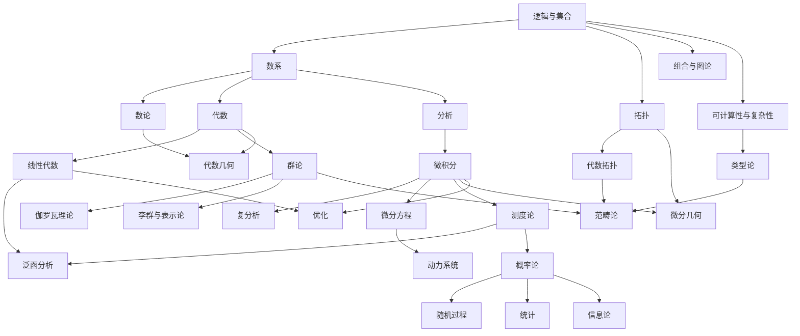

# 《数学大观：AI 时代的数学认知地图》路线大纲

> 不为证明，而为看见全貌；不为解题，而为读懂语言。
> 为现代数学的每个主要领域搭一副"认知脚手架"：它研究什么、核心概念是什么、用什么符号说话、与其他领域如何相连。

---

## 0. 写作定位

### 0.1 这本书是什么

- **一张地图**：覆盖现代数学的主要分支（基础、数论、代数、分析、几何拓扑、离散、概率统计、应用与计算、统一视角），让读者知道数学"有哪些地方、彼此怎么连接"。
- **一套脚手架**：每个领域只讲最核心的 5–10 个概念。理解够用即可，不做证明，不做大量计算。
- **一本符号词典**：每个领域都配有完整的符号体系，读者学完能看懂这个领域的式子，也能用这些符号向 AI 精确地表达意图。

### 0.2 为什么在 AI 时代需要它

- 证明和计算可以交给 AI；人要做的是**提出正确的问题、选对数学框架、读懂并检验结果**。
- 有了全局地图，才知道一个现实问题"属于哪片数学"，进而用那片数学的语言去描述它。
- 符号是数学的压缩表达。读懂符号，就能直接阅读论文、文档和 AI 的推导。

### 0.3 目标读者

- 想建立数学全局观的工程师、研究者、产品人和学生。
- 前提：有高中数学的基本印象即可。

### 0.4 三层阅读深度

每章都按三个深度来写，读者可以按需取用：

| 层次 | 时间 | 收获 |
|------|------|------|
| **速览层** | 15 分钟 | 知道这个领域研究什么，能认出它的核心符号 |
| **标准层** | 2–3 小时 | 理解核心概念与直觉，能读懂典型的式子 |
| **延伸层** | 按需 | 标志性定理、前沿方向、进一步阅读的指引 |

### 0.5 每章统一模板

```
1. 一句话          —— 这个领域研究什么
2. 起源问题        —— 它是被什么问题"逼"出来的
3. 核心对象与概念  —— 概念卡：名称 | 直觉 | 形式定义的读法
4. 符号体系        —— 符号 | LaTeX | 读法 | 含义
5. 标志性结果      —— 只读陈述，用人话解释，不做证明
6. 直觉与图像      —— 可视化、类比
7. 地图位置        —— 前置章节 / 后续章节 / 横向联系
8. 现实与 AI 中的身影
9. 动手            —— 一段代码 + 一次与 AI 的对话练习
10. 自测           —— 读懂 3 个本领域的典型式子
```

### 0.6 贯穿全书的观察框架

每进入一个新领域，都用同一组问题去看它：

> **对象**是什么？ → 对象上有什么**结构**？ → 什么**映射**保持这种结构？ → 映射下什么东西**不变**？ → 怎样**分类**所有对象？

---

## 序章　数学是什么

- 数学研究的六类对象：**数、形、结构、变化、不确定性、计算**
- 数学地图：纯数学与应用数学；国际数学分类（MSC）简介
- 三大主干（代数、分析、几何/拓扑）与它们的交汇
- 数学语言的特点：定义、公理、定理、证明；精确性与抽象性
- 本书用法与阅读路线

---

## 第一部分　基础：数学的地基与语法

### 第 1 章　数理逻辑
- **核心问题**：什么是正确的推理？证明到底是什么？
- **核心概念**：命题、谓词、量词、推理规则、证明方法（直接证明、反证法、归纳法、构造法）、公理系统、一致性、完备性
- **关键符号**：`¬ ∧ ∨ ⇒ ⇔ ∀ ∃ ∃! ⊢ ⊨ ∎`
- **标志性结果**：哥德尔完备性定理、哥德尔不完备定理

### 第 2 章　集合、关系与映射
- **核心问题**：如何用最少的原料搭建出全部数学？
- **核心概念**：集合与运算、笛卡尔积、关系（等价关系、序关系）、函数（单射、满射、双射）、基数、可数与不可数
- **关键符号**：`∈ ⊆ ∪ ∩ ∖ ∅ {x | P(x)} × 𝒫(A) f: A→B ↦ ∘ f⁻¹ |A| ℵ₀ ∼ [x] A/∼`
- **标志性结果**：康托尔对角线论证（ℝ 不可数）、罗素悖论、ZFC 公理体系、选择公理、连续统假设的独立性

### 第 3 章　数系的构造
- **核心问题**：数是怎样一步步"长"出来的？每一次扩张解决了什么问题？
- **核心概念**：自然数（皮亚诺公理）→ 整数 → 有理数 → 实数（完备性）→ 复数 → 四元数
- **关键符号**：`ℕ ℤ ℚ ℝ ℂ ℍ  i  |z|  z̄  e^{iθ}  ∞`
- **标志性结果**：√2 是无理数、实数的完备性、代数基本定理、欧拉公式 `e^{iπ} + 1 = 0`

---

## 第二部分　数论：整数的奥秘

### 第 4 章　初等数论
- **核心问题**：整数有什么内在规律？
- **核心概念**：整除、素数、最大公约数、同余、模运算、欧拉函数
- **关键符号**：`a | b  gcd(a, b)  lcm  a ≡ b (mod n)  ℤ/nℤ  φ(n)`
- **标志性结果**：算术基本定理、素数有无穷多个、费马小定理、中国剩余定理、二次互反律
- **应用**：RSA 密码、哈希、校验码

### 第 5 章　解析数论
- **核心问题**：素数是如何分布的？
- **核心概念**：素数计数函数、黎曼 ζ 函数、欧拉乘积、渐近估计
- **关键符号**：`π(x)  ζ(s) = Σ n⁻ˢ  ∏_p  ∼  O(·)  Re(s)`
- **标志性结果**：素数定理 `π(x) ∼ x / ln x`、黎曼猜想（千禧年难题）

### 第 6 章　代数数论与丢番图方程
- **核心问题**：方程有没有整数解？整数的概念能推广到哪里？
- **核心概念**：代数数、代数整数、数域、理想、椭圆曲线
- **关键符号**：`ℚ(√2)  ℤ[i]  𝒪_K  E: y² = x³ + ax + b`
- **标志性结果**：费马大定理、莫德尔定理
- **应用**：椭圆曲线密码

---

## 第三部分　代数：结构与对称

### 第 7 章　线性代数
- **核心问题**：什么是"线性"？为什么线性的东西都能用矩阵描述？
- **核心概念**：向量空间、基与维数、线性映射、矩阵、行列式、特征值与特征向量、内积、正交、SVD
- **关键符号**：`V  dim V  span  ker  im  rank  Aᵀ  A⁻¹  det  tr  λ  ⟨·,·⟩  ‖·‖  ⊕  ⊗`
- **标志性结果**：秩–零化度定理、谱定理、奇异值分解
- **应用**：几乎全部 AI 与科学计算的底层语言

### 第 8 章　群论：对称的语言
- **核心问题**：如何精确地描述"对称"？
- **核心概念**：群、子群、陪集、正规子群、商群、同态与同构、群作用、置换群、循环群
- **关键符号**：`(G, ·)  e  g⁻¹  H ≤ G  N ⊴ G  G/N  ≅  ker φ  Sₙ  ℤₙ  |G|  gH  Orb(x)  Stab(x)`
- **标志性结果**：拉格朗日定理、同构定理、轨道–稳定子定理、有限单群分类
- **应用**：晶体学、魔方、粒子物理、等变神经网络

### 第 9 章　环、域与模
- **核心问题**：能做加法和乘法的结构有哪些？
- **核心概念**：环、理想、多项式环、整环、域、域扩张、有限域、模
- **关键符号**：`R[x]  (a)  I ◁ R  𝔽_q  [K : F]  char F`
- **标志性结果**：唯一分解、有限域分类
- **应用**：纠错码、密码学

### 第 10 章　伽罗瓦理论
- **核心问题**：为什么五次方程没有求根公式？
- **核心概念**：域扩张、自同构、伽罗瓦群、伽罗瓦对应
- **关键符号**：`Gal(K/F)  Aut(K)  K^H`
- **标志性结果**：伽罗瓦基本定理、五次方程没有根式解、古希腊三大尺规作图问题不可能

### 第 11 章　李群、李代数与表示论
- **核心问题**：如何描述连续的对称？如何把抽象的群"翻译"成矩阵？
- **核心概念**：李群、李代数、指数映射、表示、不可约表示、特征标
- **关键符号**：`GL(n)  SO(3)  SU(2)  𝔤  [X, Y]  exp  ρ: G → GL(V)  χ`
- **标志性结果**：舒尔引理、彼得–外尔定理
- **应用**：量子力学、粒子物理的标准模型、广义傅里叶分析

---

## 第四部分　分析：极限、变化与无穷

### 第 12 章　实分析：极限与连续
- **核心问题**：如何严格地谈论"无限接近"？
- **核心概念**：数列极限、ε–δ 语言、连续、一致连续、一致收敛、上确界、完备性
- **关键符号**：`lim  →  ε  δ  sup  inf  limsup  O(·)  o(·)`
- **标志性结果**：介值定理、最值定理、Bolzano–Weierstrass 定理

### 第 13 章　微积分：微分与积分
- **核心问题**：如何描述变化率与累积量？
- **核心概念**：导数、积分、微积分基本定理、泰勒展开、无穷级数
- **关键符号**：`f'(x)  df/dx  ∫ₐᵇ f(x) dx  Σ  n!  e  ln`
- **标志性结果**：微积分基本定理、泰勒定理、中值定理

### 第 14 章　多元微积分与向量分析
- **核心问题**：在多维空间中如何描述变化与累积？
- **核心概念**：偏导数、梯度、雅可比矩阵、黑塞矩阵、多重积分、散度、旋度、曲线与曲面积分
- **关键符号**：`∂  ∇  ∇·  ∇×  Δ (∇²)  ∬  ∮  J  H  dV`
- **标志性结果**：格林公式、斯托克斯定理、高斯散度定理，以及它们的统一形式 `∫_{∂M} ω = ∫_M dω`

### 第 15 章　复分析
- **核心问题**：把微积分搬到复数上会发生什么"奇迹"？
- **核心概念**：全纯函数、柯西–黎曼方程、围道积分、留数、解析延拓、共形映射
- **关键符号**：`z  z̄  Re  Im  arg  ∮_γ  Res  f⁽ⁿ⁾`
- **标志性结果**：柯西积分公式、留数定理、刘维尔定理、黎曼映射定理

### 第 16 章　测度论与勒贝格积分
- **核心问题**：如何给任意集合"测量大小"？如何积分更多的函数？
- **核心概念**：σ-代数、测度、可测函数、几乎处处、勒贝格积分、Lᵖ 空间
- **关键符号**：`(X, 𝒜, μ)  μ(A)  ∫ f dμ  a.e.  Lᵖ  ‖f‖ₚ`
- **标志性结果**：单调收敛定理、控制收敛定理、Radon–Nikodym 定理
- **地图位置**：现代概率论的地基

### 第 17 章　泛函分析
- **核心问题**：当"向量"变成函数，空间变成无穷维时会怎样？
- **核心概念**：赋范空间、巴拿赫空间、希尔伯特空间、有界线性算子、对偶空间、谱
- **关键符号**：`‖·‖  ⟨·,·⟩  ℋ  ℓ²  L²  X*  T*  ⊥  σ(T)`
- **标志性结果**：Hahn–Banach 定理、里斯表示定理、谱定理
- **应用**：量子力学、核方法、偏微分方程

### 第 18 章　傅里叶分析与调和分析
- **核心问题**：能否把任意信号拆成简单波的叠加？
- **核心概念**：傅里叶级数、傅里叶变换、卷积、频域、小波
- **关键符号**：`f̂(ξ)  ℱ  *  e^{2πixξ}  δ(x)`
- **标志性结果**：卷积定理、Plancherel 定理、采样定理
- **应用**：信号处理、图像压缩、卷积神经网络、位置编码

### 第 19 章　常微分方程
- **核心问题**：如何用"变化规律"预测未来？
- **核心概念**：初值问题、线性系统、相空间、平衡点、稳定性
- **关键符号**：`ẋ  dx/dt = f(x, t)  y''  e^{At}`
- **标志性结果**：存在唯一性定理（Picard–Lindelöf）、线性化稳定性判据

### 第 20 章　偏微分方程
- **核心问题**：在空间和时间中同时变化的量遵循什么规律？
- **核心概念**：三类经典方程（椭圆、抛物、双曲）、边值问题、弱解
- **关键符号**：`uₜ = Δu`（热方程）、`uₜₜ = c²Δu`（波动方程）、`Δu = 0`（拉普拉斯方程）、`iℏ ∂ₜψ = Ĥψ`（薛定谔方程）
- **标志性结果**：纳维–斯托克斯方程解的存在性与光滑性（千禧年难题）

### 第 21 章　动力系统与混沌
- **核心问题**：确定性的规则为何会产生不可预测的行为？
- **核心概念**：迭代、不动点、周期轨道、吸引子、分岔、混沌、遍历性
- **关键符号**：`xₙ₊₁ = f(xₙ)  fⁿ  φₜ  λ`（李雅普诺夫指数）
- **标志性结果**：Logistic 映射与通往混沌的倍周期分岔、洛伦兹吸引子、Poincaré–Bendixson 定理

---

## 第五部分　几何与拓扑：空间与形状

### 第 22 章　几何的谱系：从欧几里得到克莱因
- **核心问题**："几何"到底在研究什么？
- **核心概念**：欧氏几何、非欧几何（双曲、椭圆）、仿射几何、射影几何；爱尔兰根纲领（几何研究的是变换群作用下的不变量）
- **关键符号**：`ℝⁿ  ℙⁿ  d(x, y)  ∠  ≅  ∼  Isom(X)`
- **标志性结果**：平行公设的独立性、射影对偶

### 第 23 章　点集拓扑
- **核心问题**：抛开距离与角度之后，"形状"还剩下什么？
- **核心概念**：开集、拓扑空间、连续、同胚、紧致、连通、度量空间、豪斯多夫性
- **关键符号**：`(X, τ)  Ā  int A  ∂A  B(x, r)  d  ≅`
- **标志性结果**：海涅–博雷尔定理、吉洪诺夫定理

### 第 24 章　代数拓扑
- **核心问题**：如何用代数来数出一个空间里的"洞"？
- **核心概念**：同伦、基本群、覆叠空间、同调群、欧拉示性数
- **关键符号**：`≃  π₁(X)  Hₙ(X)  χ  S¹  S²  T²  Dⁿ`
- **标志性结果**：欧拉公式 `V − E + F = 2`、布劳威尔不动点定理、毛球定理、庞加莱猜想
- **应用**：拓扑数据分析（持久同调）

### 第 25 章　微分几何与流形
- **核心问题**：如何在弯曲的空间上做微积分？
- **核心概念**：流形、切空间、向量场、微分形式、黎曼度量、联络、曲率、测地线
- **关键符号**：`M  TₚM  TM  g_{ij}  Γᵏ_{ij}  R  dω  ∧`，以及爱因斯坦求和约定
- **标志性结果**：高斯绝妙定理、高斯–博内定理
- **应用**：广义相对论、流形学习、信息几何

### 第 26 章　代数几何
- **核心问题**：多项式方程组的解集长什么样？
- **核心概念**：仿射簇、射影簇、理想与簇的对应、坐标环、概形（只作识别）
- **关键符号**：`𝔸ⁿ  ℙⁿ  V(I)  I(V)  k[x₁, …, xₙ]  Spec R  𝒪_X`
- **标志性结果**：希尔伯特零点定理、Bézout 定理
- **地图位置**：与数论交汇（算术几何），通向朗兰兹纲领

---

## 第六部分　离散数学：有限与组合

### 第 27 章　组合数学
- **核心问题**：有多少种方式？什么结构必然存在？
- **核心概念**：计数原理、排列组合、二项式定理、容斥原理、生成函数、鸽巢原理、拉姆齐理论
- **关键符号**：`n!  C(n, k) 或 (n choose k)  G(x) = Σ aₙxⁿ  R(s, t)`
- **标志性结果**：二项式定理、拉姆齐定理

### 第 28 章　图论
- **核心问题**：如何描述事物之间的连接？
- **核心概念**：图、度、路径、连通、树、二部图、平面图、着色、匹配、网络流、谱图论
- **关键符号**：`G = (V, E)  deg(v)  Kₙ  K_{m,n}  χ(G)  A  L = D − A`
- **标志性结果**：哥尼斯堡七桥问题、四色定理、Hall 婚配定理、最大流最小割定理
- **应用**：社交网络、知识图谱、图神经网络

### 第 29 章　序、格与布尔代数
- **核心问题**："比较"与"组合"的抽象结构是什么？
- **核心概念**：偏序集、格、布尔代数、不动点
- **关键符号**：`≤  ∨ (join)  ∧ (meet)  ⊤  ⊥`
- **标志性结果**：Knaster–Tarski 不动点定理
- **应用**：逻辑电路、数据库、程序分析

---

## 第七部分　概率与统计：不确定性的数学

### 第 30 章　概率论
- **核心问题**：如何精确地谈论"可能性"？
- **核心概念**：概率空间（Kolmogorov 公理）、随机变量、分布、期望、方差、条件概率、独立性
- **关键符号**：`(Ω, ℱ, P)  P(A | B)  X ∼ 𝒩(μ, σ²)  𝔼[X]  Var(X)  Cov(X, Y)  i.i.d.  F_X  f_X`
- **标志性结果**：贝叶斯公式、大数定律、中心极限定理

### 第 31 章　随机过程
- **核心问题**：随时间演化的随机现象如何描述？
- **核心概念**：马尔可夫链、泊松过程、布朗运动、鞅、随机微分方程
- **关键符号**：`{Xₜ}  Pᵢⱼ  Wₜ  dXₜ = μ dt + σ dWₜ  𝔼[Xₜ | ℱₛ]`
- **标志性结果**：马尔可夫链收敛定理、伊藤引理
- **应用**：金融数学、扩散模型、强化学习

### 第 32 章　数理统计
- **核心问题**：如何从数据反推规律？
- **核心概念**：估计量、最大似然、置信区间、假设检验、回归、频率学派与贝叶斯学派
- **关键符号**：`θ̂  L(θ)  H₀  H₁  α  p  β  ε`
- **标志性结果**：Cramér–Rao 下界、Neyman–Pearson 引理

### 第 33 章　信息论
- **核心问题**：信息能被量化吗？
- **核心概念**：熵、联合熵与条件熵、互信息、KL 散度、信道容量
- **关键符号**：`H(X)  H(X | Y)  I(X; Y)  D_KL(p ‖ q)  C`
- **标志性结果**：香农信源编码定理、信道编码定理
- **应用**：数据压缩、通信、交叉熵损失

---

## 第八部分　应用数学：从模型到决策

### 第 34 章　优化
- **核心问题**：如何在约束下找到"最好"的解？
- **核心概念**：目标函数、可行域、凸集与凸函数、线性规划、拉格朗日乘子、对偶、梯度方法
- **关键符号**：`min  argmin  s.t.  ∇  ℒ(x, λ)  ⪰`
- **标志性结果**：KKT 条件、强对偶定理
- **应用**：机器学习训练、运筹调度

### 第 35 章　数值分析
- **核心问题**：计算机如何近似地求解连续的数学问题？
- **核心概念**：浮点数与舍入误差、条件数、稳定性、插值、数值积分、迭代法
- **关键符号**：`κ(A)  ε_mach  h  O(hᵖ)`
- **标志性结果**：Lax 等价定理、牛顿法的二次收敛

### 第 36 章　博弈论与决策论
- **核心问题**：理性的个体会如何选择？
- **核心概念**：策略、支付、纳什均衡、零和博弈、机制设计、马尔可夫决策过程
- **关键符号**：`uᵢ(s)  s₋ᵢ  (S, A, P, R, γ)  V^π  Q(s, a)`
- **标志性结果**：纳什均衡存在定理、冯·诺依曼极小极大定理、贝尔曼方程

### 第 37 章　数学物理一瞥
- **核心问题**：为什么数学能如此有效地描述自然？
- **核心概念**：拉格朗日力学与哈密顿力学、守恒律、麦克斯韦方程、量子力学的希尔伯特空间表述、时空流形
- **关键符号**：`L = T − V  H  {f, g}  |ψ⟩  ⟨ψ|  Ĥ  ℏ  g_{μν}`
- **标志性结果**：诺特定理（对称性对应守恒律）

---

## 第九部分　计算的数学

### 第 38 章　可计算性理论
- **核心问题**：什么问题原则上能被算法解决？
- **核心概念**：图灵机、λ 演算、递归函数、丘奇–图灵论题、可判定性
- **关键符号**：`λx. M  M ↓  M ↑  ≤_m`
- **标志性结果**：停机问题不可判定

### 第 39 章　计算复杂性理论
- **核心问题**：什么问题能被高效地解决？
- **核心概念**：时间与空间复杂度、P、NP、NP-完全、多项式归约、随机算法
- **关键符号**：`O  Θ  Ω  P  NP  ≤_p  BPP`
- **标志性结果**：Cook–Levin 定理、P vs NP（千禧年难题）

### 第 40 章　类型论与形式化证明
- **核心问题**：程序与证明有什么关系？计算机能验证数学吗？
- **核心概念**：类型、柯里–霍华德对应（命题即类型）、依赖类型、证明助手
- **关键符号**：`Γ ⊢ t : A  A → B  Π  Σ`
- **应用**：Lean 与 Mathlib、AI 辅助的自动定理证明

---

## 第十部分　统一视角：数学的整体

### 第 41 章　范畴论：数学的数学
- **核心问题**：不同领域中反复出现的模式能否统一描述？
- **核心概念**：对象、态射、函子、自然变换、泛性质、伴随、极限
- **关键符号**：`𝒞  f: A → B  Hom(A, B)  F: 𝒞 → 𝒟  η: F ⇒ G  F ⊣ G`
- **标志性结果**：米田引理
- **应用**：函数式编程、类型系统、组合式系统设计

### 第 42 章　贯穿数学的大思想
- 对称与不变量
- 线性化：把复杂问题局部近似为线性问题
- 从局部到整体
- 对偶
- 分类
- 逼近与极限
- 抽象与推广：结构与保持结构的映射

### 第 43 章　当代数学的前沿地图
- 朗兰兹纲领：数论、几何与表示论的大统一
- 千禧年七大难题概览
- AI 与数学：形式化、自动定理证明、AI 辅助发现

---

## 终章　带着地图与 AI 对话

- **定位**：判断一个现实问题属于哪片数学（结构？变化？不确定性？优化？）
- **翻译**：调用该领域的对象与符号，把需求写成精确的数学描述
- **协作**：让 AI 解释、推导、编程、找反例
- **检验**：量纲检查、边界检查、小例子代入、代码数值验证
- **模板**：各领域常用的提示词模板

---

## 附录

- **A. 符号总表**：按领域分类，每个符号给出 LaTeX、读法（中/英）、含义和出现章节
- **B. 希腊字母与数学字体**：α…ω 的惯用含义；粗体、花体、黑板粗体、哥特体的约定
- **C. 常见缩写与拉丁短语**：iff、s.t.、WLOG、i.i.d.、a.e.、cf.、i.e.……
- **D. 术语中英对照表**
- **E. 一符多义表**：例如 `σ` 可以是标准差、sigmoid、奇异值、σ-代数或置换
- **F. 数学史时间线**：从欧几里得到朗兰兹
- **G. 推荐资源**：《普林斯顿数学指南》、《什么是数学》（柯朗）、《数学：它的内容、方法和意义》、《通向实在之路》（彭罗斯）、3Blue1Brown、Quanta Magazine、nLab
- **H. LaTeX 速查**

---

## 领域关系图



---

## 阅读路线建议

```
全景速览（约 2 周）：全书只读"速览层"，建立整张地图
AI / 机器学习方向：  1–3 → 7 → 12–14 → 30、32、33 → 34 → 18 → 25（流形学习）→ 终章
工程 / 物理方向：    1–3 → 7 → 12–15 → 19–21 → 25 → 37 → 终章
软件 / 算法方向：    1–2 → 4 → 27–29 → 38–40 → 41 → 终章
纯数学好奇心路线：   按章节顺序全部读完，重点读第 42、43 章
```

## 里程碑自测

| 阶段 | 自测任务 |
|------|----------|
| 完成基础部分 | 能读出并解释 `∀ε > 0 ∃δ > 0 ∀x (|x − a| < δ ⇒ |f(x) − f(a)| < ε)` |
| 完成代数部分 | 能用群的语言描述一个对称现象，能解释 `G/N` 的含义 |
| 完成分析部分 | 能逐个符号解释 `∇_θ ‖Xθ − y‖²` 和 `f̂(ξ) = ∫ f(x) e^{−2πixξ} dx` |
| 完成几何拓扑部分 | 能解释为什么"咖啡杯 ≅ 甜甜圈"，能读懂 `π₁(S¹) ≅ ℤ` |
| 完成概率统计部分 | 能读懂 `𝔼_{x∼p_data}[log p_θ(x)]`，并说出它在优化什么 |
| 完成全书 | 拿到一个现实问题，能说出它属于哪个领域，并用该领域的符号写出它的数学描述 |

---

## 建议的仓库结构

```
my-math-book/
├── README.md
├── OUTLINE.md                 # 本大纲
├── chapters/
│   ├── 00-prologue/
│   ├── 01-foundations/
│   ├── 02-number-theory/
│   ├── 03-algebra/
│   ├── 04-analysis/
│   ├── 05-geometry-topology/
│   ├── 06-discrete/
│   ├── 07-probability-statistics/
│   ├── 08-applied/
│   ├── 09-computation/
│   ├── 10-unification/
│   └── 99-epilogue/
├── appendix/
├── code/                      # 每章配套的 Python 示例
└── prompts/                   # 与 AI 对话的示例与模板
```
