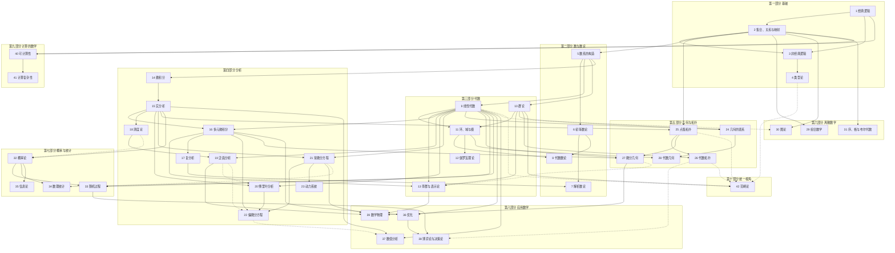

# 《数学大观：AI 时代的数学认知地图》路线大纲

> 不为证明，而为看见全貌；不为解题，而为读懂语言。
> 为现代数学的每个主要领域搭一副“认知脚手架”：它研究什么、核心概念从何而来又怎样被一次次重新定义、用什么符号说话、与其他领域如何相连。

---

## 0. 写作定位

> 本节编号 0.1–0.7 只用于写作定位，与正文的“序章”无关。

### 0.1 这本书是什么

- **一张地图**：覆盖现代数学的十个部分（基础、数与数论、代数、分析、几何与拓扑、离散数学、概率与统计、应用数学、计算的数学、统一视角），让读者知道数学“有哪些地方、彼此怎么连接”。
- **一部概念重构史**：每个领域都围绕一个核心问题“X 究竟是什么”（命题、数、空间、函数、概率……），沿着这个概念被定义、碰壁、再定义的脉络来讲（见 0.6）。读者看到的不是从天而降的定义，而是每个定义为什么不得不长成这样。
- **一套脚手架**：每个领域只讲最核心的 5–10 个概念。理解够用即可，不做证明，不做大量计算。
- **一本符号词典**：每个领域都配有完整的符号体系，读者学完能看懂这个领域的式子，也能用这些符号向 AI 精确地表达意图。

### 0.2 为什么在 AI 时代需要它

- 证明和计算可以交给 AI；人要做的是**提出正确的问题、选对数学框架、读懂并检验结果**。
- 有了全局地图，才知道一个现实问题“属于哪片数学”，进而用那片数学的语言去描述它。
- 符号是数学的压缩表达。读懂符号，就能直接阅读论文、文档和 AI 的推导。
- 定义是会变的。“命题”“函数”“解”“概率”在不同时代、不同学派有不同的定义。知道一个概念经历过哪些版本，才能判断一篇文档或一段 AI 推导用的是哪一版，以及它在哪里会失效。

### 0.3 目标读者

- 想建立数学全局观的工程师、研究者、产品人和学生。
- 前提：有高中数学的基本印象即可。

### 0.4 三层阅读深度

每章都按三个深度来写，读者可以按需取用：

| 层次       | 时间     | 收获                                                                       |
| ---------- | -------- | -------------------------------------------------------------------------- |
| **速览层** | 15 分钟  | 知道这个领域研究什么、核心概念经历过哪几次重新定义、在地图上的位置，能认出它的核心符号 |
| **标准层** | 2–3 小时 | 理解核心概念与直觉，能读懂典型的式子和标志性结果的陈述                     |
| **延伸层** | 按需     | 标志性结果的背景与前沿、主要子领域、进一步阅读的指引                       |

各段内容属于哪一层，见 0.5 模板表的最后一列。

### 0.5 每章统一模板

第 1–42 章是**领域章**，统一使用下表的十段结构。序章（导论）、十篇部分导言、第 43–44 章（综合章）和终章另有结构，不套用此模板。

| 段  | 名称                 | 内容                                                                                                                         | 所属层次                                 |
| --- | -------------------- | ---------------------------------------------------------------------------------------------------------------------------- | ---------------------------------------- |
| 1   | 一句话               | 这个领域研究什么                                                                                                             | 速览                                     |
| 2   | 概念的演进           | 全章的主干：核心概念最初被定义成什么，遇到什么困境，又怎样被重新定义（0.6 的四步循环，可以不止一轮）                         | 速览：演进线一句话；标准：完整叙述       |
| 3   | 核心对象与概念       | 先用五问框架（0.6）概括对象、结构、映射、不变量、分类，再给出 5–10 张概念卡：名称、直觉、形式定义的读法、它在演进线上修补了什么问题 | 速览：框架与概念名称；标准：概念卡       |
| 4   | 符号体系             | 符号、LaTeX、读法（中/英）、含义；与其他章节含义冲突的符号须注明区别                                                         | 速览：核心符号；标准：完整符号表         |
| 5   | 标志性结果与著名问题 | 已证明的结果只读陈述，用人话解释，不做证明；未解决的问题明确标注“猜想”或“未解决”                                             | 标准：陈述与解释；延伸：背景、意义与进展 |
| 6   | 直觉与图像           | 可视化、类比                                                                                                                 | 标准                                     |
| 7   | 地图位置             | 前置章节、后续章节、横向联系                                                                                                 | 速览                                     |
| 8   | 主要子领域           | 子领域名称（英文名）、研究对象与核心问题、彼此的区别与联系                                                                   | 延伸                                     |
| 9   | 主要实际应用         | 应用场景、解决什么实际问题、用到本领域的哪些概念或方法                                                                       | 标准                                     |
| 10  | 延伸阅读             | 进一步阅读的书目、课程与资源                                                                                                 | 延伸                                     |

- **概念的演进**：本段是全章的主干，按 0.6 的四步来写：最初抓住什么直觉、把核心概念定义成什么；沿着旧定义走下去，遇到了什么算不出来、自相矛盾或违反直觉的“怪物”；数学家怎样修改定义，新旧定义差在哪里；为了表达新定义，又发明了哪些符号，它们为什么必须长成这样。从催生本领域的实际需求或数学内部难题切入，关键人物按下面“人名与译名”的格式标注；史实与归属须核实，有争议时说明，不确定的细节宁可省略。篇幅以帮助理解为度，不展开证明。
- **全章挂在演进线上**：后面各段尽量指回演进线。概念卡写明“这个定义是为了解决哪个困境”，符号说明“它表达的是哪一版定义”，标志性结果说明“它巩固了哪次重构，或暴露了哪个新困境”，让全章读成一条线，而不是一串清单。
- **主要子领域**：介绍本领域内部的主要研究分支，各用简短说明交代“研究什么、为什么单独成为一个方向”，帮助读者建立领域内部的地图；与“地图位置”侧重领域之间的联系相区分。
- **主要实际应用**：选取当前有代表性的实际应用，说明从现实问题到数学方法的连接，而不只罗列行业名称。应用不限于 AI；区分成熟应用与探索性方向，没有直接应用时如实说明其间接作用，不牵强附会。
- **章节粒度**：模板以“章”为单位。若一章本身是某个领域的子领域（如第 6–8 章同属数论，第 12 章属于代数），“概念的演进”写部分演进线中属于本章的那一段，开头一句交代它接在哪一步上；“主要子领域”写本章内部的研究方向，“地图位置”说明它在上级领域中的位置。
- **部分导言**：十个部分各有一篇导言，不套用领域章模板，内容固定为三项：① 核心问题：本领域反复追问的“X 是什么”；② 演进表：阶段、核心概念被理解为什么、推动它的问题或困境、对应章节；③ 读法提示：演进线与章节顺序不一致之处、多条修补路线并存之处、演进线较弱之处的说明。一个部分有不止一条演进线时（如第四部分），分别列出。下文每个部分开头的“部分导言”是它的提要。
- **前向依赖**：章节大体按依赖顺序排列，但第 7、8、13 章的标准层要用到后面部分的知识。这几章的速览层可以按顺序读，标准层在“地图位置”中注明需要先读的章节。另外，第 14 章（微积分）有意排在第 15 章（实分析）之前：先用直觉的无穷小把微积分做起来，再在第 15 章讲它遇到的危机和 ε–δ 的重构。
- **人名与译名**：人物在每章正文首次出现时写作“中文名（英文名）”，英文名用英文文献中的通行写法（一般为全名），如“高斯（Carl Friedrich Gauss）”“哥德尔（Kurt Gödel）”，之后只写中文名；不标生卒年。以人名命名的定理用通行中文译名，中文文献中通常保留原文的（如 Plancherel、Knaster–Tarski、Lax、Cook–Levin）保留原文。

下文各章条目是模板的提要，统一列出：核心问题、演进线、核心概念、关键符号、标志性结果（有未解决的问题时另列“著名问题”）、应用、地图位置。

### 0.6 贯穿全书的两个视角：纵向的演进线，横向的五问

#### 纵向：概念的重构史（主线）

数学的定义不是从天而降的。一个领域往往围绕一个核心概念展开：命题是什么？数是什么？空间是什么？函数是什么？概率是什么？这个概念会反复经历同一种循环：


写每个领域之前，先回答四个问题：

1. **初代直觉**：这个领域最初想抓住现实中的什么直觉？最初把核心概念定义成了什么？
2. **困境**：顺着最初的定义走下去，遇到了什么算不出来、自相矛盾或违反直觉的“怪物”？
3. **重构**：为了处理这个困境，数学家怎样修改了定义？新旧定义的本质区别是什么？
4. **新语言**：为了精确表达新定义，发明了哪些符号与规则？它们为什么必须长成这样？

例如“命题是什么”（第一部分）：经典逻辑把命题看成非真即假的值，“若 P 则 Q”只能定义成一个真值函数，于是有了“P 假时整句为真”这条别扭的规则，它是二值定义的代价；直觉主义逻辑把命题看成待完成的构造；类型论把命题看成类型，“若 P 则 Q”成了“把 P 的证明变成 Q 的证明”的函数。P 不可能有证明时（即 P 为假），这样的函数平凡地存在（没有任何输入需要处理），同一条规则从“硬性规定”变成了“自然结果”。

写作原则：

- **困境要具体**：写出那个反例、悖论或算不出来的问题本身（√2、罗素悖论、五次方程、狄利克雷函数、贝特朗悖论），不要抽象地说“遇到了困难”。
- **重构不等于淘汰**：新定义常把旧定义当作特例，或划清旧定义的适用范围。经典逻辑仍是大多数数学的默认逻辑，黎曼积分在工程中依然够用。写清旧定义在哪里仍然好用、在哪里失效。
- **多条修补路线并存时如实写出**：罗素悖论之后有 ZFC 与类型论两条路；概率在公理化之后仍有频率与信念两种解释。
- **按概念逻辑排列，不等于编年史**：时间交错时注明（如直觉主义早于克里普克语义，伽罗瓦早于群公理的定型）。
- **不神化，也不贬低**：不把历史写成通向今天的必然，也不把旧定义写成“错误”；每个定义都是在当时的问题与约束下合理的设计。
- **演进线较弱时如实说明**：有的领域没有单一的核心概念（如离散数学），只写几条短线，不硬套。

#### 横向：五问观察框架

每进入一个新领域，都用同一组问题去看它：

> **对象**是什么？ → 对象上有什么**结构**？ → 什么**映射**保持这种结构？ → 映射下什么东西**不变**？ → 怎样**分类**所有对象？

这组问题写在每章“核心对象与概念”一段的开头。并非每个领域都能五问齐全（例如在概率论、计算复杂性中，“映射”和“不变量”的角色不那么直接），写作时如实说明哪一环不适用，不牵强套用。

#### 两个视角的关系

演进线回答“这个定义为什么长这样”，五问回答“在当前的定义下，这个领域看什么”。一次重构往往就是改动了五问中的某一环：拓扑学抛弃距离，改的是“结构”；克莱因用变换群定义几何，改的是“映射”；同调把“洞的个数”提升为“同调群”，改的是“不变量”。写作时可以用这种方式把两个视角连起来。

### 0.7 读符号之前：字母从哪来、先学哪些

数学符号看着乱，其实只用了三套字母（拉丁字母、希腊字母、希伯来字母），再加上同一字母的不同字体。不必一次背完，按下面的优先级学，遇到不认识的再查。

| 优先级 | 类别       | 需要掌握的范围                                                                                                   | 读法要点                                                                                  | 搜索关键词                                                      |
| ------ | ---------- | ---------------------------------------------------------------------------------------------------------------- | ----------------------------------------------------------------------------------------- | --------------------------------------------------------------- |
| 1      | 拉丁字母   | a–z、A–Z                                                                                                         | 按英文字母念（x 念 /eks/），不按汉语拼音念                                                | —                                                               |
| 2      | 希腊字母   | 先学常用的小写 α β γ δ ε ζ η θ κ λ μ ξ π ρ σ τ φ χ ψ ω 和大写 Γ Δ Θ Λ Π Σ Φ Ω，其余用到再查                      | 用英文读法；LaTeX 命令名基本就是读法（`\alpha` 念 alpha）                                 | 希腊字母 读音、Greek letters used in mathematics                |
| 3      | 字体变体   | 黑板粗体 ℕ ℤ ℚ ℝ ℂ、花体 𝒜 ℱ 𝒪、哥特体 𝔤 𝔽、粗体 **v**                                                          | 念“字体名 + 字母”，或直接念含义：ℝ 念“R”或“实数集”，𝔤 念“fraktur g”                      | blackboard bold、calligraphic letters、Fraktur math             |
| 4      | 希伯来字母 | 基本只有 ℵ（aleph），偶尔见 ℶ（beth）                                                                            | ℵ₀ 念“aleph-null”或“aleph zero”                                                           | aleph number                                                    |

另外两点值得一起了解：

- **修饰记号的读法**：同一个字母加上修饰，读法有固定说法，如 x̂“x hat”、x̄“x bar”、x̃“x tilde”、ẋ“x dot”、f′“f prime”、xᵢ“x sub i”、x²“x squared”。搜索关键词：how to read math notation hat bar tilde。
- **形近易混**：ε 与 ∈、ν 与 v、ρ 与 p、ω 与 w、χ 与 x 形状相近但含义不同；ε/ϵ、φ/ϕ、θ/ϑ 是同一字母的两种写法。∂（partial）和 ∇（nabla）不是字母，但常被当成字母问读法。

遇到不认识的符号，可以这样查：

- [希腊字母（中文维基）](https://zh.wikipedia.org/wiki/希腊字母)：24 个字母的大小写与读音。
- [Greek letters used in mathematics, science, and engineering](https://en.wikipedia.org/wiki/Greek_letters_used_in_mathematics,_science,_and_engineering)：每个希腊字母在各领域的惯用含义。
- [Glossary of mathematical symbols](https://en.wikipedia.org/wiki/Glossary_of_mathematical_symbols)：常见数学符号的名称与含义，含字体变体。
- [Detexify](https://detexify.kirelabs.org/classify.html)：手绘一个符号，查出它的 LaTeX 命令，命令名通常就是它的英文名。
- 直接把符号或截图发给 AI，问“这个符号怎么读、在这里是什么意思”。

完整的字母表与字体约定放在附录 B；同一符号在不同章节的不同含义汇总在附录 E。

---

## 序章　数学是什么

> 导论章，不套用领域章模板。

- 数学研究的六类对象：**数、形、结构、变化、不确定性、计算**
- 数学地图：纯数学与应用数学；国际数学分类（MSC）简介
- 三大主干（代数、分析、几何/拓扑）与它们的交汇
- 数学语言的特点：定义、公理、定理、证明；精确性与抽象性
- 本书用法与阅读路线；全书主线：概念的重构史（0.6）

---

## 第一部分　基础：命题、集合与证明

> **部分导言**
>
> - **核心问题**：命题是什么？证明又是什么？
> - **读法提示**：罗素悖论之后有两条修补路线：ZFC（第 2 章）和罗素本人提出的类型论（第 4 章的源头）。希尔伯特想在形式系统中一劳永逸地证明数学无矛盾，哥德尔不完备定理（1931）表明这个计划不能按原样完成：足够强的系统中“真”不等于“可证”，这为第 3、4 章换一种命题观埋下了伏笔。第 3 章的两条路线按概念排列，不按时间：直觉主义（布劳威尔 1907 年起）实际早于克里普克语义（1959 年起）。

| 阶段         | 核心概念被理解为                                           | 推动它的问题或困境                                            | 章  |
| ------------ | ---------------------------------------------------------- | ------------------------------------------------------------- | --- |
| 词项逻辑     | 命题是主谓形式的句子，推理靠三段论                         | 怎样区分有效的论证与诡辩                                      | 1   |
| 经典逻辑     | 命题是非真即假的真值，联结词是真值函数；再加上谓词与量词   | 三段论处理不了关系与多重量词，如“每个数都有比它大的数”        | 1   |
| 形式系统     | 命题是公理系统中的符号串，证明是按规则进行的符号变换       | 希尔伯特纲领：想用有限的方法证明数学没有矛盾                  | 1   |
| 公理化集合论 | “性质决定集合”只能在公理允许的范围内使用（ZFC）            | 罗素悖论击穿了“任何性质都决定一个集合”的朴素集合论            | 2   |
| 可能世界     | 命题是它在其中成立的那些可能世界                           | “必然”“可能”“将来总会”无法用单一的真值表达                    | 3   |
| 构造         | 命题是一个待完成的构造，有证明才算真                       | 只靠反证法得到的“存在”给不出对象本身                          | 3   |
| 类型         | 命题是一个类型，证明是这个类型的项（程序）                 | 罗素悖论的另一条修补路线；让机器检查证明                      | 4   |

### 第 1 章　经典逻辑：命题是真值
- **核心问题**：什么是正确的推理？证明到底是什么？
- **演进线**：亚里士多德（Aristotle）的三段论把命题看成主谓句，处理不了关系与多重量词 → 布尔把命题化为 0/1 的代数（1847、1854），弗雷格引入谓词与量词（1879）：命题是真值，联结词是真值函数，真值表随之确定，实质蕴含（前件为假则整句为真）是二值定义的代价 → 希尔伯特把证明重构为形式系统中的符号变换（`⊢`），塔斯基把“真”定义为在模型中成立（`⊨`），哥德尔完备性定理说明一阶逻辑中两者一致 → 困境：不完备定理表明足够强的系统中真不等于可证（引向第 3、4、40 章）
- **核心概念**：命题与真值、联结词与真值表、实质蕴含、谓词与量词、推理规则、证明方法（直接证明、反证法、归纳法、构造法）、公理系统、语法与语义（可证与有效）、一致性、完备性
- **关键符号**：`¬ ∧ ∨ ⇒ ⇔ ∀ ∃ ∃! ⊢ ⊨ ∎`
- **标志性结果**：哥德尔完备性定理、哥德尔不完备定理
- **应用**：程序验证与形式化方法、SAT/SMT 求解器、数据库查询语言（关系演算）
- **地图位置**：前置：无（序章之后的起点）；通向第 2、3、40 章；横向：第 31 章（布尔代数是经典命题逻辑的代数形式）

### 第 2 章　集合、关系与映射
- **核心问题**：如何用最少的原料搭建出全部数学？
- **演进线**：康托尔把集合看成任意一堆确定的对象，并用它比较无穷的大小；弗雷格默认任何性质都决定一个集合 → 困境：罗素悖论（1901 年发现，1902 年写信告知弗雷格）：“所有不属于自身的集合”组成的集合导致矛盾 → 策梅洛（1908）把集合重构为“只能按公理逐步构造出来的东西”，后来补充为 ZFC；罗素同年提出类型论作为另一条修补路线（第 4 章）→ 新的困境：连续统假设独立于 ZFC，“集合是什么”无法由公理完全确定
- **核心概念**：集合与运算、笛卡尔积、关系（等价关系、序关系）、函数（单射、满射、双射）、基数、可数与不可数、公理化集合论（ZFC 与选择公理）
- **关键符号**：`∈ ⊆ ∪ ∩ ∖ ∅ {x | P(x)} × 𝒫(A) f: A→B ↦ ∘ f⁻¹ |A| ℵ₀ ∼ [x] A/∼`
- **标志性结果**：康托尔对角线论证（ℝ 不可数）、康托尔定理（`|𝒫(A)| > |A|`）、罗素悖论、连续统假设独立于 ZFC（哥德尔 1940、科恩 1963）
- **应用**：关系数据库的数学模型（关系即笛卡尔积的子集）；间接作用：为全书提供通用语言
- **地图位置**：前置第 1 章；通向第 3、5、25、29、30、31、40 章

### 第 3 章　非经典逻辑：可能世界与构造
- **核心问题**：如果命题不只是“非真即假”，它还可以是什么？
- **演进线**：两条路线改写经典逻辑的命题观。其一，布劳威尔（L. E. J. Brouwer）的直觉主义拒绝把排中律用于无穷对象，海廷（Arend Heyting）把直觉主义逻辑形式化（1930），BHK 解释说：命题是一个构造任务，证明 `A ⇒ B` 就是给出把 A 的证明变成 B 的证明的方法；其二，模态逻辑要表达“必然”“可能”，单一的真值不够，克里普克（Saul Kripke）的语义（1959 年起）把命题解释为它在其中成立的可能世界，世界之间由可达关系相连；时序逻辑把“世界”换成“时刻”，被普努埃利（Amir Pnueli）引入程序验证（1977）→ 两条路线由哥德尔的翻译连在一起：直觉主义逻辑可以嵌入模态逻辑 S4 → 延伸：线性逻辑（吉拉尔（Jean-Yves Girard），1987）把命题看成可以消耗的资源
- **核心概念**：排中律与双重否定、构造性证明与 BHK 解释、直觉主义逻辑、模态算子（必然、可能）、可能世界与可达关系（克里普克框架）、时序逻辑（LTL、CTL）、（延伸）线性逻辑与资源
- **关键符号**：`□  ◇  (W, R, V)  w ⊩ φ  ¬¬A  G  F  X  U  ⊸`
- **标志性结果**：格利文科定理（1929：A 是经典命题逻辑的定理，当且仅当 ¬¬A 是直觉主义命题逻辑的定理）、哥德尔–麦金西–塔斯基翻译（直觉主义命题逻辑可以忠实地嵌入模态逻辑 S4）、常见模态逻辑系统对克里普克语义的完备性
- **应用**：模型检测（用时序逻辑写出“永远不会死锁”“请求终将得到响应”，自动检查硬件电路与通信协议，相关工作获 2007 年图灵奖）、分布式系统规约（TLA+ 以时序逻辑为基础）、从构造性证明中提取程序、多智能体系统中的知识推理（认知逻辑）；线性逻辑影响了资源敏感的类型系统，Rust 的所有权机制与之思想相近
- **地图位置**：前置第 1、2 章；通向第 4 章；横向：第 31 章（海廷代数是直觉主义逻辑的代数形式，正如布尔代数之于经典逻辑）、第 25 章（拓扑空间的开集给出直觉主义逻辑的一种语义）

### 第 4 章　类型论与形式化证明：命题是类型
- **核心问题**：程序与证明有什么关系？计算机能验证数学吗？
- **演进线**：罗素为避开悖论提出类型论（1908）：对象分层，集合不能以自身为元素 → 丘奇（Alonzo Church）的 λ 演算（1930 年代）原本想作为逻辑基础，无类型版本被证明不一致（克莱尼–罗瑟悖论，1935），于是加上类型（简单类型 λ 演算，1940）→ 柯里与霍华德发现，直觉主义逻辑的命题与证明恰好对应类型与程序：`A ⇒ B` 对应函数类型 `A → B`，合取对应积类型，假命题对应没有元素的空类型（命题即类型）→ 马丁-洛夫（Per Martin-Löf）的依赖类型论（1970 年代）让类型可以依赖于值，足以表达整个数学 → 证明助手（Coq（现名 Rocq）、Lean）让机器逐步检查证明；延伸：同伦类型论把“相等”也重新理解为“路径”
- **核心概念**：类型与项、λ 演算与简单类型 λ 演算、柯里–霍华德对应（命题即类型、证明即程序）、依赖类型、归纳类型、证明助手、（延伸）同伦类型论
- **关键符号**：`λx. M  Γ ⊢ t : A  A → B  A × B  A + B  ⊥  Π  Σ`
- **标志性结果**：简单类型 λ 演算的强正规化定理（每个良类型项的归约都会终止）；形式化验证的里程碑：四色定理（Coq，2005）、开普勒猜想（Flyspeck 项目，2014）
- **应用**：Lean 与 Mathlib、AI 辅助的自动定理证明、经过验证的软件（如用 Coq 验证的 C 编译器 CompCert）、编程语言的类型系统
- **地图位置**：前置第 3 章；横向：第 40 章（无类型 λ 演算作为计算模型）、第 42 章（类型论与范畴论相互对应）；通向第 44 章（AI 与形式化）

---

## 第二部分　数：从计数到理想

> **部分导言**
>
> - **核心问题**：数是什么？整数有什么内在规律？
> - **读法提示**：第 5 章是全书第一条完整的“扩张—危机—再扩张”线，也是第三、四部分的前置。第 6–8 章转向整数本身的规律：第 7 章的“重构”不是改写素数的定义，而是改写研究方法（用连续的工具研究离散的对象）；第 8 章则真正改写了“整数”与“素数”的含义。第 7、8 章的标准层分别要用到第四部分的复分析、第三部分的理想。

| 阶段         | 核心概念被理解为                                   | 推动它的问题或困境                                         | 章  |
| ------------ | -------------------------------------------------- | ---------------------------------------------------------- | --- |
| 计数         | 数是数东西用的自然数                               | 数羊、记账                                                 | 5   |
| 运算封闭     | 整数、有理数：让减法、除法总能做                   | 3 − 5、3 ÷ 5 在自然数中没有结果                            | 5   |
| 连续统       | 实数：数轴上没有“缝隙”                             | 正方形对角线 √2 不是两个整数之比；“没有缝隙”怎样严格定义？ | 5   |
| 方程的根     | 复数：让每个多项式方程都有根                       | 三次方程有三个实根时，求根公式仍然绕不开负数开平方         | 5   |
| 乘法的原子   | 素数是乘法的“原子”，整数可以唯一分解               | 整除、同余中的规律                                         | 6   |
| 分析的工具   | 素数的分布由一个复变函数 ζ(s) 的零点控制           | 素数怎样分布？逐个检验看不出规律                           | 7   |
| 理想         | 唯一分解从“数”转移到“理想”上                       | 在 ℤ[√−5] 中，6 = 2·3 = (1+√−5)(1−√−5)，唯一分解失效       | 8   |

### 第 5 章　数系的构造
- **核心问题**：数是怎样一步步“长”出来的？每一次扩张解决了什么问题？
- **演进线**：自然数用来计数 → 为让减法、除法总能做，扩张到整数、有理数 → 危机：√2 不是有理数（毕达哥拉斯学派）→ 实数：19 世纪 70 年代戴德金与康托尔等人用分割或柯西序列严格定义“数轴没有缝隙”（完备性）→ 为让方程总有根，引入复数 → 四元数（哈密顿，1843）不得不放弃乘法交换律：扩张开始要付出代价，“运算规则本身”成为问题（引向第三部分）→ 皮亚诺公理（1889）反过来从公理出发重建自然数
- **核心概念**：自然数（皮亚诺公理）→ 整数 → 有理数 → 实数（完备性）→ 复数 → 四元数
- **关键符号**：`ℕ ℤ ℚ ℝ ℂ ℍ  i  |z|  z̄  e^{iθ}  ∞`
- **标志性结果**：√2 是无理数、实数的完备性（ℝ 是同构意义下唯一的完备有序域）、代数基本定理、欧拉恒等式 `e^{iπ} + 1 = 0`
- **应用**：计算机中的整数与浮点数表示（与实数的差别见第 37 章）、复数在交流电路与信号处理中的应用、四元数表示三维旋转（图形学、机器人、航天器姿态）
- **地图位置**：前置第 2 章；通向第 6、9、10、14 章；复指数 `e^{iθ}` 的严格定义见第 14、17 章

### 第 6 章　初等数论
- **核心问题**：整数有什么内在规律？
- **演进线**：古希腊人把素数看作乘法的“原子”：欧几里得证明素数有无穷多个，并给出求最大公约数的辗转相除法 → 高斯《算术研究》（1801）引入同余，把整除问题变成“模 n 的算术” → 费马小定理、欧拉定理、二次互反律逐步揭示同余世界的规律 → 困境：素数在大范围内怎样分布？逐个检验看不出规律（引向第 7 章）；唯一分解在更大的“整数”中会失效（引向第 8 章）
- **核心概念**：整除、素数、最大公约数、同余、模运算、欧拉函数
- **关键符号**：`a | b  gcd(a, b)  lcm(a, b)  a ≡ b (mod n)  ℤ/nℤ  φ(n)`
- **标志性结果**：算术基本定理、素数有无穷多个、费马小定理与欧拉定理、中国剩余定理、二次互反律
- **应用**：RSA 密码、哈希、校验码
- **地图位置**：前置第 5 章；通向第 7、8 章；横向：第 11 章（本章把 `ℤ/nℤ` 当作剩余类的集合使用，它的环结构在第 11 章系统讲）

### 第 7 章　解析数论
- **核心问题**：素数是如何分布的？
- **演进线**：欧拉（1737）发现 `Σ n⁻ˢ` 可以写成对所有素数的乘积，素数的信息被编码进一个函数 → 高斯与勒让德从素数表猜测，x 附近素数的密度约为 `1 / ln x` → 黎曼（1859）把 s 推广到复数，指出素数分布的误差由 ζ 函数的零点控制 → 阿达马与德拉瓦莱普桑（1896）用复分析证明素数定理 → 未解决：黎曼猜想。本章的重构不在“素数”的定义，而在研究方法：用连续的工具研究离散的对象
- **核心概念**：素数计数函数、算术函数与狄利克雷级数、黎曼 ζ 函数、欧拉乘积、解析延拓与非平凡零点、渐近估计
- **关键符号**：`π(x)  ζ(s) = Σ n⁻ˢ  ∏_p  ∼  O(·)  Re(s)`
- **标志性结果**：欧拉乘积公式、素数定理 `π(x) ∼ x / ln x`（阿达马与德拉瓦莱普桑 1896）、狄利克雷算术级数定理
- **著名问题**：黎曼猜想（千禧年难题之一）
- **应用**：直接应用很少；素数定理给出大数附近素数的密度约为 `1 / ln x`，可用来估计密码学中随机生成大素数的效率
- **地图位置**：前置第 6 章；标准层还需第 17 章（复分析），渐近记号 `∼`、`O(·)` 见第 15 章（前向依赖）；通向第 44 章

### 第 8 章　代数数论与丢番图方程
- **核心问题**：方程有没有整数解？整数的概念能推广到哪里？
- **演进线**：费马大定理等丢番图问题促使人们在更大的“整数”中做分解，如高斯整数 ℤ[i] → 困境：拉梅（1847）宣布的费马大定理“证明”默认了唯一分解，而唯一分解在这类环中可能失效（ℤ[√−5] 中 6 = 2·3 = (1+√−5)(1−√−5)），库默尔此前已发现这一点 → 库默尔引入“理想数”，戴德金（1871）改写为理想：数不能唯一分解，理想可以 → “整数”被抽象为环中的元素，“素数”被抽象为素理想；椭圆曲线又把方程的有理解变成几何对象上的点（引向第 28 章的算术几何）
- **核心概念**：代数数、代数整数、数域、理想与唯一分解的失效、椭圆曲线
- **关键符号**：`ℚ(√2)  ℤ[i]  𝒪_K  E: y² = x³ + ax + b`
- **标志性结果**：费马大定理（怀尔斯 1994 年完成证明）、莫德尔定理（ℚ 上椭圆曲线的有理点构成有限生成阿贝尔群）
- **著名问题**：BSD 猜想（Birch–Swinnerton-Dyer 猜想，千禧年难题之一）
- **应用**：椭圆曲线密码
- **地图位置**：前置第 6 章；标准层还需第 11 章（理想）（前向依赖）；横向：第 28 章（两者交汇为算术几何）；通向第 44 章（朗兰兹纲领）

---

## 第三部分　代数：从解方程到研究结构

> **部分导言**
>
> - **核心问题**：代数是什么？它怎样从“求未知数的技巧”变成“研究运算本身的规则”？
> - **读法提示**：章节按逻辑依赖排列，与历史顺序不同：伽罗瓦的工作（1830 年前后）早于群公理的定型（19 世纪后期），也早于向量空间的抽象定义（皮亚诺，1888）。第 12 章回到这条线的起点，用群论回答五次方程问题，是本部分的收束。

| 阶段         | 核心概念被理解为                                             | 推动它的问题或困境                                         | 章     |
| ------------ | ------------------------------------------------------------ | ---------------------------------------------------------- | ------ |
| 求根公式     | 代数是解方程的技巧：配方、消元、求根公式                     | 三、四次方程的公式在 16 世纪找到，五次方程的公式始终找不到 | 12     |
| 线性方程组   | 消元、行列式，再到把系数表本身当成对象：矩阵                 | 方程组越来越大，需要描述解集的整体形态                     | 9      |
| 向量空间     | 任何满足线性运算规则的东西都是向量；重点是线性映射           | 函数、多项式、信号也服从同样的规则                         | 9      |
| 根的对称     | 研究方程根的置换：群                                         | 拉格朗日、伽罗瓦追问五次方程为何没有公式                   | 10、12 |
| 抽象结构     | 代数 = 带运算的集合 + 公理：群、环、域、模                   | 整数、多项式、矩阵的运算规则各不相同，需要统一处理         | 10、11 |
| 连续对称与表示 | 李群描述连续的对称；表示论把抽象的群“翻译”回矩阵            | 旋转等连续对称；抽象之后怎样回到具体计算                   | 13     |

### 第 9 章　线性代数
- **核心问题**：什么是“线性”？为什么线性的东西都能用矩阵描述？
- **演进线**：从解线性方程组开始：消元法（《九章算术》“方程”章、高斯消元）、行列式（莱布尼茨、克拉默）→ 凯莱（1858）把系数表作为对象，定义矩阵运算 → 格拉斯曼（1844）与皮亚诺（1888）把“向量”抽象为满足运算规则的任何东西，函数、多项式、信号都成了向量 → 重心从“解方程组”转为“研究线性映射”：矩阵只是线性映射在选定基下的表示，换基不变的量（秩、行列式、特征值）才是本质
- **核心概念**：向量空间、基与维数、线性映射、矩阵、行列式、特征值与特征向量、内积与正交、矩阵分解
- **关键符号**：`V  dim V  span  ker  im  rank  Aᵀ  A⁻¹  det  tr  λ  ⟨·,·⟩  ‖·‖  ⊕  ⊗`
- **标志性结果**：秩–零化度定理、谱定理（实对称矩阵可正交对角化）、奇异值分解
- **应用**：几乎全部 AI 与科学计算的底层语言
- **地图位置**：前置第 5 章；通向第 11、13、16、19、20、21、24、27、33、34、36、37 章；横向：第 30 章（谱图论）、第 42 章（向量空间是范畴论的常用例子）

### 第 10 章　群论：对称的语言
- **核心问题**：如何精确地描述“对称”？
- **演进线**：拉格朗日（1770）研究根的置换如何影响方程的可解性 → 伽罗瓦把方程的全部“对称”合成一个整体：根的置换群 → 凯莱（1854）给出抽象群的定义，19 世纪后期群公理定型：群不必是“置换”，任何满足结合律、有单位元和逆元的运算都算 → 克莱因（1872）用群统一几何（第 24 章）→ 群成为“对称”的通用定义：对称就是保持某种结构的可逆变换的全体
- **核心概念**：群、子群、陪集、正规子群、商群、同态与同构、群作用、置换群、循环群
- **关键符号**：`(G, ·)  e  g⁻¹  H ≤ G  N ⊴ G  G/N  ≅  ker φ  Sₙ  ℤ/nℤ  |G|  gH  Orb(x)  Stab(x)`
- **标志性结果**：拉格朗日定理、同构定理、轨道–稳定子定理、有限单群分类
- **应用**：晶体学、魔方、粒子物理、等变神经网络
- **地图位置**：前置第 5 章；通向第 11、13、24、26、42 章

### 第 11 章　环、域与模
- **核心问题**：能做加法和乘法的结构有哪些？
- **演进线**：整数、多项式、矩阵都能做加法和乘法，但规则各不相同：矩阵乘法不交换，ℤ[√−5] 中唯一分解失效 → 戴德金（理想，1871）、希尔伯特、诺特（Emmy Noether，1920 年代）把“能加能乘”抽象为环，把能做除法的情形抽象为域 → 诺特的公理化观点让交换代数成为独立学科：理想取代具体的数成为研究对象；模把向量空间与阿贝尔群统一起来
- **核心概念**：环、理想、多项式环、整环、域、域扩张、有限域、模
- **关键符号**：`R[x]  (a)  I ⊴ R  R/I  𝔽_q  [K : F]  char F`
- **标志性结果**：主理想整环中的唯一分解、有限域分类（元素个数必为素数幂 q，且每个 q 在同构意义下恰有一个 q 元域）
- **应用**：纠错码、密码学
- **地图位置**：前置第 9、10 章；通向第 8、12、28 章；横向：第 6 章（`ℤ/nℤ` 是环的原型）

### 第 12 章　伽罗瓦理论
- **核心问题**：为什么一般的五次方程没有求根公式？
- **演进线**：三、四次方程的求根公式在 16 世纪找到（卡尔达诺《大术》，1545）→ 此后两百多年找不到五次方程的公式 → 拉格朗日看出关键在根的置换；鲁菲尼（1799）与阿贝尔（1824）证明一般五次方程没有根式解 → 伽罗瓦把问题从“找公式”改为“看对称”：每个方程对应一个群，方程根式可解当且仅当这个群可解 → 问题的提法本身被重构：从“求出根”变成“研究域扩张与它的对称群之间的对应”
- **核心概念**：域扩张与扩张次数、分裂域、域自同构、伽罗瓦群、伽罗瓦对应、可解群
- **关键符号**：`Gal(K/F)  Aut(K)  K^H  [K : F]`
- **标志性结果**：伽罗瓦基本定理；根式可解判据（在特征为 0 的域上，多项式方程可用根式求解当且仅当其伽罗瓦群是可解群），由此得到阿贝尔–鲁菲尼定理（一般的五次及以上方程没有根式求根公式）；倍立方与三等分任意角不能用尺规完成（化圆为方的不可能性另需 π 的超越性，林德曼 1882）
- **应用**：直接应用很少；有限域的伽罗瓦理论是编码与密码学中有限域运算的基础，“用对称性判断可解性”的思想影响了整个现代代数
- **地图位置**：前置第 11 章；横向：第 8 章（数域的伽罗瓦群）、第 44 章（朗兰兹纲领）

### 第 13 章　李群、李代数与表示论
- **核心问题**：如何描述连续的对称？如何把抽象的群“翻译”成矩阵？
- **演进线**：李（Sophus Lie，1870 年代）想为微分方程建立类似伽罗瓦理论的对称理论，面对的是旋转这类连续变化的对称 → 连续对称群是带群结构的光滑空间（李群），在单位元附近线性化得到李代数 → 弗罗贝尼乌斯（1896）为研究有限群引入特征标与表示：把抽象的群元素“翻译”成矩阵，用线性代数研究群 → 外尔、维格纳等人把表示论用于量子力学：基本粒子的类型对应对称群的不可约表示
- **核心概念**：李群、李代数、指数映射、表示、不可约表示、特征标
- **关键符号**：`GL(n)  SO(3)  SU(2)  𝔤  [X, Y]  exp  ρ: G → GL(V)  χ`
- **标志性结果**：舒尔引理、彼得–外尔定理
- **应用**：量子力学、粒子物理的标准模型、广义傅里叶分析
- **地图位置**：前置第 9、10 章；标准层还需第 16 章（指数映射与切空间要用微积分）（前向依赖），李群作为流形的严格处理见第 27 章；通向第 39 章；横向：第 20 章（表示论是傅里叶分析的推广）、第 44 章（朗兰兹纲领）

---

## 第四部分　分析：极限、变化与无穷

> **部分导言**
>
> - **核心问题**：怎样严格地谈论“无限接近”？函数是什么？方程的“解”又是什么？
> - **读法提示**：本部分有两条演进线。第 14 章（微积分）有意排在第 15 章（实分析）之前：先用直觉的无穷小把微积分做起来，再看它遇到的危机和 ε–δ 的重构。傅里叶级数在历史上是推动分析严格化的主要动力之一，但它的系统理论要用到测度论与泛函分析，所以放在第 20 章；第 14、15 章只把它当作困境的例子引用。

**线一：极限与函数**

| 阶段       | 核心概念被理解为                                             | 推动它的问题或困境                                                                     | 章     |
| ---------- | ------------------------------------------------------------ | -------------------------------------------------------------------------------------- | ------ |
| 无穷小     | 导数与积分建立在“无限小但不为零”的量 dx 上                   | 瞬时速度、切线、面积                                                                   | 14     |
| 极限       | 用 ε–δ 不等式定义极限，不再需要无穷小；实数的完备性成为地基  | 贝克莱的批评；傅里叶级数与处处连续处处不可导的函数打破了“函数 = 光滑曲线”的直觉       | 15     |
| 推广       | 同一套语言搬到多维空间与复数上                               | 物理中的场；复可导函数出乎意料地“刚性”                                                 | 16、17 |
| 测度       | 积分 = 先给集合“测量大小”，再按函数值分层求和                | 黎曼积分处理不了狄利克雷函数，极限与积分常常不能交换次序                               | 18     |
| 函数是点   | 函数是无穷维空间中的向量，算子作用在函数上                   | 积分方程与量子力学需要在“函数组成的空间”里做几何                                       | 19     |
| 函数是波   | 函数是简单波的叠加，可以在频域中看                           | 热传导与信号处理                                                                       | 20     |

**线二：方程的“解”**

| 阶段       | 核心概念被理解为                                   | 推动它的问题或困境                                                 | 章  |
| ---------- | -------------------------------------------------- | ------------------------------------------------------------------ | --- |
| 公式解     | 解是一个显式表达式                                 | 牛顿力学把运动规律写成微分方程                                     | 21  |
| 存在唯一   | 解是一个被证明存在且唯一的函数，即使写不出公式     | 绝大多数方程没有公式解                                             | 21  |
| 弱解       | 解只需在积分意义下满足方程                         | 冲击波、尖角使经典导数不存在                                       | 22  |
| 定性       | 不求解，研究所有轨道的整体形态                     | 三体问题找不到可用的公式解                                         | 23  |
| 混沌       | 确定性的规则也能产生不可预测的行为                 | 初值的微小差别被迅速放大（洛伦兹，1963）                           | 23  |

### 第 14 章　微积分：微分与积分
- **核心问题**：如何描述变化率与累积量？
- **演进线**：古希腊的穷竭法、开普勒与费马的面积和切线算法 → 牛顿与莱布尼茨（17 世纪后期）各自发明微积分：导数是无穷小增量之比，积分是无穷多个无穷小之和，微积分基本定理把两者连成互逆运算 → 18 世纪欧拉等人大胆地用无穷级数运算，成果丰硕 → 困境：贝克莱（1734）指出无穷小“时而非零、时而为零”；随意处理无穷级数会得出矛盾的结果（如 1 − 1 + 1 − 1 + … 等于几）→ 引向第 15 章的重构
- **核心概念**：导数、积分、微积分基本定理、泰勒展开、无穷级数
- **关键符号**：`f'(x)  df/dx  ∫ₐᵇ f(x) dx  Σ  n!  e  ln`
- **标志性结果**：微积分基本定理、泰勒定理、中值定理
- **应用**：物理中的运动与变化建模、经济学中的边际分析、用泰勒展开做近似计算
- **地图位置**：前置第 5 章；通向第 15 章

### 第 15 章　实分析：极限与连续
- **核心问题**：如何严格地谈论“无限接近”？
- **演进线**：柯西（1821）用“无限趋近”重写极限、连续与导数 → 波尔查诺、魏尔斯特拉斯把“趋近”彻底改写为不含运动、也不含无穷小的 ε–δ 不等式 → 新的困境：魏尔斯特拉斯构造出处处连续却处处不可导的函数（1872），直觉不再可靠；极限的存在依赖于实数没有“缝隙”→ 戴德金与康托尔严格构造实数（第 5 章），完备性成为分析的地基 → 延伸：无穷小并未被彻底判死，鲁滨逊（1960 年代）的非标准分析用模型论让它重获严格意义
- **核心概念**：数列极限、ε–δ 语言、连续、一致连续、一致收敛、上确界、完备性
- **关键符号**：`lim  →  ε  δ  sup  inf  limsup  O(·)  o(·)  ∼`
- **标志性结果**：介值定理、最值定理、波尔查诺–魏尔斯特拉斯定理
- **应用**：间接作用：为算法的收敛性与误差估计提供严格语言（如证明迭代算法收敛、估计近似误差的量级）
- **地图位置**：前置第 14 章；实数的完备性见第 5 章；通向第 16、18、20、21、25、32、37 章

### 第 16 章　多元微积分与向量分析
- **核心问题**：在多维空间中如何描述变化与累积？
- **演进线**：把单变量微积分推广到多维：偏导数、多重积分 → 物理学需要描述场：电磁学与流体力学用散度、旋度描述场的“源”和“涡” → 困境：格林、高斯、斯托克斯的积分公式各自成立、看似互不相干，矢量记号又只适用于三维 → 吉布斯与亥维赛（1880 年代）整理出今天的向量分析；嘉当的微分形式（第 27 章）把三个公式统一为 `∫_{∂M} ω = ∫_M dω`
- **核心概念**：偏导数、梯度、雅可比矩阵、黑塞矩阵、多重积分、散度、旋度、曲线与曲面积分
- **关键符号**：`∂  ∇  ∇·  ∇×  Δ (∇²)  ∬  ∮  J  H  dV`
- **标志性结果**：格林公式、斯托克斯定理、高斯散度定理（它们在第 27 章统一为 `∫_{∂M} ω = ∫_M dω`）
- **应用**：反向传播（多元链式法则）、梯度下降、电磁学与流体力学（散度、旋度）
- **地图位置**：前置第 9、15 章；通向第 13、17、22、27、36 章

### 第 17 章　复分析
- **核心问题**：把微积分搬到复数上会发生什么“奇迹”？
- **演进线**：复数起初只是解方程时的“虚构”中间量 → 欧拉公式 `e^{iθ} = cos θ + i sin θ`（1748）把指数函数与三角函数连在一起 → 柯西（1814 年起）把积分搬到复平面，发现复可导（全纯）函数异常“刚性”：一小块区域上的值就决定了整个函数（柯西积分公式、解析延拓）→ 黎曼（1851）把复函数看作几何对象：黎曼面与共形映射；魏尔斯特拉斯从幂级数出发给出另一套严格基础 → “复数是否真实存在”的争论，被它在数学内外的有效性消解
- **核心概念**：全纯函数、柯西–黎曼方程、围道积分、留数、解析延拓、共形映射
- **关键符号**：`z  z̄  Re  Im  arg  ∮_γ  Res  f⁽ⁿ⁾`
- **标志性结果**：柯西积分公式、留数定理、刘维尔定理、黎曼映射定理
- **应用**：交流电路与控制理论（传递函数的零点与极点）、二维流体与静电场中的共形映射、用留数计算实积分
- **地图位置**：前置第 16 章；通向第 7 章（解析数论的主要工具）

### 第 18 章　测度论与勒贝格积分
- **核心问题**：如何给任意集合“测量大小”？如何积分更多的函数？
- **演进线**：黎曼积分（1854）把面积看成竖着切出的小长方形之和 → 困境：狄利克雷函数（有理点取 1、无理点取 0）不可积；在傅里叶级数等极限过程中，“先取极限再积分”与“先积分再取极限”常常不相等 → 勒贝格（1902）改为按函数值横着切，为此先要定义“任意集合的长度”：测度 → 新的困境：不是所有集合都能测量（维塔利 1905 年构造的不可测集，依赖选择公理），于是只在 σ-代数上定义测度 → 测度与积分成为抽象框架，柯尔莫哥洛夫（1933）用它重建了概率论（第 32 章）
- **核心概念**：σ-代数、测度、可测函数、几乎处处、勒贝格积分、Lᵖ 空间
- **关键符号**：`(X, 𝒜, μ)  μ(A)  ∫ f dμ  a.e.  Lᵖ  ‖f‖ₚ`（在概率论中对应记作 `(Ω, ℱ, P)`，见第 32 章）
- **标志性结果**：单调收敛定理、控制收敛定理、拉东–尼科迪姆定理
- **应用**：间接作用：现代概率论与随机过程的严格基础；Lᵖ 空间是分析与信号处理的标准工作空间
- **地图位置**：前置第 15 章；通向第 19 章；是第 32 章的严格基础

### 第 19 章　泛函分析
- **核心问题**：当“向量”变成函数，空间变成无穷维时会怎样？
- **演进线**：变分法与积分方程要在“所有可能的函数”中找解 → 弗雷德霍姆（1900 年前后）、希尔伯特（1904–1910）把积分方程看作无穷多个未知数的线性方程组 → 重构：函数本身成为空间中的点，有长度、距离与正交，线性代数被搬进无穷维 → 困境：有限维的直觉在无穷维中失效（有界闭集不一定紧致，线性算子未必有特征值）→ 巴拿赫（1920–1932）以赋范空间为框架把理论系统化；冯·诺依曼（1932）用希尔伯特空间为量子力学提供数学基础
- **核心概念**：赋范空间、巴拿赫空间、希尔伯特空间、有界线性算子、对偶空间、谱
- **关键符号**：`‖·‖  ⟨·,·⟩  ℋ  ℓ²  L²  X*  T*  ⊥  σ(T)`
- **标志性结果**：哈恩–巴拿赫定理、里斯表示定理、谱定理（第 9 章谱定理的无限维推广）
- **应用**：量子力学、核方法、偏微分方程
- **地图位置**：前置第 9、18 章；通向第 39 章；为第 20 章的 L² 理论和第 22 章的弱解提供框架

### 第 20 章　傅里叶分析与调和分析
- **核心问题**：能否把任意信号拆成简单波的叠加？
- **演进线**：傅里叶研究热传导（1807 年的论文，1822 年的《热的解析理论》）时断言：任意函数都能写成三角级数 → 困境：这一断言冲击了“函数 = 光滑的解析式”的观念；级数何时收敛、收敛到什么，成为 19 世纪分析严格化的主要动力（狄利克雷的收敛定理、黎曼积分、康托尔的集合论都由此而来）→ 重构：在 L² 框架中，傅里叶级数就是函数在一组正交基下的坐标（第 19 章）→ 推广：傅里叶变换处理非周期信号；小波（1980 年代）在时间与频率上同时局部化；表示论把“频率”推广到一般的群
- **核心概念**：傅里叶级数、傅里叶变换、卷积、频域、小波
- **关键符号**：`f̂(ξ) = ∫ f(x) e^{−2πixξ} dx  ℱ  *  δ(x)`
- **标志性结果**：卷积定理、Plancherel 定理、奈奎斯特–香农采样定理
- **应用**：信号处理、图像压缩、卷积神经网络、位置编码
- **地图位置**：前置第 9、15 章；L² 理论需第 18、19 章；通向第 22 章；横向：第 13 章（表示论把傅里叶分析推广到一般的群）

### 第 21 章　常微分方程
- **核心问题**：如何用“变化规律”预测未来？
- **演进线**：牛顿把运动规律写成微分方程，18 世纪的目标是“求出解的公式”→ 困境：大多数方程没有公式解（刘维尔 1841 年证明某些里卡蒂方程不能用积分求出）→ 柯西、皮卡等人把问题改为“解是否存在、是否唯一”：解可以只是一个被证明存在的函数 → 庞加莱进一步放弃求解，转向相空间中轨道的整体形态（引向第 23 章）；李雅普诺夫（1892）给出不求解就能判断稳定性的方法
- **核心概念**：初值问题、线性系统、相空间、平衡点、稳定性
- **关键符号**：`ẋ  dx/dt = f(x, t)  y''  e^{At}`
- **标志性结果**：存在唯一性定理（皮卡–林德勒夫定理）、线性化稳定性判据
- **应用**：人口与传染病模型（如 SIR 模型）、电路与控制系统、神经常微分方程（Neural ODE）
- **地图位置**：前置第 9、15 章；通向第 22、23、39 章；随机微分方程见第 33 章

### 第 22 章　偏微分方程
- **核心问题**：在空间和时间中同时变化的量遵循什么规律？
- **演进线**：达朗贝尔（波动方程，1747）、傅里叶（热方程）、拉普拉斯（势方程）从物理问题写出方程，用分离变量等方法求公式解 → 阿达马（1902）提出适定性：一个好的问题应当解存在、唯一，并且连续依赖于数据 → 困境：冲击波、带尖角的形状使经典导数不存在，经典意义下的解根本不存在 → 重构：索伯列夫与施瓦茨（1930–1950 年代）重新定义“导数”与“解”：广义函数让 δ 函数也有导数，弱解只需在积分意义下满足方程 → 未解决：纳维–斯托克斯方程光滑解的存在性
- **核心概念**：三类经典方程（椭圆、抛物、双曲）、初值与边值问题、分离变量法、基本解与格林函数、适定性、弱解
- **关键符号**：`uₜ = Δu`（热方程）、`uₜₜ = c²Δu`（波动方程）、`Δu = 0`（拉普拉斯方程）、`iℏ ∂ₜψ = Ĥψ`（薛定谔方程）
- **标志性结果**：极值原理（拉普拉斯方程与热方程）、波动方程的有限传播速度、Lax–Milgram 定理（双线性型连续且强制时，弱解存在且唯一）
- **著名问题**：纳维–斯托克斯方程解的存在性与光滑性（千禧年难题之一）
- **应用**：热传导与流体模拟、天气预报、期权定价（布莱克–斯科尔斯方程）；用物理信息神经网络（PINN）求解偏微分方程属于探索性方向
- **地图位置**：前置第 16、20、21 章；弱解需第 19 章；数值解法见第 37 章

### 第 23 章　动力系统与混沌
- **核心问题**：确定性的规则为何会产生不可预测的行为？
- **演进线**：拉普拉斯式的决定论：知道初始状态就能算出全部未来 → 困境：庞加莱研究三体问题（1890）时发现轨道可以极其复杂（同宿缠结），公式解无望 → 重构：不再追踪单条轨道，而研究所有轨道的整体结构（不动点、周期轨道、吸引子）→ 洛伦兹（1963）在简化的天气模型中发现对初值的敏感依赖：“确定”不再意味着“可预测” → 遍历理论用测度论描述长期的统计行为
- **核心概念**：迭代、不动点、周期轨道、吸引子、分岔、混沌、遍历性
- **关键符号**：`xₙ₊₁ = f(xₙ)  fⁿ  φₜ  λ`（李雅普诺夫指数）
- **标志性结果**：庞加莱–本迪克松定理（平面上连续时间的自治系统不会出现混沌；离散时间的映射不受此限）、逻辑斯谛映射的倍周期分岔与费根鲍姆常数的普适性、洛伦兹吸引子的存在（塔克 2002 年用计算机辅助证明）
- **应用**：天气预报的可预测性极限、生态系统中的种群振荡、天体轨道力学
- **地图位置**：前置第 21 章；横向：第 18 章（遍历理论用测度论描述长期统计行为）

---

## 第五部分　几何与拓扑：空间与形状

> **部分导言**
>
> - **核心问题**：空间是什么？“形状”由什么决定？
> - **读法提示**：这条线是“先剥离，再装配”：第 24–25 章不断丢掉结构（平直、距离、角度），第 26–28 章再在拓扑空间上装回代数不变量、光滑结构与度量。章节按逻辑排列，与历史顺序不同：黎曼的流形思想（1854）早于点集拓扑的公理化（豪斯多夫，1914），但流形的严格定义要以拓扑空间为基础。

| 阶段         | 核心概念被理解为                                           | 推动它的问题或困境                                           | 章  |
| ------------ | ---------------------------------------------------------- | ------------------------------------------------------------ | --- |
| 欧氏空间     | 平直的空间，由五条公设与距离、角度决定                     | 测量土地、天文                                               | 24  |
| 非欧空间     | 平行公设可以替换，得到同样自洽的几何                       | 两千年来证明平行公设的尝试全部失败                           | 24  |
| 变换群       | 一种几何 = 某个变换群作用下的不变量                        | 射影、仿射、非欧几何越来越多，需要统一的原则                 | 24  |
| 拓扑空间     | 抛弃距离，只用开集描述“邻近”与“连续”                       | 收敛与连续并不依赖具体的距离；需要描述可以任意拉伸的“形状”   | 25  |
| 代数不变量   | 用群等代数对象区分空间                                     | 两个空间是否同胚，很难直接判断                               | 26  |
| 流形         | 局部像欧氏空间、整体可以弯曲；距离由逐点变化的度量给出     | 曲率是曲面的内蕴性质，几何不必依赖外部空间                   | 27  |
| 概形         | 空间由其上的函数环决定，任何交换环都对应一个“空间”         | 用代数研究几何，并把方法推广到整数等一般的环上               | 28  |

### 第 24 章　几何的谱系：从欧几里得到克莱因
- **核心问题**：“几何”到底在研究什么？
- **演进线**：欧几里得用五条公设推出平面几何，第五公设（平行公设）显得不够自明 → 两千年的证明尝试全部失败 → 罗巴切夫斯基与鲍耶（1820–30 年代）把它换成否定形式，得到自洽的双曲几何；贝尔特拉米（1868）给出模型，证明它与欧氏几何同样一致 → 射影几何（彭赛列，1822）研究透视下不变的性质 → 几何越来越多，克莱因（1872）用爱尔兰根纲领统一：一种几何就是一个变换群作用下的不变量；希尔伯特《几何基础》（1899）把公理改写为“选定的出发点”
- **核心概念**：欧氏几何、非欧几何（双曲、椭圆）、仿射几何、射影几何；爱尔兰根纲领（几何研究的是变换群作用下的不变量）
- **关键符号**：`ℝⁿ  ℙⁿ  d(x, y)  ∠  ≅  ∼  Isom(X)`
- **标志性结果**：平行公设的独立性、射影几何的对偶原理
- **应用**：计算机视觉中的相机模型与多视图几何、图形学中的齐次坐标、航海与航空中的球面几何
- **地图位置**：前置第 9、10 章；通向第 28 章；横向：第 27 章（黎曼几何把欧氏与非欧几何纳入同一框架）

### 第 25 章　点集拓扑
- **核心问题**：抛开距离与角度之后，“形状”还剩下什么？
- **演进线**：欧拉的七桥问题（1736）与多面体公式显示，有些性质与长度、角度无关 → 康托尔研究实数中的点集，19 世纪的分析需要一般地谈论收敛与连续 → 弗雷歇（1906）提出度量空间，把“距离”抽象出来 → 豪斯多夫（1914）进一步抛开距离，只用邻域定义“靠近”，后来以开集公理的形式定型：拓扑空间 → 拓扑成为谈论“连续”的最一般的语言；分离性、紧致性等概念在这一过程中逐步确定
- **核心概念**：开集、拓扑空间、连续、同胚、紧致、连通、度量空间、豪斯多夫性
- **关键符号**：`(X, τ)  Ā  int A  ∂A  B(x, r)  d  ≅`
- **标志性结果**：海涅–博雷尔定理、吉洪诺夫定理
- **应用**：间接作用：为分析、几何与概率提供“连续”“收敛”“紧致”的通用语言
- **地图位置**：前置第 2、15 章；通向第 26、27 章；横向：第 3 章（开集给出直觉主义逻辑的一种语义）

### 第 26 章　代数拓扑
- **核心问题**：如何用代数来数出一个空间里的“洞”？
- **演进线**：欧拉公式 `V − E + F = 2` 对凸多面体成立，对带洞的多面体却失效（吕利耶，1813）→ “洞”需要被计数：黎曼、贝蒂用连通数刻画曲面 → 庞加莱《位置分析》（1895）引入基本群与同调的雏形：用代数对象作为空间的不变量 → 诺特（1920 年代）建议把贝蒂数提升为同调群：不变量从“数”重构为“群” → 同伦与同调成为标准工具，并催生了同调代数与范畴论（第 42 章）
- **核心概念**：同伦、基本群、覆叠空间、同调群、欧拉示性数
- **关键符号**：`≃  π₁(X)  Hₙ(X)  χ  S¹  S²  T²  Dⁿ`
- **标志性结果**：欧拉多面体公式 `V − E + F = 2`（推广为欧拉示性数是拓扑不变量）、布劳威尔不动点定理、毛球定理、庞加莱猜想（佩雷尔曼 2002–2003 年证明，证明用到里奇流等几何分析工具；它是千禧年难题中唯一已被解决的）
- **应用**：拓扑数据分析（持久同调）
- **地图位置**：前置第 10、25 章；横向：第 30 章（平面图的欧拉公式）、第 38 章（不动点定理用于证明纳什均衡存在）、第 42 章（同调代数是范畴论的来源之一）

### 第 27 章　微分几何与流形
- **核心问题**：如何在弯曲的空间上做微积分？
- **演进线**：高斯（1827）发现曲面的曲率只靠曲面上的测量就能求出（绝妙定理）：弯曲是内蕴的，不需要外部空间 → 黎曼（1854）把这一想法推广到任意维：空间是局部像欧氏空间的“流形”，距离由逐点变化的度量决定 → 困境：在没有统一坐标的弯曲空间里，怎样比较不同点上的向量？→ 里奇与列维–奇维塔的张量分析、列维–奇维塔（1917）的平行移动、嘉当的微分形式给出答案；外尔（1913）、惠特尼（1936）给出流形的严格定义 → 爱因斯坦把引力重新解释为时空的弯曲（1915）
- **核心概念**：流形、切空间、向量场、微分形式、黎曼度量、联络、曲率、测地线
- **关键符号**：`M  TₚM  TM  g_{ij}  Γᵏ_{ij}  R  dω  ∧`，以及爱因斯坦求和约定
- **标志性结果**：高斯绝妙定理、高斯–博内定理、广义斯托克斯定理 `∫_{∂M} ω = ∫_M dω`
- **应用**：广义相对论、流形学习、信息几何
- **地图位置**：前置第 9、16、25 章；通向第 39 章；横向：第 13 章（李群是带群结构的流形）

### 第 28 章　代数几何
- **核心问题**：多项式方程组的解集长什么样？
- **演进线**：笛卡尔与费马（17 世纪）用方程描述曲线，代数几何的对象是多项式方程组的解集 → 困境：在实数中，解集可能是空的，交点的个数也不稳定 → 改在复数与射影空间中计数（贝祖定理）；希尔伯特零点定理（1893）把解集与多项式理想对应起来 → 意大利学派凭几何直觉得到大量结果，却缺乏严格基础 → 扎里斯基、韦伊用交换代数重建基础；格罗滕迪克（1960 年代）进一步重构：空间不由点决定，而由其上的“函数环”决定，任何交换环都对应一个“空间”（概形），整数也有了几何
- **核心概念**：仿射簇、射影簇、理想与簇的对应、坐标环、概形（只作识别）
- **关键符号**：`𝔸ⁿ  ℙⁿ  V(I)  I(V)  k[x₁, …, xₙ]  Spec R  𝒪_X`
- **标志性结果**：希尔伯特零点定理、贝祖定理
- **著名问题**：霍奇猜想（千禧年难题之一）
- **应用**：椭圆曲线密码、代数几何码（如 Goppa 码）、机器人运动学中的多项式方程组求解（格罗布纳基）
- **地图位置**：前置第 11、24 章；横向：第 8 章（两者交汇为算术几何）；通向第 44 章（朗兰兹纲领）

---

## 第六部分　离散数学：有限与组合

> **部分导言**
>
> - **核心问题**：离散的对象，怎样从“逐个数”走向“看结构”？
> - **读法提示**：本部分没有单一的核心概念，演进线较弱，三章各有一条短线；共同的转变是从枚举具体情形，转向研究结构与存在性。四色定理（1976）的计算机辅助证明引出“什么算证明”的争论，与第 4 章的形式化证明相呼应。

| 阶段       | 核心概念被理解为                                             | 推动它的问题或困境                           | 章  |
| ---------- | ------------------------------------------------------------ | -------------------------------------------- | --- |
| 逐个枚举   | 计数 = 列出所有情形                                          | 排列、组合、赌博与历法问题                   | 29  |
| 代数地计数 | 一个数列 = 一个生成函数，计数变成幂级数的运算                | 情形数随规模爆炸，递推关系难以直接求解       | 29  |
| 只证存在   | 不构造也能证明某种结构必然存在（拉姆齐理论、概率方法）       | 对象太多，既无法枚举，也难以直接构造         | 29  |
| 抽象连接   | 只保留“谁和谁相连”：图                                       | 七桥问题与长度、形状无关                     | 30  |
| 图即矩阵   | 用邻接矩阵、拉普拉斯矩阵的特征值研究图                       | 大规模网络难以逐点分析                       | 30  |
| 序与格     | “比较”本身成为结构：偏序、格、布尔代数、海廷代数             | 逻辑、集合包含、整除中有同一种“比较”的模式   | 31  |

### 第 29 章　组合数学
- **核心问题**：有多少种方式？什么结构必然存在？
- **演进线**：古代的排列组合问题（贾宪三角，即帕斯卡三角）靠逐个列举与递推 → 棣莫弗、欧拉（18 世纪）把数列编码为幂级数：计数问题变成生成函数的代数运算 → 困境：许多对象多到既无法列举，也难以直接构造 → 拉姆齐（1930）证明足够大的结构中必然出现有序的子结构；埃尔德什（1947）的概率方法：只要随机构造成功的概率大于零，所求的对象就一定存在
- **核心概念**：计数原理、排列组合、二项式定理、容斥原理、生成函数、鸽巢原理、拉姆齐理论
- **关键符号**：`n!  C(n, k) 或 (n choose k)  G(x) = Σ aₙxⁿ  R(s, t)`
- **标志性结果**：二项式定理、拉姆齐定理
- **应用**：算法分析中的计数、实验设计、编码理论、概率方法
- **地图位置**：前置第 2 章；横向：第 30 章（许多计数问题以图为对象）、第 32 章（概率方法）

### 第 30 章　图论
- **核心问题**：如何描述事物之间的连接？
- **演进线**：欧拉的七桥问题（1736）只关心陆地之间“是否相连”，图的概念由此出现 → 凯莱（树的计数）、基尔霍夫（电路）把图用于化学与物理 → 四色问题（1852 年提出）推动了大量理论，最终由阿佩尔与哈肯（1976）借助计算机完成证明，引发“什么算证明”的争论（形式化验证见第 4 章）→ 20 世纪后半叶：网络流把图变成优化问题，谱图论把图变成矩阵，随机图（埃尔德什–雷尼，1959）把图变成概率对象
- **核心概念**：图与度、路径与连通、树、二部图与匹配、平面图与着色、网络流、谱图论
- **关键符号**：`G = (V, E)  deg(v)  Kₙ  K_{m,n}  χ(G)  A  L = D − A`
- **标志性结果**：欧拉对哥尼斯堡七桥问题的解答（一笔画判定）、四色定理（1976 年计算机辅助证明）、霍尔婚配定理、最大流最小割定理
- **应用**：社交网络、知识图谱、图神经网络
- **地图位置**：前置第 2 章；谱图论需第 9 章；横向：第 26 章（平面图的欧拉公式）

### 第 31 章　序、格与布尔代数
- **核心问题**：“比较”与“组合”的抽象结构是什么？
- **演进线**：布尔（1847、1854）把逻辑写成代数，“与、或、非”服从一套运算律 → 戴德金（1897 年前后）发现整除、集合包含等关系中有同一种结构：格 → 伯克霍夫（1930 年代）系统建立格论；斯通（1936）证明每个布尔代数都同构于某个集合的子集代数 → 直觉主义逻辑对应的不是布尔代数，而是海廷代数：逻辑的每一次改写都在代数上留下对应（第 3 章）→ 完备格上的不动点定理成为程序语义与程序分析的基础
- **核心概念**：偏序集与哈斯图、格、完备格、布尔代数、海廷代数、单调映射与不动点
- **关键符号**：`≤  ∨ (join)  ∧ (meet)  ⊤  ⊥`
- **标志性结果**：Knaster–Tarski 不动点定理（完备格上的单调映射必有不动点）、斯通表示定理
- **应用**：逻辑电路、数据库、程序分析
- **地图位置**：前置第 2 章；横向：第 1 章（布尔代数是经典命题逻辑的代数形式）、第 3 章（海廷代数是直觉主义逻辑的代数形式）

---

## 第七部分　概率与统计：不确定性的数学

> **部分导言**
>
> - **核心问题**：概率是什么？怎样从数据中学到东西？
> - **读法提示**：柯尔莫哥洛夫的公理只规定概率怎样运算，不规定概率“是什么”。频率解释与信念（贝叶斯）解释在公理化之后仍然并存，并在统计学中形成两大学派（第 34 章）。这是“重构不等于淘汰”的典型例子。

| 阶段     | 核心概念被理解为                                   | 推动它的问题或困境                                                       | 章  |
| -------- | -------------------------------------------------- | ------------------------------------------------------------------------ | --- |
| 古典概率 | 有利情形数 ÷ 总情形数（等可能）                    | 赌博中的分赌注问题                                                       | 32  |
| 频率     | 大量重复试验中稳定下来的频率                       | 等可能往往无从判断；贝特朗悖论表明“随机”的含义不明确时答案不唯一         | 32  |
| 测度     | 概率是总量为 1 的测度                              | 无穷样本空间与连续随机变量需要严格的基础                                 | 32  |
| 随机过程 | 随时间演化的一族随机变量                           | 布朗运动、排队、扩散                                                     | 33  |
| 推断     | 从样本反推总体：频率学派与贝叶斯学派               | 参数是固定的未知数，还是可以用概率描述的信念？                           | 34  |
| 信息     | 不确定性可以用比特度量：熵                         | 通信工程需要量化“信息”                                                   | 35  |

### 第 32 章　概率论
- **核心问题**：如何精确地谈论“可能性”？
- **演进线**：帕斯卡与费马（1654）通过分赌注问题奠定古典概率：等可能情形的比例 → 伯努利（1713）的大数定律把概率与频率联系起来；拉普拉斯（1812）系统化古典定义 → 困境：在无穷、连续的情形中，“等可能”没有明确含义（贝特朗悖论，1889）；冯·米塞斯（1919）的频率定义也难以严格化 → 柯尔莫哥洛夫（1933）把概率重新定义为测度：概率空间 `(Ω, ℱ, P)`，事件是可测集，随机变量是可测函数，期望是积分 → 公理化之后，“概率的含义”仍有频率与信念两种解释（第 34 章）
- **核心概念**：概率空间（柯尔莫哥洛夫公理）、随机变量、分布、期望、方差、条件概率、独立性
- **关键符号**：`(Ω, ℱ, P)  P(A | B)  X ∼ 𝒩(μ, σ²)  𝔼[X]  Var(X)  Cov(X, Y)  i.i.d.  F_X  f_X`
- **标志性结果**：贝叶斯公式、大数定律、中心极限定理
- **应用**：风险评估与保险精算、机器学习中的概率模型、随机算法
- **地图位置**：前置第 15 章；严格基础见第 18 章；通向第 33、34、35 章

### 第 33 章　随机过程
- **核心问题**：随时间演化的随机现象如何描述？
- **演进线**：概率论最初研究单次或独立重复的试验 → 马尔可夫（1906）研究“只依赖当前状态”的相依序列，打破了独立性假设 → 爱因斯坦（1905）用随机运动解释布朗运动，维纳（1923）严格构造了布朗运动 → 困境：布朗运动的路径处处不可导，普通微积分无法处理“随机的变化率” → 伊藤清（1940 年代）重新定义积分，建立随机微积分；杜布（1950 年代）以鞅为核心统一了理论
- **核心概念**：马尔可夫链、泊松过程、布朗运动、鞅、随机微分方程
- **关键符号**：`{Xₜ}  Pᵢⱼ  Wₜ  dXₜ = μ dt + σ dWₜ  𝔼[Xₜ | ℱₛ]`
- **标志性结果**：马尔可夫链收敛定理、伊藤引理
- **应用**：金融数学、扩散模型、强化学习
- **地图位置**：前置第 9、32 章；随机微分方程部分需第 21 章；通向第 38 章

### 第 34 章　数理统计
- **核心问题**：如何从数据反推规律？
- **演进线**：最小二乘法（勒让德 1805、高斯 1809）用于处理天文观测的误差 → 皮尔逊（1900 年前后）的相关分析与卡方检验，从数据中归纳规律 → 费希尔（1920 年代）提出似然、最大似然估计与显著性检验；奈曼与皮尔逊（1933）把检验重构为在两类错误之间权衡 → 困境：参数是固定的未知数，还是随机变量？概率能否描述信念？→ 频率学派与贝叶斯学派并存；计算能力的提升（马尔可夫链蒙特卡洛在 1990 年代普及）使贝叶斯方法复兴
- **核心概念**：估计量、最大似然、置信区间、假设检验、回归、频率学派与贝叶斯学派
- **关键符号**：`θ̂  L(θ)  H₀  H₁  α  p  β  ε`
- **标志性结果**：克拉美–罗下界、奈曼–皮尔逊引理
- **应用**：A/B 测试、临床试验、计量经济学、机器学习中的模型评估
- **地图位置**：前置第 9、32 章；横向：第 35 章（最大似然等价于最小化 KL 散度）

### 第 35 章　信息论
- **核心问题**：信息能被量化吗？
- **演进线**：奈奎斯特（1924）与哈特莱（1928）尝试度量电报的传输能力，用可能消息数的对数度量信息 → 香农（1948）把信息重新定义为不确定性的减少：信息量只依赖概率，与内容的“意义”无关；熵、信道容量随之出现 → 柯尔莫哥洛夫等人（1960 年代）从另一个角度定义信息：一个对象的信息量是生成它的最短程序的长度（算法信息论，与第 40 章相连）
- **核心概念**：熵、联合熵与条件熵、互信息、KL 散度、信道容量
- **关键符号**：`H(X)  H(X | Y)  I(X; Y)  D_KL(p ‖ q)  C`
- **标志性结果**：香农信源编码定理、信道编码定理
- **应用**：数据压缩、通信、交叉熵损失
- **地图位置**：前置第 32 章；横向：第 34 章、第 40 章（算法信息论）

---

## 第八部分　应用数学：从模型到决策

> **部分导言**
>
> - **核心问题**：什么是一个“好的”答案？——最优、可靠的近似、均衡
> - **读法提示**：四章各自重新定义了“好答案”：第 36 章从“导数为零”走到“凸性”，第 37 章从“精确”走到“稳定”，第 38 章从“个人最优”走到“均衡”，第 39 章则把自然界的运动本身看成一种“最优”。

| 阶段       | 核心概念被理解为                                                     | 推动它的问题或困境                                 | 章  |
| ---------- | -------------------------------------------------------------------- | -------------------------------------------------- | --- |
| 极值       | 最优点 = 导数为零的点                                                | 最大面积、最短时间等实际问题                       | 36  |
| 约束最优   | 用拉格朗日乘子处理等式约束，用 KKT 条件处理不等式约束                | 资源总是有限的                                     | 36  |
| 凸性       | 凸问题的局部最优就是全局最优；难易的分界在凸与非凸，而不在线性与非线性 | 大规模线性规划与计算的需要                         | 36  |
| 可靠近似   | 计算机给出的答案总有误差，要求它稳定、误差可控                       | 舍入误差会被算法放大                               | 37  |
| 均衡       | 多个决策者互相影响时，“最好”变成“谁都不愿单方面改变”                 | 单人最优化描述不了博弈与竞争                       | 38  |
| 最小作用量 | 自然界的运动也是一种“最优”：作用量取驻值                             | 从牛顿的力走向更一般的力学、场论与量子力学         | 39  |

### 第 36 章　优化
- **核心问题**：如何在约束下找到“最好”的解？
- **演进线**：费马（17 世纪）：极值点处导数为零 → 拉格朗日（1788）用乘子处理等式约束；变分法寻找最优的函数（最速降线问题，1696）→ 坎托罗维奇（1939）、丹齐格（1947）的线性规划处理大规模的不等式约束；库恩与塔克（1951）给出不等式约束下的最优性条件（后来发现卡鲁什 1939 年已经得到）→ 重构：难易的分界在于凸与非凸：凸问题的局部最优就是全局最优，可以高效求解 → 深度学习又回到大规模非凸问题，梯度方法为什么有效仍在研究中
- **核心概念**：目标函数、可行域、凸集与凸函数、线性规划、拉格朗日乘子、对偶、梯度方法
- **关键符号**：`min  argmin  s.t.  ∇  ℒ(x, λ)  ⪰`
- **标志性结果**：KKT（卡鲁什–库恩–塔克）条件、强对偶定理
- **应用**：机器学习训练、运筹调度
- **地图位置**：前置第 9、16 章；通向第 38 章；横向：第 37 章（数值求解）

### 第 37 章　数值分析
- **核心问题**：计算机如何近似地求解连续的数学问题？
- **演进线**：牛顿法、高斯消元等算法早已存在，目标是“算出答案” → 电子计算机出现后（1940 年代），舍入误差在成百万次运算中累积 → 困境：数学上等价的两个算法，在计算机上可能一个准确、一个完全失真 → 冯·诺依曼与戈德斯坦（1947）分析矩阵求逆的误差；威尔金森（1960 年代）提出向后误差分析，重构了“好答案”的标准：不问结果是否精确，而问它是不是某个邻近问题的精确解 → 条件数（问题本身的敏感度）与稳定性（算法的可靠性）成为两个分开的概念；Lax 等价定理（1956）把差分格式的收敛归结为相容加稳定
- **核心概念**：浮点数与舍入误差、条件数、稳定性、插值、数值积分、迭代法
- **关键符号**：`κ(A)  ε_mach  h  O(hᵖ)`
- **标志性结果**：Lax 等价定理（对适定的线性初值问题，相容的差分格式收敛当且仅当它稳定）、牛顿法的局部二次收敛
- **应用**：工程仿真（有限元方法）、科学计算、深度学习中的数值稳定性（如混合精度训练）
- **地图位置**：前置第 9、15 章；Lax 等价定理需第 22 章

### 第 38 章　博弈论与决策论
- **核心问题**：理性的个体会如何选择？
- **演进线**：经济学最初把决策看作单人的最优化 → 困境：在下棋、竞价、竞争中，一个人的最优选择取决于别人的选择 → 冯·诺依曼（1928）证明两人零和博弈的极小极大定理，并与摩根斯特恩合著《博弈论与经济行为》（1944）→ 纳什（1950）把“最优”重构为“均衡”：谁都不愿单方面改变策略的状态，并用不动点定理证明它存在 → 贝尔曼（1950 年代）的动态规划处理多阶段决策：最优策略满足贝尔曼方程；机制设计反过来设计规则，让个体的自利行为产生期望的结果
- **核心概念**：策略、支付、纳什均衡、零和博弈、机制设计、马尔可夫决策过程
- **关键符号**：`uᵢ(s)  s₋ᵢ  (S, A, P, R, γ)  V^π  Q(s, a)`
- **标志性结果**：纳什均衡存在定理、冯·诺依曼极小极大定理、贝尔曼最优性原理与贝尔曼方程
- **应用**：拍卖与机制设计（频谱拍卖、广告竞价）、强化学习、多智能体系统
- **地图位置**：前置第 33、36 章；纳什均衡存在性的证明用到第 26 章的不动点定理

### 第 39 章　数学物理一瞥
- **核心问题**：为什么数学能如此有效地描述自然？
- **演进线**：牛顿力学用“力”描述运动 → 欧拉、拉格朗日（1788）、哈密顿（1830 年代）把力学重构为“作用量取驻值”：运动是某个量的最优解，坐标可以任意选择 → 诺特（1918）证明：每一种连续对称性都对应一个守恒律 → 困境：黑体辐射、原子光谱无法用经典物理解释 → 量子力学把物理状态重新定义为希尔伯特空间中的向量，可观测量是算子（冯·诺依曼，1932）；广义相对论把引力重新定义为时空的弯曲（1915）
- **核心概念**：拉格朗日力学与哈密顿力学、守恒律、麦克斯韦方程、量子力学的希尔伯特空间表述、时空流形
- **关键符号**：`L = T − V  H  {f, g}  |ψ⟩  ⟨ψ|  Ĥ  ℏ  g_{μν}`
- **标志性结果**：诺特定理（连续对称性对应守恒律）
- **著名问题**：杨–米尔斯存在性与质量间隙（千禧年难题之一）
- **应用**：卫星导航的相对论修正、半导体与量子器件设计、量子计算
- **地图位置**：前置第 13、19、21、27 章；横向：第 22 章（经典场方程）

---

## 第九部分　计算的数学

> **部分导言**
>
> - **核心问题**：什么是“计算”？什么样的计算才算“可行”？
> - **读法提示**：“计算”与“证明”是同一条线索的两面：第 1 章的不完备定理与第 40 章的停机问题思路相通；第 4 章的类型论把证明本身当作程序。

| 阶段         | 核心概念被理解为                                             | 推动它的问题或困境                                                 | 章  |
| ------------ | ------------------------------------------------------------ | ------------------------------------------------------------------ | --- |
| 直观的算法   | 一套能机械执行的步骤                                         | 希尔伯特的判定问题：有没有判定一切数学命题的通用方法？             | 40  |
| 计算模型     | 图灵机、λ 演算、递归函数，三者被证明等价                     | 要证明“不存在算法”，必须先精确定义算法                             | 40  |
| 不可判定     | 有些问题原则上不可能用算法解决                               | 停机问题；判定问题被否定地解决                                     | 40  |
| 可行计算     | 能算不等于算得动：多项式时间成为“高效”的标准                 | 许多可判定的问题只有指数时间的算法                                 | 41  |
| 归约与完全性 | 用归约比较问题的难度：NP-完全                                | 许多实际问题既找不到高效算法，又证不出不存在                       | 41  |
| 随机与量子   | 随机算法、量子算法重新划定“可行”的边界                       | 素性检验中随机性带来巨大加速；量子计算机可以高效分解整数           | 41  |

### 第 40 章　可计算性理论
- **核心问题**：什么问题原则上能被算法解决？
- **演进线**：“算法”长期只是一个直观概念 → 希尔伯特提出判定问题（1928）：要证明某个问题“没有算法”，必须先精确定义什么是算法 → 1936 年前后，丘奇（λ 演算）、图灵（图灵机）、哥德尔与克莱尼（递归函数）给出三种定义，并被证明等价，形成丘奇–图灵论题 → 图灵用对角线论证证明停机问题不可判定，判定问题被否定地解决 → 赖斯定理（1953）把不可判定性推广到程序的一切非平凡语义性质
- **核心概念**：图灵机、λ 演算、递归函数、丘奇–图灵论题、可判定性
- **关键符号**：`λx. M  M ↓  M ↑  ≤_m`
- **标志性结果**：停机问题不可判定、赖斯定理（程序的任何非平凡语义性质都不可判定）
- **应用**：程序分析的理论极限（由赖斯定理，不存在对所有程序都精确的通用静态分析，实用工具只能近似或限制问题范围）、编译器与静态分析工具的设计取舍
- **地图位置**：前置第 1、2 章；通向第 41 章；横向：第 4 章（类型化的 λ 演算）、第 35 章（算法信息论）

### 第 41 章　计算复杂性理论
- **核心问题**：什么问题能被高效地解决？
- **演进线**：可计算性只问“能不能算”，不问“算多久” → 科巴姆与埃德蒙兹（1965）提出以多项式时间作为“高效”的标准 → 库克（1971）与莱文（1973）引入 NP-完全：成千上万个看似无关的难题，其实难度相同 → 困境：P 是否等于 NP 至今无人能证 → 重构：用归约、随机性（BPP）与量子计算（肖尔算法，1994）不断重新划定“可行”的边界；密码学反过来把“难”当作资源
- **核心概念**：时间与空间复杂度、P、NP、NP-完全、多项式归约、随机算法
- **关键符号**：`O  Θ  Ω  P  NP  ≤_p  BPP`
- **标志性结果**：Cook–Levin 定理（SAT 是 NP-完全的）、时间层级定理
- **著名问题**：P vs NP（千禧年难题之一）
- **应用**：密码学安全性的理论基础（单向函数假设）、判断问题能否高效求解，从而决定改用近似算法或启发式算法
- **地图位置**：前置第 40 章；渐近记号见第 15 章

---

## 第十部分　统一视角：数学的整体

> **部分导言**
>
> - **核心问题**：数学对象是什么？由它的内部构成决定，还是由它与其他对象的关系决定？
> - **读法提示**：本部分只有一条短线（第 42 章）。第 43、44 章是综合章，回顾全书的演进线，不另列演进表。

| 阶段       | 核心概念被理解为                                                 | 推动它的问题或困境                                           | 章     |
| ---------- | ---------------------------------------------------------------- | ------------------------------------------------------------ | ------ |
| 集合加结构 | 数学对象 = 带运算或关系的集合                                    | 用统一的语言重写各个分支（布尔巴基）                         | 42     |
| 对象与态射 | 重要的不是对象的内部，而是对象之间保持结构的映射                 | 代数拓扑需要精确描述不同构造之间的“自然”对应                 | 42     |
| 泛性质     | 对象由它与所有其他对象的关系唯一确定                             | 积、商、自由对象等同一种构造在各领域反复出现                 | 42     |
| 新的基础   | 范畴论、类型论与集合论成为三种可以互相翻译的数学基础             | “元素”的视角不适合描述“结构相同”                             | 4、42  |

### 第 42 章　范畴论：数学的数学
- **核心问题**：不同领域中反复出现的模式能否统一描述？
- **演进线**：19 世纪后期起，数学对象被理解为“集合加结构” → 艾伦伯格与麦克莱恩（1945）在代数拓扑中需要精确定义不同构造之间的“自然”对应，为此引入范畴、函子与自然变换 → 重构：研究一个对象，不看它的元素，而看它与其他对象之间的态射；米田引理说明对象由这些关系完全决定 → 格罗滕迪克把范畴论用作代数几何的基础语言；劳维尔（1960 年代）提出以范畴论为数学基础，与集合论、类型论形成三种可以互相翻译的基础
- **核心概念**：对象、态射、函子、自然变换、泛性质、伴随、极限
- **关键符号**：`𝒞  f: A → B  Hom(A, B)  F: 𝒞 → 𝒟  η: F ⇒ G  F ⊣ G`
- **标志性结果**：米田引理
- **应用**：函数式编程、类型系统、组合式系统设计
- **地图位置**：前置第 10 章；第 4、9、25、26 章提供更多例子

### 第 43 章　贯穿数学的大思想

> 综合章，不套用领域章模板；建议读完前十个部分的大部分章节后阅读。

- 概念的重构：回顾全书各部分的演进线，比较“初代直觉—困境—重构—新语言”在不同领域中的共同模式
- 对称与不变量
- 线性化：把复杂问题局部近似为线性问题
- 从局部到整体
- 对偶
- 分类
- 逼近与极限
- 抽象与推广：结构与保持结构的映射

### 第 44 章　当代数学的前沿地图

> 综合章，不套用领域章模板。

- 朗兰兹纲领：数论、几何与表示论的大统一（与第 7、8、12、13、28 章呼应）
- 千禧年七大难题概览（与第 7、8、22、26、28、39、41 章呼应）
- AI 与数学：形式化、自动定理证明、AI 辅助发现（与第 4 章、终章呼应）

---

## 终章　带着地图与 AI 对话

> 收束全书，不套用领域章模板。

- **定位**：判断一个现实问题属于哪片数学：先按序章的六类对象（数？形？结构？变化？不确定性？计算？）粗分，再细化到具体领域（如优化、统计推断、图论）
- **对齐定义**：确认问题中的关键概念用的是演进线上的哪一版定义（经典的还是构造性的证明、黎曼积分还是勒贝格积分、频率的还是贝叶斯的概率），并让 AI 也使用同一版
- **翻译**：调用该领域的对象与符号，把需求写成精确的数学描述
- **协作**：让 AI 解释、推导、编程、找反例
- **检验**：量纲检查、边界检查、小例子代入、代码数值验证
- **模板**：各领域常用的提示词模板

---

## 附录

- **A. 符号总表**：按领域分类，每个符号给出 LaTeX、读法（中/英）、含义和出现章节
- **B. 希腊字母与数学字体**：24 个希腊字母的大小写、读音（中/英）与惯用含义；粗体、花体、黑板粗体、哥特体的读法与约定；希伯来字母 ℵ、ℶ（入门指引见 0.7）
- **C. 常见缩写与拉丁短语**：iff、s.t.、WLOG、i.i.d.、a.e.、cf.、i.e.……
- **D. 术语中英对照表**
- **E. 一符多义表**：同一符号或术语在不同章节的不同含义，至少收录：
  - `σ`：标准差、sigmoid 函数、奇异值、σ-代数、置换
  - `∼`：等价关系（第 2 章）、渐近等价（第 7、15 章）、服从某分布（第 32 章）、相似（第 24 章）
  - `≅`：同构（第 10 章）、全等（第 24 章）、同胚（第 25 章）
  - `χ`：特征标（第 13 章）、欧拉示性数（第 26 章）、色数（第 30 章）
  - `φ`：欧拉函数（第 6 章）、同态（第 10 章）、流（第 23 章）
  - `λ`：特征值（第 9 章）、李雅普诺夫指数（第 23 章）、拉格朗日乘子（第 36 章）、λ 演算（第 4、40 章）
  - `ℱ`：σ-代数与 σ-代数流（filtration，第 32、33 章）、傅里叶变换（第 20 章）
  - `H`：黑塞矩阵（第 16 章）、同调群（第 26 章）、原假设 H₀（第 34 章）、熵（第 35 章）、哈密顿量（第 39 章）
  - `L` / `ℒ`：似然函数（第 34 章）、拉格朗日函数（第 36、39 章）、拉普拉斯矩阵（第 30 章）
  - `∧` / `∨`：逻辑与/或（第 1 章）、交/并（第 31 章）；`∧` 另作外积（第 27 章）
  - `⊥`：空类型、假命题（第 4 章）、格的最小元（第 31 章）、正交（第 19 章）
  - `→`：函数类型（第 4 章）、映射（第 2 章）、极限中的“趋于”（第 15 章）
  - “完备性”：逻辑系统的完备性（第 1、3 章）、实数与度量空间的完备性（第 5、15、19 章）
- **F. 数学史时间线**：从欧几里得到朗兰兹，标出各部分演进线上的关键转折（困境与重构）
- **G. 推荐资源**：《普林斯顿数学指南》、《什么是数学》（柯朗）、《数学：它的内容、方法和意义》、《通向实在之路》（彭罗斯）、《证明与反驳》（拉卡托斯，概念在反例中被重新定义的经典案例）、3Blue1Brown、Quanta Magazine、nLab
- **H. LaTeX 速查**

---

## 领域关系图

实线表示标准层的前置要求，虚线表示部分内容或严格化才需要的前置。图中只画直接前置，与各章“地图位置”一致；第 43、44 章和终章综合全书，未画出。



---

## 阅读路线建议

```
全景速览（约 2 周）：  序章 + 十篇部分导言 + 全书各章的速览层，建立整张地图
AI / 机器学习方向：    序章 → 1–2 → 5 → 9 → 14–16 → 32、34、35 → 36 → 37 → 20 → 30 → 33 → 38 → 25、27（流形学习）→ 终章
工程 / 物理方向：      序章 → 1–2 → 5 → 9 → 10 → 14–23 → 25 → 27 → 13 → 37 → 39 → 终章
软件 / 算法方向：      序章 → 1–4 → 5 → 6 → 9–11 → 29–31 → 40–41 → 42 → 终章
纯数学好奇心路线：     序章 → 按章节顺序全部读完，重点读第 43、44 章
```

- 以上路线的章节顺序都满足各章“地图位置”中的前置要求（虚线依赖除外）。
- 每进入一个部分，先读它的部分导言，知道本部分的核心概念经历了哪几次重新定义，再读具体章节。
- 按章节顺序阅读时，第 7、8、13 章有前向依赖：先读速览层，读完其前置章节后再回读标准层。

## 里程碑自测

| 阶段               | 自测任务                                                                                                                                     |
| ------------------ | -------------------------------------------------------------------------------------------------------------------------------------------- |
| 完成基础部分       | 能读出并解释 `∀x ∈ ℝ ∃n ∈ ℕ (n > x)`；能说出“命题”在经典逻辑、直觉主义逻辑和类型论中分别被理解成什么，以及 `A ⇒ B` 在三者中各是什么意思       |
| 完成数与数论部分   | 能说出从 ℕ 到 ℂ 的每一步扩张解决了什么问题；能读懂 `a^{p−1} ≡ 1 (mod p)`（p 为素数且 p ∤ a），并说出 RSA 依赖了哪些数论事实                   |
| 完成代数部分       | 能用群的语言描述一个对称现象，能解释 `G/N` 的含义                                                                                              |
| 完成分析部分       | 能读出并解释 `∀ε > 0 ∃δ > 0 ∀x (\|x − a\| < δ ⇒ \|f(x) − f(a)\| < ε)`，能逐个符号解释 `∇_θ ‖Xθ − y‖²` 和 `f̂(ξ) = ∫ f(x) e^{−2πixξ} dx`     |
| 完成几何拓扑部分   | 能解释为什么“咖啡杯 ≅ 甜甜圈”，能读懂 `π₁(S¹) ≅ ℤ`                                                                                           |
| 完成离散数学部分   | 能把一个网络问题写成 `G = (V, E)`，并判断它是路径、匹配、着色还是网络流问题                                                                    |
| 完成概率统计部分   | 能读懂 `𝔼_{x∼p_data}[log p_θ(x)]`，并说出最大化它等价于最小化哪个 KL 散度                                                                     |
| 完成应用数学部分   | 能把一个资源分配问题写成 `min_x f(x) s.t. gᵢ(x) ≤ 0`，并判断它是不是凸优化问题                                                                |
| 完成计算部分       | 能区分“不可判定”与“NP-完全”，能读懂 `SAT ∈ NP` 和 `A ≤_p B`                                                                                   |
| 完成统一视角部分   | 能用“对象与态射”的语言说出群同态、线性映射、连续映射的共同点                                                                                  |
| 完成全书           | 拿到一个现实问题，能说出它属于哪个领域、关键概念用的是哪一版定义，并用该领域的符号写出它的数学描述                                           |
