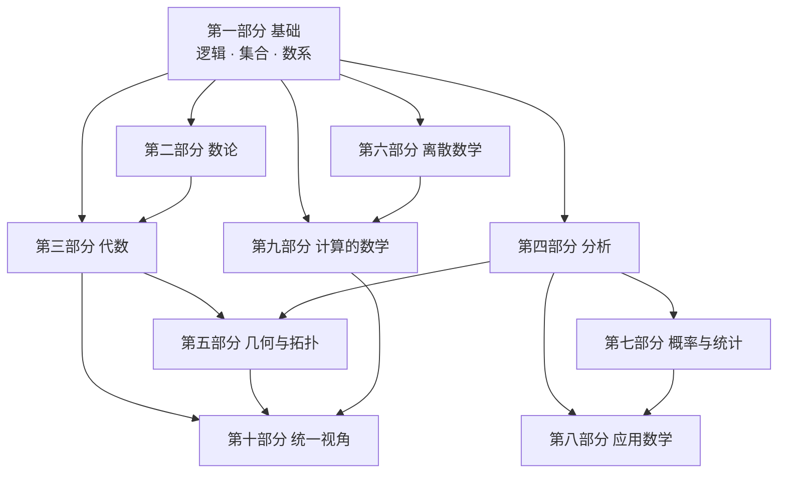
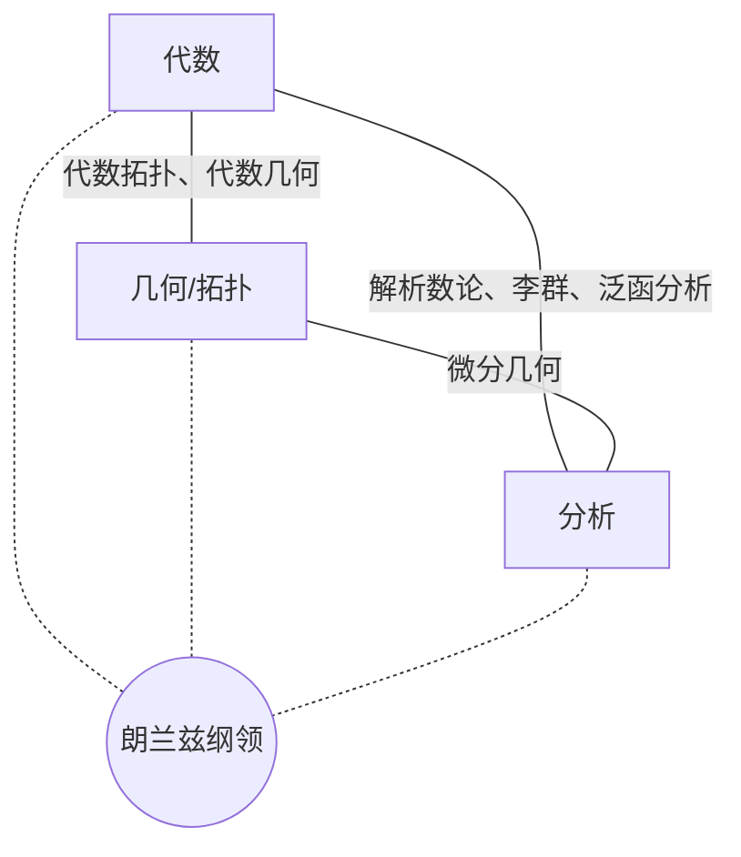

# 序章　数学是什么

> **速览（15 分钟）**
>
> - 数学研究六类对象：**数、形、结构、变化、不确定性、计算**。它们彼此交织，而不是六个互不相干的格子。
> - 现代数学像一片大陆：**代数、分析、几何/拓扑**是三大主干，最深刻的成果常常诞生在它们的交汇处。
> - 数学用四种语句说话：**公理**立规则，**定义**起名字，**定理**下结论，**证明**作担保。
> - 每进入一个新领域，都问五个问题：**对象 → 结构 → 映射 → 不变量 → 分类**。
> - 只想速览？读 [0.0](#00-开篇一个问题属于哪片数学)、[0.1](#01-数学研究的六类对象) 的总表和 [0.2](#02-数学地图这片大陆的行政区划) 的地图即可。

---

## 0.0 开篇：一个问题属于哪片数学？

打开导航软件，输入目的地，几秒钟后它给出一条路线，并告诉你"预计 23 分钟到达"。这件再平常不过的小事，背后至少站着五片数学：

- 城市的道路网是一张**图**：路口是顶点，路段是边，每条边上标着通行时间——这是**图论**（第 28 章）。
- "最快的路线"是一个**优化**问题，而要在几百万个路口中几秒内找到它，靠的是**算法与复杂性**的研究（第 34、39 章）。
- 路况时好时坏，"23 分钟"只是一个**估计**，背后是**概率与统计**（第 30–32 章）。
- 手机靠卫星定位，而卫星上的时钟必须做相对论修正，否则定位误差每天会累积到大约十公里——这要用到**微分几何**与**数学物理**（第 25、37 章）。
- 就连屏幕上那张平面地图也有数学：高斯证明了，弯曲的球面不可能被毫无变形地摊平在纸上，所以任何地图都必然有所失真（第 25 章）。

如果只把数学当作"算题的工具"，这些联系都是看不见的。可是在 AI 时代，计算和推导越来越可以交给机器，真正稀缺的能力反而是：**看到一个问题，知道它属于哪片数学；然后用那片数学的语言，把它说清楚。**

这需要一张地图。序章就是这张地图的图例，它要回答两个问题：

1. **数学到底研究什么？**
2. **这本书该怎么用？**

---

## 0.1 数学研究的六类对象

"数学是什么"，哲学家争论了两千多年，至今没有定论（感兴趣的读者可以看本章的[延伸](#延伸)部分）。本书采取一个更实用的回答方式：**看看数学家每天在研究什么东西。** 粗略地说，可以分成六类。

### 数：可以计数与度量的东西

数学从数羊、分粮开始。但"数"本身一直在长大：减法逼出了负数，除法逼出了分数，正方形的对角线逼出了 √2 这样的无理数，方程 x² = −1 又逼出了虚数 i。每一次扩张，都是因为旧的数"不够用了"（第 3 章）。

而最古老的数——整数——至今仍藏着无数谜题：素数有无穷多个吗？（有，两千多年前欧几里得就证明了。）素数在整数中是怎样分布的？（这引出了黎曼猜想，至今悬而未决。）这是**数论**的领地（第 4–6 章）。

### 形：空间、形状与位置

"几何"的英文 geometry，字面意思是"测量土地"。欧几里得的《几何原本》把几何整理成从几条公理出发的推理体系，统治了两千年。直到 19 世纪，数学家才发现，其中的"平行公设"可以换掉——换掉后得到的**非欧几何**同样自洽，而且后来竟成了描述宇宙的语言（第 22 章）。

再往前走一步：如果不关心距离和角度，只关心"哪些部分连在一起、有几个洞"，就得到了**拓扑学**。在拓扑学家眼里，咖啡杯和甜甜圈是同一个东西——它们都恰好有一个洞（第 23、24 章）。

### 结构：带有运算或关系的集合

19 世纪的数学家注意到一个奇妙的现象：许多看似毫不相干的东西，遵守着同样的规则。整数的加法、魔方的转动、钟表上的时间推移——它们都能**组合**（两次操作合成一次）、都有**"什么也不做"**的那个操作、每个操作都能**撤销**。把这些共同规则抽出来单独研究，就得到了**群**。

不关心元素"是什么"，只关心它们之间"如何运算、如何关联"——这就是**代数**的视角（第 7–11 章）。

### 变化：随时间或位置变动的量

行星如何运行？炮弹沿什么轨迹飞行？17 世纪，牛顿和莱布尼茨发明了**微积分**来回答这类问题：**导数**描述瞬时的变化率，**积分**描述累积的总量，而**微分方程**则把"变化的规律"写成方程，从现在推算未来。

从这里生长出的整片领域叫作**分析**（第 12–21 章）。

### 不确定性：无法完全预言的现象

1654 年，帕斯卡和费马在通信中讨论一个赌徒的问题：一场赌局中途被打断，赌金该如何公平地分配？这次通信通常被看作**概率论**的起点。三百年后，柯尔莫哥洛夫用几条公理为概率论奠定了严格的基础。

概率是从规律推出数据会怎样；**统计**反过来，从数据推出规律；**信息论**则问：信息本身能不能被量化（第 30–33 章）？

### 计算：可以按规则机械执行的过程

算法很古老——欧几里得求最大公约数的辗转相除法，至今仍在每一台计算机里运行。但"什么是计算"这个问题本身，直到 20 世纪 30 年代才由图灵、丘奇等人给出精确定义。

由此诞生的问题是：什么问题**原则上**能被算法解决？什么问题能被**高效地**解决？证明本身能不能交给机器来检验？（第 38–40 章）

### 六类对象总表

| 对象 | 直觉 | 起源问题举例 | 代表分支 | 代表符号 | 本书位置 |
|------|------|--------------|----------|----------|----------|
| **数** | 可以计数与度量的东西 | √2 是数吗？素数有多少？ | 数系、数论 | `ℕ ℤ ℚ ℝ ℂ`　`a ≡ b (mod n)` | 第一、二部分 |
| **形** | 空间、形状与位置 | 平行线会相交吗？ | 几何、拓扑 | `ℝⁿ`　`π₁(X)`　`g_{ij}` | 第五部分 |
| **结构** | 带有运算或关系的集合 | 如何精确地描述对称？ | 代数 | `(G, ·)`　`V`　`R[x]` | 第三部分 |
| **变化** | 随时间或位置变动的量 | 瞬时速度是什么？ | 分析、微分方程 | `lim`　`f'(x)`　`∫`　`uₜ = Δu` | 第四部分 |
| **不确定性** | 无法完全预言的现象 | 中断的赌局如何分赌金？ | 概率、统计、信息论 | `P(A \| B)`　`𝔼[X]`　`H(X)` | 第七部分 |
| **计算** | 按规则机械执行的过程 | 什么问题可解？多快可解？ | 可计算性、复杂性 | `O(·)`　`P`　`NP`　`λx. M` | 第六、八、九部分 |

> 表中的符号现在只需"认个脸熟"，它们会在各自的章节里被逐一讲解。

### 六类对象并不孤立

这六类对象不是六个互不相干的格子，而是相互交织的经纬：

- **随机过程** = 不确定性 × 变化（股价、布朗运动、扩散模型）
- **密码学** = 数 × 计算（RSA 加密建立在"大数难以分解"之上）
- **李群** = 结构 × 形 × 变化（既是群，又是光滑的空间，还能连续地变动）
- **图神经网络** = 结构 × 形 × 计算

现代数学最激动人心的地方，往往正是这些对象相遇之处——[0.3 节](#03-三大主干与它们的交汇)会再回到这一点。

---

## 0.2 数学地图：这片大陆的行政区划

### 纯数学与应用数学

人们常把数学分成**纯数学**和**应用数学**：前者为数学本身而研究数学，后者为解决外部问题而研究数学。但这条边界远比想象中模糊，而且一直在移动。

- 1940 年，英国数学家哈代在《一个数学家的辩白》中颇为自豪地写道，数论这类"真正的"数学不会有任何军事用途。三十多年后，RSA 公钥密码让数论成了整个互联网安全的基石。
- 1854 年，黎曼在演讲中提出了弯曲空间的几何，那是纯粹的思想实验。六十年后，爱因斯坦用它写出了广义相对论；今天你的手机定位，每天都在依赖这套几何做时钟修正。
- 反过来也一样：傅里叶为了研究热传导而发展出三角级数；康托尔在研究三角级数的唯一性时，一路追问下去，最终创立了集合论——今天全部数学的地基。

所以，与其说纯数学和应用数学是两块领土，不如说它们是**同一片大陆上的两种旅行方式**：一种为了看风景，一种为了到达某处。走的常常是同一条路。

### 数学家自己的分类：MSC

数学家自己是怎样给数学分区的？最常用的是**数学主题分类（Mathematics Subject Classification，MSC）**，由美国数学会和 zbMATH 共同维护。当前版本是 MSC2020，共有 63 个两位数的一级分类，每个一级分类下面再分两层，形如 `11M26`。几个例子：

| 编号 | 领域 | 本书章节 |
|------|------|----------|
| 03 | 数理逻辑与数学基础 | 第 1、2 章 |
| 11 | 数论 | 第 4–6 章 |
| 14 | 代数几何 | 第 26 章 |
| 20 | 群论及其推广 | 第 8 章 |
| 35 | 偏微分方程 | 第 20 章 |
| 53 | 微分几何 | 第 25 章 |
| 60 | 概率论与随机过程 | 第 30、31 章 |
| 68 | 计算机科学 | 第 38–40 章 |
| 94 | 信息与通信理论、电路 | 第 33 章 |

你不需要背下这些编号。只需知道：**数学论文的首页常常标着 MSC 编号**，它告诉你这篇文章位于地图的哪个位置。与 AI 交流时，"我在找 MSC 60J（马尔可夫过程）方向的入门综述"也比"我在找一些关于随机的东西"精确得多。

### 本书的地图

本书的十个部分，大致可以看作一份"粗粒度"的 MSC。它们之间的依赖关系如下（章级的详细关系图见[大纲](../../OUTLINE.md)末尾）：



读这张图的方式很简单：**箭头表示"前者为后者提供语言或工具"**。第一部分是所有道路的起点；第十部分是所有道路最终汇聚、回望全局的地方。

---

## 0.3 三大主干与它们的交汇

如果把六类对象看作数学研究的"原材料"，那么**代数、分析、几何/拓扑**就是处理这些原材料的三种基本手艺，也是现代数学的三大主干。

| 主干 | 关注什么 | 气质 | 典型问题 |
|------|----------|------|----------|
| **代数** | 运算与结构 | 离散、精确，喜欢**等式** | 这个结构能不能拆成更简单的部分？ |
| **分析** | 极限与逼近 | 连续、估计，喜欢**不等式** | 这个量有多大？能多快地逼近它？ |
| **几何/拓扑** | 空间与形状 | 直观、整体，喜欢**图像** | 这个空间长什么样？它有几个洞？ |

数学界流传着一句玩笑：代数学家证明两个东西**相等**，分析学家证明一个东西**小于**另一个东西。它道出了两种思维习惯的差别。

但真正深刻的数学，往往出现在主干**交汇**的地方：

| 交汇 | 代表领域 | 一句话 | 章节 |
|------|----------|--------|------|
| 代数 × 分析 | 解析数论 | 用微积分研究素数 | 第 5 章 |
| | 李群与表示论 | 既是群，又是光滑的空间 | 第 11 章 |
| | 泛函分析 | 无穷维空间里的线性代数 | 第 17 章 |
| 代数 × 几何 | 代数拓扑 | 用群来"数"空间中的洞 | 第 24 章 |
| | 代数几何 | 方程的解集本身就是几何图形 | 第 26 章 |
| 分析 × 几何 | 微分几何 | 在弯曲的空间上做微积分 | 第 25 章 |
| 三者汇流 | 朗兰兹纲领 | 数论、几何与表示论之间的大统一猜想 | 第 43 章 |



1994 年，怀尔斯证明了困扰数学家三百多年的费马大定理。他走的路正是穿过这个交汇地带：把一个关于整数的问题（数论），转化为关于椭圆曲线（代数几何）和模形式（复分析与表示论）之间对应关系的问题。一个初中生能读懂的命题，最终要动用整片大陆的力量才能解决——这就是"交汇"的分量。

至于离散数学、概率统计和计算的数学，它们并不是游离在三大主干之外的"小岛"：概率论建立在测度论（分析）之上，图论大量借用线性代数（代数），复杂性理论则与逻辑血脉相连。它们更像是从主干上长出的、最贴近现实世界的枝叶。

---

## 0.4 数学的语言：定义、公理、定理、证明

数学之所以能被 AI 处理、被机器验证、被跨越几个世纪地传承，是因为它有一套异常精确的语言。这一节是全书"读懂数学"训练的起点。

### 四种基本语句

打开任何一本数学书，你会反复看到四类语句。用棋类游戏打个比方：

| 语句 | 作用 | 棋类比喻 | 例子 |
|------|------|----------|------|
| **公理**（axiom） | 不加证明、作为出发点的命题 | 游戏规则 | 过两点有且只有一条直线 |
| **定义**（definition） | 给一个概念精确地起名字 | 给某种局面命名，如"将军" | 整数 n 是偶数，如果 n = 2k 对某个整数 k 成立 |
| **定理**（theorem） | 由公理和定义必然推出的结论 | 必然出现的局面，如"双方只剩王，必然和棋" | 两个偶数之和是偶数 |
| **证明**（proof） | 从前提到结论的、每一步都有依据的推理链 | 复盘：一步步说明为什么必然如此 | 见下文 |

定理还有几位"亲戚"，区别主要在于地位而非逻辑：

- **引理**（lemma）：为证明更大的定理而准备的"零件"。
- **命题**（proposition）：有用但不那么重要的结论。
- **推论**（corollary）：从某个定理顺手得到的结论。
- **猜想**（conjecture）：被普遍相信、但**尚未被证明**的命题。黎曼猜想至今仍是猜想；而"费马大定理"在 1994 年之前，严格来说一直只是个猜想。

### 一个完整的证明

本书原则上不做证明，这里破例展示一个。它很简单，但它是一件"展品"：请留意它的每一步。

> **定义**　整数 n 称为**偶数**，如果存在整数 k，使得 n = 2k。
>
> 用符号写：n 是偶数　⇔　∃k ∈ ℤ, n = 2k
>
> **定理**　两个偶数之和是偶数。
>
> **证明**　设 m、n 是偶数。由定义，存在整数 a、b，使得 m = 2a，n = 2b。于是
>
> m + n = 2a + 2b = 2(a + b)。
>
> 因为两个整数之和仍是整数，所以 a + b ∈ ℤ。按定义，m + n 是偶数。∎

这三行体现了证明的全部要素：

1. **只用定义和已知事实**，不靠"看起来是这样"。
2. **每一步都有依据**，任何人都可以逐行检查。
3. **对所有偶数都成立**，而不是验证了几个例子。

最后一点尤其重要。看看这个例子：欧拉发现，表达式 n² + n + 41 在 n = 0, 1, 2, …, 39 时得到的**全都是素数**——连续 40 个！但当 n = 40 时，结果是 1681 = 41 × 41，不是素数。**举一万个例子也不是证明**；而一个证明，可以一次性管住无穷多个情形。

句末的 `∎` 读作"证毕"（拉丁语 Q.E.D. 的符号版），表示证明到此结束。

### 精确性：消灭歧义

日常语言充满歧义，而数学语言的首要任务就是消灭歧义。看这句话：

> "每个人都爱着某个人。"

它至少有两种意思，用数学符号写出来就截然不同：

| 写法 | 读法 | 意思 |
|------|------|------|
| `∀x ∃y 爱(x, y)` | 对每个 x，都存在一个 y，使得 x 爱 y | 每个人都有自己爱的人（各爱各的） |
| `∃y ∀x 爱(x, y)` | 存在一个 y，使得对每个 x，x 都爱 y | 有那么一个人，被所有人爱着 |

这里 `∀` 读作"对所有"，`∃` 读作"存在"。**仅仅交换两个量词的顺序，意思就完全变了。** 这个看似细小的区别，正是后面理解极限、连续、收敛等核心概念的关键（第 1、12 章）。

数学语言里还有一些与日常用法不同的约定，例如数学中的"A **或** B"是**可兼的**：A、B 同时成立时，"A 或 B"也成立。而餐厅菜单上的"送咖啡或茶"，通常意味着只能二选一。

### 抽象性：删去无关的细节

数学家希尔伯特有一句名言：几何学中的"点、线、面"，完全可以换成"桌子、椅子、啤酒杯"——只要它们满足同样的公理，所有定理照样成立。

这就是**抽象**：**删去与问题无关的细节，只保留结构**。抽象的回报是**复用**。回忆 0.1 节里"能组合、有单位、能撤销"的那组规则：一旦把它定义为"群"，关于群的任何一条定理，就**同时**适用于整数加法、魔方转动和时钟运算。例如群论中的拉格朗日定理，一端可以解释为什么魔方上任何一套转法、只要不断重复，最终必然回到原状；另一端则推出了数论中的费马小定理，而后者正是 RSA 加密能够工作的原因之一（第 4、8 章）。

抽象不是故弄玄虚，而是数学的"杠杆"：证明一次，到处使用。

### 符号是压缩的语言

数学符号是对语言的极度压缩。读懂一个式子，可以分三步：

1. **认符号**：每个符号是什么意思？
2. **看结构**：这是一个等式、不等式还是命题？量词管到哪里？谁是主语？
3. **译人话**：用自己的话把它说出来，再找一个小例子验证。

**例一**：欧拉恒等式　`e^{iπ} + 1 = 0`

| 符号 | 读法 | 含义 | 详见 |
|------|------|------|------|
| `e` | 自然常数 | 约等于 2.718，描述"连续增长" | 第 13 章 |
| `i` | 虚数单位 | 满足 i² = −1 | 第 3 章 |
| `π` | 圆周率 | 约等于 3.14159，单位圆半周的长度 | — |
| `1`、`0` | 一、零 | 乘法和加法的"什么也不做"元素 | 第 3 章 |

结构：一个等式，左边是 `e` 的 `iπ` 次方加 1，右边是 0。

人话：在复数平面上，`e^{iθ}` 表示单位圆上转过角度 θ 的那个点。令 θ = π，就是从 1 出发转半圈，正好落在 −1；再加上 1，得到 0。一个式子里，同时出现了数学中最重要的五个常数。

**例二**：连续性的定义

```
∀ε > 0 ∃δ > 0 ∀x (|x − a| < δ ⇒ |f(x) − f(a)| < ε)
```

逐字读出："对任意大于 0 的 ε，都存在大于 0 的 δ，使得对所有 x：只要 x 与 a 的距离小于 δ，就有 f(x) 与 f(a) 的距离小于 ε。"

译成人话，它是一场**挑战与应答**的游戏：你给我一个输出上的误差要求 ε，无论多么苛刻，我都能找到一个输入上的容差 δ，使得只要输入落在 a 附近 δ 的范围内，输出就落在 f(a) 附近 ε 的范围内。这就是"函数 f 在 a 处**连续**"的严格含义——"输入变化一点点，输出也只变化一点点"。

注意量词的顺序：`∀ε ∃δ` 意味着 δ 可以随 ε 而定。如果交换成 `∃δ ∀ε`，意思就会完全不同（回忆刚才那个"爱"的例子）。你现在不必完全理解它，第 12 章会把它彻底讲透；读完第一部分时，你应该能独立读懂这个式子。

---

## 0.5 一副统一的眼镜：观察框架

数学有几百个分支，如何才能在每个新领域里都不迷路？本书为你准备了一副"眼镜"——每进入一个新领域，都问同样五个问题：

> **对象**是什么？ → 对象上有什么**结构**？ → 什么**映射**保持这种结构？ → 映射下什么东西**不变**？ → 怎样**分类**所有对象？

先用一个非数学的例子热身：

| 问题 | 音乐中的例子 |
|------|--------------|
| 对象 | 一段旋律 |
| 结构 | 相邻音符之间的音高差（音程） |
| 保持结构的映射 | **移调**：所有音整体升高或降低同样多 |
| 不变量 | 音程序列，也就是旋律的"轮廓" |
| 分类 | 移调后能重合的旋律，算作"同一首歌" |

这正是为什么你用 C 调唱和用 D 调唱，大家都听得出是同一首歌——你的耳朵在自动识别"移调下的不变量"。

再看一个数学的例子：**三角形**。有趣的是，**允许的映射不同，得到的"几何"也不同**：

| 允许的映射 | 不变量 | 分类结果 | 对应的数学 |
|------------|--------|----------|------------|
| 平移、旋转、翻折（保持距离） | 边长、角度、面积 | 三条边长完全决定一个三角形（"边边边"全等） | 欧氏几何 |
| 再允许整体缩放 | 角度、边长的比例 | 只需看三个角（相似三角形） | 相似几何 |
| 允许任意连续变形（不撕裂、不粘合） | 只剩"围成一个圈" | 三角形、正方形、圆，全都是同一个东西 | 拓扑学 |

允许的变换越多，不变量越少，分类就越"粗"。1872 年，克莱因正是用这个观点统一了当时五花八门的几何学：**一种几何，就是研究某个变换群作用下的不变量**（第 22 章）。

这副眼镜会伴随你走遍全书：

| 领域 | 对象 | 结构 | 保持结构的映射 | 关键不变量 | 分类结果 |
|------|------|------|----------------|------------|----------|
| 线性代数（第 7 章） | 向量空间 | 加法与数乘 | 线性映射 | 维数 | 同一数域上的有限维向量空间按维数完全分类 |
| 群论（第 8 章） | 群 | 群运算 | 同态 | 阶、子群结构 | 有限单群分类定理 |
| 拓扑（第 23、24 章） | 拓扑空间 | 开集 | 连续映射 | 连通性、洞的个数 | 闭曲面按"洞数"和可定向性分类 |

不必现在就看懂这张表。只要记住：**在任何陌生领域里，先找出对象、结构、映射、不变量和分类，你就拿到了这个领域的骨架。**

---

## 0.6 本书用法与阅读路线

### 三层阅读深度

每一章都按三个深度来写，你可以按需取用：

| 层次 | 时间 | 收获 | 在章节中的位置 |
|------|------|------|----------------|
| **速览层** | 15 分钟 | 知道这个领域研究什么，能认出它的核心符号 | 每章开头的"速览"框 |
| **标准层** | 2–3 小时 | 理解核心概念与直觉，能读懂典型的式子 | 正文 |
| **延伸层** | 按需 | 标志性定理、前沿方向、进一步阅读的指引 | 每章末尾的"延伸"小节 |

第一遍读全书，只读每章的速览框，大约两周就能把整张地图走一遍。之后再根据需要，选择感兴趣的章节深入。

### 每章的统一结构

除了序章和终章，每章都遵循同样的十段式结构：

| 段落 | 内容 | 阅读建议 |
|------|------|----------|
| 1. 一句话 | 这个领域研究什么 | 必读 |
| 2. 起源问题 | 它是被什么问题"逼"出来的 | 必读，这是理解动机的关键 |
| 3. 核心对象与概念 | 概念卡：名称、直觉、形式定义的读法 | 先读"直觉"列，"形式定义"可以第二遍再读 |
| 4. 符号体系 | 符号、LaTeX、读法、含义 | 当作词典查阅，不必背诵 |
| 5. 标志性结果 | 只读陈述，用人话解释，不做证明 | 了解"这个领域最骄傲的成就" |
| 6. 直觉与图像 | 可视化、类比 | 建立画面感 |
| 7. 地图位置 | 前置章节、后续章节、横向联系 | 用来规划下一步读什么 |
| 8. 现实与 AI 中的身影 | 这个领域在哪里被用到 | 连接到你自己的工作 |
| 9. 动手 | 一段代码 + 一次与 AI 的对话练习 | 强烈建议亲手做 |
| 10. 自测 | 读懂 3 个本领域的典型式子 | 检验是否真正读懂了这门"语言" |

### 阅读路线

根据你的兴趣和目标，可以选择不同的路线：

```
全景速览（约 2 周）：全书只读"速览层"，建立整张地图
AI / 机器学习方向：  1–3 → 7 → 12–14 → 30、32、33 → 34 → 18 → 25（流形学习）→ 终章
工程 / 物理方向：    1–3 → 7 → 12–15 → 19–21 → 25 → 37 → 终章
软件 / 算法方向：    1–2 → 4 → 27–29 → 38–40 → 41 → 终章
纯数学好奇心路线：   按章节顺序全部读完，重点读第 42、43 章
```

无论选哪条路线，都建议先完成第一部分（第 1–3 章）。逻辑、集合和数系是全部数学的"语法"，跳过它们，后面的符号会处处卡壳。

### 与 AI 协作的基本姿势

本书的终章会详细介绍一套与 AI 协作解决数学问题的方法，这里先预告它的四个步骤：

1. **定位**：这个问题属于哪片数学？是关于结构、变化、不确定性，还是优化？
2. **翻译**：调用那片数学的对象与符号，把需求写成精确的数学描述。
3. **协作**：让 AI 去解释、推导、编程、找反例。
4. **检验**：用量纲、边界情况、小例子代入、数值实验来检查结果。

你会发现，这四步中，AI 最擅长的是第 3 步，而第 1、2、4 步恰恰最需要一张地图——这正是本书要给你的东西。

---

## 0.7 动手与自测

### 动手一：用代码碰一碰六类对象

下面这段 Python 代码只依赖标准库，用几行代码分别"碰一下"六类对象。完整文件见 [code/00-prologue/six_objects.py](../../code/00-prologue/six_objects.py)。

```python
import math
import random
from itertools import combinations, product


def numbers():
    """数：找出 50 以内的素数。"""

    def is_prime(n):
        return n >= 2 and all(n % d for d in range(2, math.isqrt(n) + 1))

    primes = [n for n in range(50) if is_prime(n)]
    print("【数】50 以内的素数：", primes)


def shapes():
    """形：用坐标搭出一个立方体，验证欧拉公式 V − E + F = 2。"""
    vertices = list(product([0, 1], repeat=3))
    # 恰好一个坐标不同的两个顶点之间有一条棱
    edges = [
        (u, v)
        for u, v in combinations(vertices, 2)
        if sum(a != b for a, b in zip(u, v)) == 1
    ]
    # 固定某一个坐标为 0 或 1，得到一个面
    faces = [(axis, value) for axis in range(3) for value in (0, 1)]
    V, E, F = len(vertices), len(edges), len(faces)
    print(f"【形】立方体 V={V}, E={E}, F={F}, V − E + F = {V - E + F}")


def structures():
    """结构：两个置换按不同顺序复合，结果不同——群的运算可以不交换。"""
    p = (1, 0, 2)  # p：把 0 和 1 互换
    q = (0, 2, 1)  # q：把 1 和 2 互换

    def compose(f, g):
        """f∘g：先做 g，再做 f。"""
        return tuple(f[g[i]] for i in range(len(g)))

    print("【结构】p∘q =", compose(p, q), "  q∘p =", compose(q, p))


def change():
    """变化：用差商逼近 sin 在 0 处的导数（精确值是 1）。"""
    for h in (0.1, 0.01, 0.001):
        slope = (math.sin(h) - math.sin(-h)) / (2 * h)
        print(f"【变化】h = {h:<6} 差商 = {slope:.10f}")


def uncertainty():
    """不确定性：抛硬币次数越多，正面频率越接近 1/2（大数定律）。"""
    rng = random.Random(2026)
    for n in (10, 1000, 100000):
        heads = sum(rng.random() < 0.5 for _ in range(n))
        print(f"【不确定性】抛 {n:>6} 次，正面频率 = {heads / n:.4f}")


def computation():
    """计算：考拉兹迭代——规则极简，却没人能证明它对所有正整数都会停下。"""
    n, steps = 27, 0
    while n != 1:
        n = n // 2 if n % 2 == 0 else 3 * n + 1
        steps += 1
    print(f"【计算】从 27 出发，经过 {steps} 步到达 1")


if __name__ == "__main__":
    for demo in (numbers, shapes, structures, change, uncertainty, computation):
        demo()
```

运行结果：

```
【数】50 以内的素数： [2, 3, 5, 7, 11, 13, 17, 19, 23, 29, 31, 37, 41, 43, 47]
【形】立方体 V=8, E=12, F=6, V − E + F = 2
【结构】p∘q = (1, 2, 0)   q∘p = (2, 0, 1)
【变化】h = 0.1    差商 = 0.9983341665
【变化】h = 0.01   差商 = 0.9999833334
【变化】h = 0.001  差商 = 0.9999998333
【不确定性】抛     10 次，正面频率 = 0.3000
【不确定性】抛   1000 次，正面频率 = 0.4980
【不确定性】抛 100000 次，正面频率 = 0.5022
【计算】从 27 出发，经过 111 步到达 1
```

几点值得留意的观察：

- **形**：欧拉公式 V − E + F = 2 不只对立方体成立，对任何"没有洞"的多面体都成立。这个 2 是一个**拓扑不变量**（第 24 章）。
- **结构**：p∘q ≠ q∘p。"先做什么、后做什么"会影响结果，就像先穿袜子再穿鞋，和先穿鞋再穿袜子，结果大不相同（第 8 章）。
- **不确定性**：抛 10 次，正面频率是 0.3，离 0.5 相当远；抛 10 万次，就非常接近 0.5 了。这就是**大数定律**（第 30 章）。
- **计算**：考拉兹迭代的规则一行就能写完，但"它是否对**每个**正整数都会停在 1"至今无人能证明。验证了无数个例子，仍然不是证明——回忆 0.4 节的 n² + n + 41。

### 动手二：把模糊的需求翻译成数学

试着向 AI 提出下面两个问题，对比它们的回答：

> **模糊的提问**
>
> 帮我找出数据里的异常。

> **数学化的提问**
>
> 我有一组服务器每分钟的响应时间 x₁, x₂, …, xₙ（单位：毫秒）。假设正常情况下它们近似服从对数正态分布。请用 log xᵢ 的样本均值 μ̂ 和样本标准差 σ̂ 估计参数，把满足 |log xᵢ − μ̂| > 3σ̂ 的点标记为异常；给出 Python 代码，并说明这个判据在什么情况下会失效。

第二个提问之所以有效，是因为它完成了"定位"和"翻译"两步：

- **定位**：这是一个**不确定性**问题，属于统计学（第 32 章）。
- **翻译**：明确了**对象**（一组正实数序列）、**模型**（对数正态分布）、**判据**（偏离均值超过三倍标准差），以及希望 AI **检验**的边界（判据何时失效）。

对比两次回答你会发现：面对模糊的提问，AI 只能猜测你的意图，往往给出一份泛泛的方法清单；而面对精确的提问，它会给出可以直接运行、可以逐条检验的方案。更重要的是，当它犯错时，你**知道该从哪里检查**。

### 自测：读懂三个式子

试着按"认符号 → 看结构 → 译人话"三步，读出下面三个式子。需要用到的符号如下：

| 符号 | 读法 | 含义 |
|------|------|------|
| `∈` | 属于 | x ∈ A 表示 x 是集合 A 的元素 |
| `∪` | 并 | 两个集合合在一起 |
| `{x \| P(x)}` | 满足 P 的所有 x 组成的集合 | 用条件描述一个集合 |
| `∀`、`∃` | 对所有、存在 | 量词 |
| `¬`、`∧`、`∨` | 非、且、或 | 逻辑联结词 |
| `ℕ`、`ℚ` | 自然数集、有理数集 | 第 3 章详述 |

1. `A ∪ B = {x | x ∈ A ∨ x ∈ B}`
2. `∀n ∈ ℕ ∃p ∈ ℕ (p > n ∧ p 是素数)`
3. `¬∃q ∈ ℚ (q² = 2)`

**附加题**：把第 2 题中两个量词的顺序交换，写成 `∃p ∈ ℕ ∀n ∈ ℕ (p > n ∧ p 是素数)`。它是什么意思？它还成立吗？

答案见本章[延伸](#自测答案)部分。

---

## 延伸

### 数学是被"发现"的，还是被"发明"的？

这是数学哲学中最古老的问题之一。许多数学家在日常工作中是**柏拉图主义者**：他们觉得数学对象独立于人类存在，数学家只是"发现"它们，就像探险家发现新大陆。而 20 世纪初，围绕"数学的基础是什么"，出现了三个影响深远的流派：

- **逻辑主义**（弗雷格、罗素）：数学可以完全还原为逻辑。这一计划因罗素悖论等问题而受挫，但它催生了现代集合论与数理逻辑（第 1、2 章）。
- **形式主义**（希尔伯特）：数学是按规则操作符号的形式系统，关键是证明这些系统不会自相矛盾。1931 年，哥德尔的不完备定理表明，这个愿望无法以希尔伯特期望的方式完全实现（第 1 章）。
- **直觉主义**（布劳威尔）：数学对象是心智的构造，只有能被"构造出来"的东西才算存在，因此在处理无穷时拒绝使用排中律。这一思想后来在构造性数学和类型论中焕发新生，并直接影响了今天的证明助手（第 40 章）。

1960 年，物理学家维格纳写了一篇著名的文章《数学在自然科学中不合理的有效性》。为什么人类在纸上推演出的抽象结构，会一次次精确地描述宇宙？这个问题至今没有令所有人满意的答案。我们会在第 37 章再次遇到它。

### MSC 与 arXiv

如果你想阅读数学论文，还有两个实用的定位工具：

- **MSC 编号**：多数数学期刊论文的首页都会列出 MSC 编号。三位编码如 `60J` 表示"马尔可夫过程"，五位编码如 `11M26` 则精确到"ζ 函数的非实零点"这样的具体课题。
- **arXiv 分类**：预印本网站 arXiv 的数学板块按 `math.NT`（数论）、`math.AG`（代数几何）、`math.PR`（概率）等分类，与 MSC 的一级分类大致对应。

把它们告诉 AI，可以让它更快地帮你找到正确的文献。

### 自测答案

1. `A ∪ B = {x | x ∈ A ∨ x ∈ B}`
   读作："A 并 B 等于所有属于 A 或属于 B 的 x 组成的集合。"这是**并集的定义**。注意这里的"或"是可兼的：同时属于 A 和 B 的元素也在并集里。

2. `∀n ∈ ℕ ∃p ∈ ℕ (p > n ∧ p 是素数)`
   读作："对每个自然数 n，都存在一个自然数 p，p 大于 n 并且 p 是素数。"人话："无论你说出多大的数，总还有比它更大的素数。"也就是**素数有无穷多个**——欧几里得在两千多年前证明了它（第 4 章）。

3. `¬∃q ∈ ℚ (q² = 2)`
   读作："不存在有理数 q，使得 q 的平方等于 2。"人话：**√2 不是有理数**，它无法写成两个整数之比（第 3 章）。

**附加题**：`∃p ∈ ℕ ∀n ∈ ℕ (p > n ∧ p 是素数)` 的意思是"存在一个素数 p，它比**所有**自然数都大"。这显然不成立——p 自己就是一个自然数，而 p 不可能大于 p。量词的顺序一换，一个真命题就变成了假命题。

### 延伸阅读

- 柯朗、罗宾斯，《什么是数学》——以初等方法展示数学思想的经典之作，序章主题的最佳延伸。
- 高尔斯（主编），《普林斯顿数学指南》——第一部分"引论"对数学的全貌、语言和目标有精彩的概述，适合作为本书的参考手册。
- 亚历山大洛夫等，《数学：它的内容、方法和意义》——三卷本的数学全景。
- 维格纳，《数学在自然科学中不合理的有效性》（1960）——一篇短文，值得一读。

---

## 下一步

现在你已经拿到了地图和图例：知道了数学研究哪些对象，三大主干如何交汇，数学语言如何书写，以及怎样用五个问题去观察一个新领域。

但在 0.4 节里，我们其实悄悄用了一些还没有正式介绍的东西：`∀`、`∃`、`⇒`，以及"证明"本身。什么才算是正确的推理？证明到底是什么？它有没有极限？

这些问题把我们带到了全书的第一站——**数理逻辑**。我们先从数学的语法学起。
