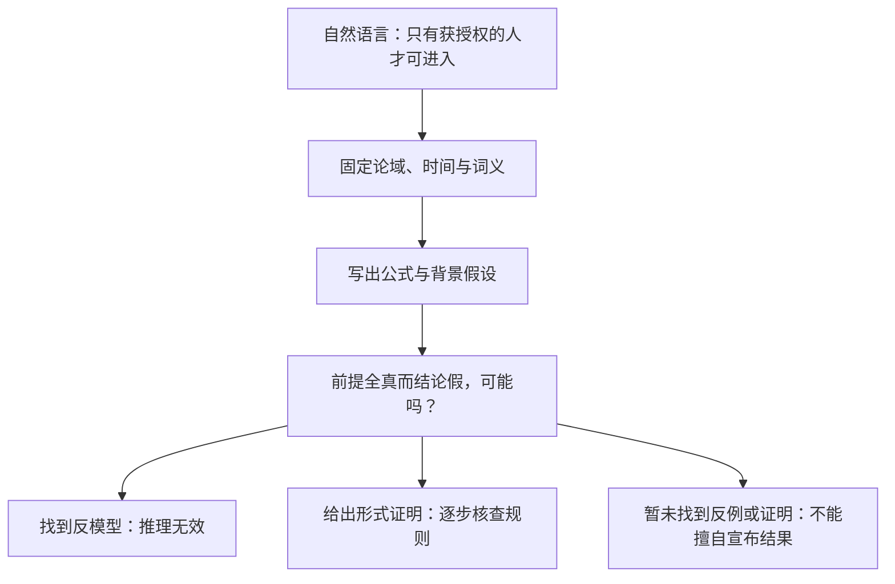

import { Aside } from '@astrojs/starlight/components';
import Figure from '../../components/Figure.astro';

<Aside type="note" title="怎样读这一章">

- **速览层（约 15 分钟）**：读第一节、第二节演进表、第三节五问表与概念卡标题、第四节的核心符号、第七节地图，以及章末回收。
- **标准层**：通读正文，第八、十节和折叠块可以暂时跳过。不要求复现任何定理的证明。
- **延伸层**：阅读折叠块、子领域和参考资料，重点分清定理的条件与边界。

本章不需要前置领域知识；集合符号只按“一堆对象”的直觉使用，第 2 章再系统解释。

</Aside>

## 一、一句话

**经典逻辑研究推理的形式：在给定解释范围内，怎样保证当前提都真时，结论不可能是假。**

先看一条门禁规则：

> 如果刷卡成功，门就会打开。现在刷卡成功了，所以门会打开。

这条推理没有问题。把最后两句换一下：

> 如果刷卡成功，门就会打开。现在门打开了，所以一定刷卡成功了。

听起来也颇像道理，但可能是管理员远程开门，也可能有人按了室内按钮。“门开”不保证“刷卡成功”。问题不在门禁系统，而在推理的结构。

令 $P$ 表示“刷卡成功”，$Q$ 表示“门打开”。两条推理分别写成：

$$
P\Rightarrow Q,\quad P\quad\therefore Q
$$

$$
P\Rightarrow Q,\quad Q\quad\therefore P
$$

$\therefore$ 读作“所以”。第一种形式有效，第二种无效。**逻辑要找到的，就是在换掉句子的具体内容之后，仍然保真的形式。**

这里“有效”不等于“说的事情确实发生了”。哪怕一台门禁设备根本不遵守那条规则，第一种推理形式依然有效；只是你没有理由相信它的前提。逻辑负责检查“结论是否跟得上前提”，并不代替实验、观测和事实核查。

本章标题中的“命题是真值”，是一种有意简化的观察方式：**把一个命题的具体内容暂时放到一边，只看它在某个确定解释下是真还是假，并研究真值怎样组合。** 这不是说命题只有两个，也不是说所有真的句子含义都相同。它是一个抽象层，正如电路设计可以只看高低电平，而不管信号究竟来自温度计还是键盘。

## 二、概念的演进

<Aside type="tip" title="本节速览">

**从主谓句的模式，到真值的运算，再到带量词的关系语言；从“这段论证看起来可靠”，到可逐步检查的形式证明；最后发现：形式推演有精确的能力边界。**

</Aside>

| 阶段 | 命题或证明被怎样理解 | 具体困境 | 重构与新语言 |
| --- | --- | --- | --- |
| 词项逻辑 | 命题是“所有 A 都是 B”一类主谓句 | 怎样识别有效论证？又怎样表达“每个人都认识某个人”？ | 用词项之间的模式组织三段论，但关系与量词嵌套仍难处理 |
| 逻辑代数与命题逻辑 | 不问整句内容，先计算真假怎样组合 | 复杂的“并且、或者、如果”不能只靠主谓句分类 | 真值函数与 $\neg,\land,\lor,\Rightarrow$ |
| 谓词逻辑 | 句子有内部结构：对象、关系、变量、量词 | “每个数都有更大的数”与“有个数大于所有数”不能混为一谈 | $R(x,y),\forall,\exists$ |
| 形式系统与语义 | 证明是有限的规则操作；真要相对于解释来谈 | 冗长推理怎样检查？符号中的“大于”究竟指什么？ | 可证 $\vdash$ 与满足、后承 $\models$ 分工 |
| 元逻辑 | 推理系统本身成为数学对象 | 规则会不会出错？够不够用？能否覆盖全部算术真理？ | 可靠性、完备性、不完备性和可判定性的区别 |

### 从“所有 A 都是 B”出发

亚里士多德（Aristotle）系统研究了三段论。一种典型形式是：

> 所有哺乳动物都是动物；所有鲸都是哺乳动物；所以所有鲸都是动物。

这里真正起作用的不是“鲸”这个词，而是“所有 A 都是 B，所有 C 都是 A，所以所有 C 都是 B”的形式。把内容抽掉，研究推理模式，这是至今仍在使用的思想。

但是，传统的词项三段论主要围绕主词、谓词及其包含或排斥关系组织句子。数学还需要表达“$x$ 比 $y$ 大”“每个人都认识某个人”这样的关系，以及一个量词嵌在另一个量词里的句子。这不容易压进那套框架。它并不是没有“所有”“有些”的思想，而是缺乏现代逻辑那样灵活的关系与量化语言。

这条主线也不是古代逻辑的全部。古代斯多亚学派已经研究过以整句为单位的推理。这里选择三段论作起点，是为了突出从“主谓结构”转向“任意关系与量化”的变化，不是把后来的逻辑都归于同一源头。

### 第一次重构：让真假像代数一样运算

布尔（George Boole）在《逻辑的数学分析》（1847）和《思维规律》（1854）中，把逻辑推理带入代数运算的框架。他原来的体系涉及类及其运算，并不等于今天教材里的二值真值表；但“逻辑可以计算”这一步打开了新路。

在现代经典命题逻辑中，我们可以把假记作 $0$，真记作 $1$。既然 $P$ 和 $Q$ 各有两个值，“$P$ 并且 $Q$”就只需要规定四种输入的输出。“并且”“或者”“不”因此成为**真值函数**：输出只由输入的真假决定。

这是一种强有力的压缩。无论 $P$ 是天气预报、数论断言还是开关状态，同一张表都可以使用。代价是它有意忘掉了内容之间的某些联系。例如，两个命题有无因果关系，不能只由它们此刻的真假决定。

最容易让人卡住的，就是“若 $P$ 则 $Q$”。经典逻辑采用的**实质蕴含**，只排除“$P$ 真而 $Q$ 假”。于是 $P$ 假时，整个蕴含式都为真。这个规则不是计算错误，而是选择这种条件关系的结果；第三节会说明它为什么有用，以及它不表达什么。

### 第二次重构：打开句子内部

假设我们想说：

> 每个数都有一个比它大的数。

命题逻辑可以把整句话记作 $P$，却看不到“每个”“一个”和“比它大”的结构。它也就无法仅凭这句 $P$，表达“给定这个数，也能找到更大的数”。

弗雷格（Gottlob Frege）在《概念文字》（1879）中发展了包含变量和量化的逻辑语言，这是现代谓词逻辑的关键起点。他使用的二维记号与今天不同，不能把现代的 $\forall$、$\exists$ 当成他原书的写法。

用今天的符号，这句话写作：

$$
\forall x\,\exists y\;(y>x)
$$

读作：“对每个 $x$，都存在一个 $y$，使 $y$ 大于 $x$。”这里 $y$ 可以随着 $x$ 改变；并没有要求所有 $x$ 共用一个 $y$。

把顺序换成 $\exists y\,\forall x\;(y>x)$，就成了“存在一个数，比所有数都大”。前一句在通常的整数里为真，后一句为假。新语言让以前被自然语言掩盖的依赖关系，变得肉眼可见。

### 第三次重构：证明是规则，真需要解释

只会写精确的句子还不够。一份几百页的证明，每一步究竟凭什么成立？能不能把这种检查完全明确下来？

希尔伯特（David Hilbert）及其合作者推动了形式化与元数学研究。希尔伯特在 1920 年代提出的纲领，希望把数学形式化，再用有限主义的方法证明它不会导出矛盾。这里的新视角是：**把公式当作有限符号串，把证明当作按照明确规则生成的有限记录。**

但符号操作与符号的含义是两件事。$x<y$ 里的 $<$ 是通常的大小关系，还是另一种关系？论域是整数，还是一个只有三个对象的世界？在一种解释中为真的句子，在另一种解释中可能为假。

塔斯基（Alfred Tarski）对形式语言中的真与满足作了系统研究，1933 年发表的真定义工作是其中的重要节点。现代逻辑由此能清楚地区分两个问题：

- **语法问题**：按规则能否推出 $\varphi$？记作 $\Gamma\vdash\varphi$。
- **语义问题**：所有使前提 $\Gamma$ 为真的解释，是否也使 $\varphi$ 为真？记作 $\Gamma\models\varphi$。

哥德尔（Kurt Gödel）的完备性工作在 1929 年的博士论文中完成、1930 年发表，说明标准的一阶证明系统足以捕捉全部一阶语义后承。这里按概念组织叙述，不是说塔斯基 1933 年的论文在时间上先于或导致了哥德尔的完备性定理。

### 新的边界：连接了可证与有效，却没有包办所有真理

如果可证与有效已经连接起来，能否挑一套公理，从此解决所有数学问题？

哥德尔 1931 年的不完备性结果表明：只要公理系统满足有效公理化、一致性和足够的算术表达能力等条件，它就不能在自己的语言里裁定一切句子；在相应条件下，它也不能证明自身的标准一致性陈述。

这不是前面的桥突然塌了。**“在所有满足公理的模型中成立”，与“在我们心里想要的那个自然数世界中成立”，并不是同一句话。** 第五节会把它们分开。

这条边界没有迫使数学抛弃经典逻辑。它改变的是对“单一形式系统能做多少事”的期待；第 3、4 章转向其他命题观，也有各自独立的动机，而不是不完备定理直接推出的结论。

## 三、核心对象与概念

<Aside type="tip" title="五问框架">

这一章先后更换了观察层级：从句子的真值，到句子的内部结构，再到整个推理系统。下表是当前这张地图，而不是又一套必须背诵的定义。

</Aside>

| 五问 | 在经典逻辑里看什么 |
| --- | --- |
| **对象** | 公式、前提与结论、形式证明，以及解释公式的结构 |
| **结构** | 公式由联结词和量词组成；证明遵守推理规则；模型给对象与关系以意义 |
| **映射** | 命题赋值把公式映到真假，并遵守联结词的真值表；一致的重命名保留逻辑形式 |
| **不变量** | 逻辑等价改写在同一解释下保留真值；有效推理保留“前提全真时结论真” |
| **分类** | 命题公式可分为恒真、矛盾、偶真；也按表达能力区分命题语言、一阶语言等 |

这里的“映射”和“不变量”主要是理解工具，并不像群论那样都围绕某一类几何变换。不要为了五问而把不同层次的对象混成一种结构。

### 概念卡 1：命题与真值——未知不等于第三种真假

**直觉。** 命题是可以谈论真假的陈述。“请开门”是指令，不是命题；“门开着吗”是问题，也不是命题。“这扇门在下午三点打开了”，在门、日期、时间等已经确定时，可以作为命题。

**定义的读法。** 在本章使用的经典二值语义中，固定解释后，一个命题恰有真、假两个值之一。可以用 $v(P)=1$ 表示赋值 $v$ 把 $P$ 判为真。

“一个很大的具体整数是不是素数”，即使我们还没有算出答案，也不因此获得第三个真值。**真不真是语义问题，知不知道是真是知识问题，能不能从某组公理证明又是另一个问题。**

**例子与边界。** “$x>3$”还没有说明 $x$ 是谁，它不是一个真假已经确定的闭句，而是带自由变量的公式。把 $x$ 换成 $5$，或用量词约束 $x$，才能得到相应的闭句。形式逻辑中常把没有自由变量的公式称为“句子”或“闭式”。

**修补的问题。** 暂时搁置具体内容，让不同学科的陈述共享同一套真假规则。但“我”“这里”“明天”等语境不能忘了固定；未定义的表达也不能靠随手填一个真值来处理。

### 概念卡 2：联结词与真值表——复合句怎样计算

**直觉。** 联结词是把简单命题组装成复杂命题的接口。真值表就是接口的完整规格。

**定义的读法。** $\neg P$ 读“不 $P$”；$P\land Q$ 读“$P$ 并且 $Q$”；$P\lor Q$ 读“$P$ 或者 $Q$”。经典析取默认是**包容或**：两者都真也算真。

| $P$ | $Q$ | $\neg P$ | $P\land Q$ | $P\lor Q$ | $P\Rightarrow Q$ | $P\Leftrightarrow Q$ |
| --- | --- | --- | --- | --- | --- | --- |
| 真 | 真 | 假 | 真 | 真 | 真 | 真 |
| 真 | 假 | 假 | 假 | 真 | 假 | 假 |
| 假 | 真 | 真 | 假 | 真 | 真 | 假 |
| 假 | 假 | 真 | 假 | 假 | 真 | 真 |

最后一列是等价联结词，读“$P$ 当且仅当 $Q$”：两边真值相同，整句就真。

**例子与边界。** “密码正确或者持有临时通行证”通常允许两者同时满足。如果要求恰有一项满足，就应写成：

$$
(P\lor Q)\land\neg(P\land Q)
$$

不要让日常语言中“二选一”的习惯替你决定公式的意思。

**修补的问题。** 自然语言的“或”“不”“如果”常有歧义；真值表让所采用的版本完全显式。这里的真值函数不处理语气、时间顺序或因果。

### 概念卡 3：实质蕴含——只禁止一种情况

**直觉。** “刷卡成功则门开”的最低条件是：不能出现“刷卡成功了，门却没开”。它没有承诺“未刷卡就一定不开”。

**定义的读法。** 经典实质蕴含定义为：

$$
P\Rightarrow Q\quad\text{与}\quad\neg P\lor Q
\quad\text{逻辑等价。}
$$

因此，它只有在 $P$ 真、$Q$ 假时为假。$P$ 叫**前件**，$Q$ 叫**后件**。

为什么 $P$ 假时整句为真？因为我们把这个条件句理解为“没有出现前件真、后件假的违规情形”。前件没有发生，就没有这种反例。这常叫**空真**或**空满足**，并不是肯定后件真的发生了。

**这并非单凭“只有两个真值”就自动推出来的唯一联结词。** 两个输入有很多可能的真值函数。我们还选择了这样一种条件含义：$P$ 真时要求 $Q$ 真，$P$ 假时不对 $Q$ 施加限制，并要求整句的值只由两边真值决定。这些选择合在一起，才得到表中的实质蕴含。

“如果 $2+2=5$，那么月亮是奶酪做的”在这种意义下为真，但它没有解释月亮，更不表示两个内容有联系。一个孤立条件句在某次赋值下为真，也不意味着你已经发现了一条普遍规律。数学通常关心的是：在指定论域中，对所有有关对象，这个条件关系是否成立。

**例子与边界。** $P\Rightarrow Q$ 中，$P$ 是 $Q$ 的**充分条件**，$Q$ 是 $P$ 的**必要条件**：

- 有 $P$，足以保证 $Q$；
- 没有 $Q$，就不可能有 $P$。

所以“只有刷卡成功才会开门”应译为 $Q\Rightarrow P$，与“只要刷卡成功就会开门”方向相反。

原命题与**逆否命题** $\neg Q\Rightarrow\neg P$ 逻辑等价；与**逆命题** $Q\Rightarrow P$、**否命题** $\neg P\Rightarrow\neg Q$ 一般不等价。门禁还有别的开门方式，就是现成反例。

**修补的问题。** 用一张可组合、可计算的表表达条件约束。代价是：它不是因果箭头，也不是对日常“如果”的全部分析。因果推断、模态与时序表达需要额外结构。

### 概念卡 4：谓词与量词——谁依赖谁

**直觉。** 命题逻辑把整句当盒子，谓词逻辑则把盒子打开。“大于”需要两个位置，“是偶数”需要一个位置。

**定义的读法。** $E(x)$ 表示“$x$ 是偶数”这样的谓词公式；$R(x,y)$ 表示二元关系。量词 $\forall x$ 读“对所有 $x$”，$\exists x$ 读“存在一个 $x$”。**一阶**的意思是这里的量词在论域的对象上取值，而不是直接在所有性质或所有子集上取值。

先声明论域是通常的整数：

$$
\forall x\,\exists y\;(y>x)
$$

每给一个 $x$，就能找一个更大的 $y$。如果把论域换成只有 $0,1,2$ 且沿用通常大小关系的世界，这句话就假了：$2$ 后面没有更大的对象。**量词遍历谁，是公式意义的一部分。**

对比量词顺序：

| 公式 | 读法 | 在通常整数里 |
| --- | --- | --- |
| $\forall x\,\exists y\;(y>x)$ | 每个数都能配到一个更大的数 | 真，$y$ 可依赖 $x$ |
| $\exists y\,\forall x\;(y>x)$ | 有一个数比所有数都大 | 假，要求同一个 $y$ 应付全部 $x$ |

括号也很重要。$\forall x\,(P(x)\Rightarrow Q(x))$ 说所有满足 $P$ 的对象也满足 $Q$；量词的作用范围是括号内的整个公式。

量词的否定会**换量词，再否定内部条件**：

$$
\neg\forall x\,P(x)\quad\text{等价于}\quad\exists x\,\neg P(x)
$$

$$
\neg\exists x\,P(x)\quad\text{等价于}\quad\forall x\,\neg P(x)
$$

“并非每次请求都成功”是“至少有一次请求不成功”，不是“每次请求都不成功”。再多一层也是如此：

$$
\neg\forall x\,\exists y\,R(x,y)
\quad\text{等价于}\quad
\exists x\,\forall y\,\neg R(x,y)
$$

$\exists!x\,P(x)$ 表示“存在唯一一个 $x$ 使 $P(x)$ 成立”，既要求存在，也要求没有第二个不同的对象满足。带等号的一阶语言里，它是可展开的缩写：

$$
\exists x\bigl(P(x)\land\forall y\,(P(y)\Rightarrow y=x)\bigr)
$$

**例子与边界。** “所有独角兽都有角”可写成 $\forall x\,(U(x)\Rightarrow H(x))$。如果论域中没有独角兽，这句仍然为真，却推不出“存在独角兽”。标准一阶语义通常要求整个论域非空，但其中满足 $U$ 的对象可以一个也没有。

**修补的问题。** 表达关系、范围和依赖，让“每人有自己的密码”与“所有人共用一个密码”不再被同一句含混中文掩盖。

### 概念卡 5：推理规则——每一步凭什么走

**直觉。** 推理规则不是另一个事实，而是从已有公式走到新公式的通行证。

**定义的读法。** 最常见的规则是**肯定前件**（modus ponens）：

$$
\frac{P\Rightarrow Q\qquad P}{Q}
$$

横线上面是已经有的前提，下面是允许得到的结论。这不是分数。另一个常见规则是合取消去：有 $P\land Q$，就可以取出 $P$，也可以取出 $Q$。

全称实例化允许从 $\forall x\,P(x)$ 得到 $P(a)$，前提是代入合法、不造成变量误绑定。但从 $P(a)$ 回到 $\forall x\,P(x)$，必须知道 $a$ 是任意对象，且推理没有利用它的特殊身份，不能因为“张三有通行证”就推广到所有人。

**例子与边界。** 从“存在一个管理员”可以在局部推理里给某个见证起一个新名字，但不能擅自认定这个人就是张三，也不能把依赖于该见证的结论当成对所有人都成立。量词规则的这些限制，防的正是“偷偷挑了一个特殊对象”。

**修补的问题。** 让每一步的合法性可检查，而不靠“显然”“同理”或读者的善意补全。不同证明系统可以使用不同的基本规则，未必都把肯定前件单列出来。

### 概念卡 6：证明方法——组织论证的几种路线

**直觉。** 推理规则像单步操作，证明方法像组织整段论证的路线。它们不能代替规则和数学前提，却能告诉我们下一步该尝试什么。

| 方法 | 要做的事 | 典型场景与注意点 |
| --- | --- | --- |
| **直接证明** | 从假设与已知结果出发，逐步走到结论 | 证明 $P\Rightarrow Q$ 时，临时假设 $P$，再得到 $Q$ |
| **反证法** | 假设目标不成立，导出矛盾，再撤销该假设 | 经典逻辑允许据此肯定原目标；与只证明一个否定句的做法要区分 |
| **数学归纳法** | 给出起点，并证明从任意一步成立能走到下一步 | 适用于自然数及相应归纳结构；不是“试了很多项” |
| **构造法** | 给出满足条件的对象或明确的构造过程 | 例如对每个整数 $x$ 选取 $y=x+1$，展示“更大整数”的见证 |

**定义的读法。** 自然数从 $0$ 开始时，归纳法的骨架是：

$$
\bigl(P(0)\land\forall n\,(P(n)\Rightarrow P(n+1))\bigr)
\Rightarrow\forall n\,P(n)
$$

这里 $n$ 在自然数中取值，并且背景理论提供相应的归纳原理。这不是对任意关系、任意论域都有效的一条纯逻辑定律。在一阶算术中，常用一族归纳公理分别处理各个公式。

**例子与边界。** 证明前一千项都满足性质，不等于证明全部自然数都满足。有限论域可以穷举，无限论域必须有覆盖所有对象的理由。构造法也不一定要打印出一个十进制数；准确指定对象及其满足条件的依据，也可能是构造的一部分。

逆否法与反证法容易混淆。证明 $P\Rightarrow Q$ 时，可以转而直接证明 $\neg Q\Rightarrow\neg P$，这叫逆否法；反证法则临时假设目标的否定，试图导出矛盾。两者有关，但不是同一份操作说明。

**修补的问题。** 不再把“证明”当作一种神秘灵感，而是看见论证的组织方式。第 3 章会解释：换成构造性的命题观后，有些经典证明路线不再无条件通用。

### 概念卡 7：公理系统——先固定游戏的全部规则

**直觉。** 想检查一份证明，不能只看最后一行；还要知道允许写什么、从哪里开始、每一步怎么走。

**定义的读法。** 一个形式化的公理系统至少需要：

1. **语言**：哪些符号和组合方式构成合法公式；
2. **公理**：哪些公式可以作为起点；
3. **推理规则**：怎样从已有公式生成后续公式。

逻辑规则与逻辑公理负责普遍的推理结构；描述具体对象的**非逻辑公理**则规定我们研究哪个领域，例如算术中的加法、乘法满足什么要求。不同演算对逻辑公理和规则的分配可以不同。

常用 $T$ 表示一套理论的公理，$\Gamma$ 表示当前使用的前提集合，$\varphi$ 表示任意一个公式。它们是我们谈论形式系统时使用的名字，不是所有形式语言内部都必须带有的符号。

一份形式证明是有限记录，每一步是公理、当前许可的假设，或由前面步骤按规则得到的结果。$\Gamma$ 可以无限大，但任何一份实际证明只能调用其中有限多个前提。

**例子与边界。** 把“刷卡成功必定开门”列为公理后，逻辑会忠实地使用它；它不会自动检查现实中的电机有没有坏。公理系统给出的是明确承诺，而不是真实性认证。

**修补的问题。** 把读者可能心照不宣的背景假设搬到台面上，也让机器检查证明成为可能。实际证明助手的内部基础未必是一阶逻辑，第 4 章会介绍另一条路线。

### 概念卡 8：语法与语义——能写出证明，与在哪儿为真

**直觉。** 同一段程序有源代码和运行含义，公式也有符号结构和解释后的含义。二者相关，却不能混叫一回事。

**定义的读法。** 对一阶语言，一个结构 $\mathcal M$ 指定论域，并解释常量、函数符号和关系符号。若闭句 $\varphi$ 在这个结构中为真，就写 $\mathcal M\models\varphi$。若公式有自由变量，还要指定这些变量取哪些对象的赋值。

同一个 $<$ 符号，可以在一个结构中解释为通常大小，也可以在另一个结构中解释为别的关系；有额外公理时，解释必须满足那些约束，才能成为相应理论的模型。

几个常见层级要分清：

| 表达 | 问的是什么 |
| --- | --- |
| $\mathcal M\models\varphi$ | 在**这个**结构中，$\varphi$ 为真吗？ |
| $\models\varphi$ | 在**所有**相应语言的结构中，$\varphi$ 都为真吗？这叫逻辑有效 |
| $\Gamma\models\varphi$ | 在所有使 $\Gamma$ 全部成立的结构中，$\varphi$ 都为真吗？这叫语义后承 |
| $\Gamma\vdash\varphi$ | 从 $\Gamma$ 出发，有一份按指定规则得到 $\varphi$ 的形式证明吗？ |

一个句子至少在一个结构中为真，叫**可满足**。可满足只要求找到一个例子，有效却要经得起所有解释；两者远不相同。在命题逻辑中，把“结构”换成对命题字母的赋值即可。

**例子与边界。** $\forall x\,\exists y\;(y>x)$ 在通常整数结构里为真，却不是纯逻辑有效式。只有一个对象、且 $>$ 关系为空的结构，就能使它为假。若要在某套数论中得到它，必须使用描述数及其大小关系的前提。

**修补的问题。** 把“对整数成立”“由这些公理推出”“不论怎么解释都成立”拆开。许多看似高深的逻辑悖论，其实先犯了这里的层级混淆。

### 概念卡 9：一致性——系统会不会两面都说

**直觉。** 如果同一套前提既能推出“门开”，又能推出“门没开”，系统就不再能用真假来筛选结论。

**定义的读法。** 理论 $T$ **一致**，是指不存在句子 $\varphi$，使 $T\vdash\varphi$ 与 $T\vdash\neg\varphi$ 同时成立。在常见经典演算中，也可以说 $T$ 推不出矛盾符号 $\bot$。

**例子与边界。** 经典逻辑有**爆炸原理**：从矛盾可以推出任意结论。这不表示现实中两份文件互相冲突，就真的能证明月亮是奶酪；而是说若你把相互矛盾的断言一起当作可用前提，经典后承关系将失去区分结论的能力。

找出一个满足全部公理的模型，是论证一致性的一条重要路线：可靠的演算不能从在该模型里全真的前提出发，导出矛盾。不过，构造模型时依赖的背景数学也需要说明；这往往是一种相对的一致性保证。

**修补的问题。** 形式化让“哪里有矛盾”能被精确追问。但一致不等于公理符合现实，也不等于它能回答所有问题。

### 概念卡 10：完备性——“够不够用”至少有两种问法

**直觉。** 一套推理规则会不会漏掉本来有效的推理？一套具体公理又能不能回答每个句子的真假？这是两种不同的“够不够用”。

**定义的读法。**

- **演算的语义完备性**：只要 $\Gamma\models\varphi$，就有 $\Gamma\vdash\varphi$。所有真正由前提保证的结论，都能被规则推出来。
- **理论的否定完备性**：对理论语言的每个闭句 $\varphi$，都有 $T\vdash\varphi$ 或 $T\vdash\neg\varphi$。理论能在每个句子与其否定之间作出裁定。

前者正是一阶逻辑完备性定理说的事；后者是算术不完备性要限制的事。

**例子与边界。** 某个 $\varphi$ 既不由 $T$ 推出，其否定也不由 $T$ 推出，可能是因为 $T$ 的模型有的使它真，有的使它假。此时演算不必是漏了规则，而可能是公理本来就没有把答案固定下来。

还要分清**可靠性**：能推出来的，都确实是前提的语义后承。完备性管“不漏”，可靠性管“不乱推”。**可判定性**则问有没有总能停机并回答是或否的算法，不能从前两个性质直接获得。

**修补的问题。** 把“逻辑规则不够强”“具体公理不够充分”“找不到终止算法”这三种困难分别命名。下一节的两类哥德尔定理，正落在不同位置。

## 四、符号体系

<Aside type="tip" title="速览先认这几组">

联结词：$\neg,\land,\lor,\Rightarrow,\Leftrightarrow$；量词：$\forall,\exists,\exists!$；两个层次：$\vdash$ 是“按规则可证”，$\models$ 是“在解释中满足或语义后承”。

</Aside>

### 联结词与量词

| 符号 | LaTeX | 读法（中 / 英） | 含义与边界 |
| --- | --- | --- | --- |
| $\neg P$ | `\neg P` | 非 P / not P | 否定，翻转真值 |
| $P\land Q$ | `P\land Q` | P 且 Q / P and Q | 两者都真才真 |
| $P\lor Q$ | `P\lor Q` | P 或 Q / P or Q | 包容或，至少一个真 |
| $P\Rightarrow Q$ | `P\Rightarrow Q` | 若 P 则 Q / P implies Q | 实质蕴含，不表示因果 |
| $P\Leftrightarrow Q$ | `P\Leftrightarrow Q` | P 当且仅当 Q / P if and only if Q，简写 iff | 两边真值相同 |
| $\forall x$ | `\forall x` | 对所有 x / for all x | 遍历论域中的每个对象 |
| $\exists x$ | `\exists x` | 存在 x / there exists x | 至少一个，不承诺唯一 |
| $\exists!x$ | `\exists!x` | 存在唯一的 x / there exists a unique x | 存在并且唯一的缩写 |
| $P(x),R(x,y)$ | `P(x),R(x,y)` | P of x；R of x and y | 一元谓词、二元关系公式 |
| $x=y$ | `x=y` | x 等于 y / x equals y | 在带等号的逻辑中表示同一对象 |

### 证明与语义的元记号

| 符号 | LaTeX | 读法（中 / 英） | 含义与边界 |
| --- | --- | --- | --- |
| $\Gamma$ | `\Gamma` | 伽马 / Gamma | 当前前提集合 |
| $\varphi$ | `\varphi` | phi | 代表任意公式的元变量，不是一个固定命题 |
| $\Gamma\vdash\varphi$ | `\Gamma\vdash\varphi` | 由 Γ 可证 φ / Gamma proves phi | 存在形式推导；须明确背景演算 |
| $\vdash\varphi$ | `\vdash\varphi` | 可证 φ / proves phi | 不用额外非逻辑前提即可证明 |
| $\mathcal M\models\varphi$ | `\mathcal M\models\varphi` | M 满足 φ / M satisfies phi | φ 在指定结构中为真 |
| $\Gamma\models\varphi$ | `\Gamma\models\varphi` | Γ 语义蕴涵 φ / Gamma entails phi | 所有满足 Γ 的结构都满足 φ |
| $\models\varphi$ | `\models\varphi` | φ 有效 / phi is valid | 所有相应结构中都成立 |
| $\top,\bot$ | `\top,\bot` | 真、假；顶、底 / top, bottom | 真常项与假常项；也用来记恒真与矛盾 |
| $\therefore$ | `\therefore` | 所以 / therefore | 论证的排版提示，不是本章的联结词 |
| $\square$ 或 $\blacksquare$ | `\square`、`\blacksquare` | 证毕 / QED，end of proof | 印刷中也写作 ∎；表示证明结束，不参加推理 |

**三个记号提醒。**

1. 逻辑教材经常用 $\to,\leftrightarrow$ 表示本章的 $\Rightarrow,\Leftrightarrow$。本章按全书约定使用双线箭头，并把它们当作公式里的联结词；有的文献却用双线箭头表示元层次推导，读前要查约定。函数箭头 $f:A\to B$、类型论里的 $A\to B$ 也不能不看语境就套进真值表。
2. $\Gamma\vdash\varphi$ 里的横线竖线是在**谈论公式**，不等于对象语言里的 $P\Rightarrow Q$。前者说存在一份证明，后者本身是一个复合公式。
3. 同一符号可能跨章换义：$\lor,\land$ 在第 31 章用于格的并、交运算；$\bot$ 也可能表示序结构中的最小元；第 3 章的 $\square$ 是“必然”的模态算子，不是证毕标记。第 4 章的 $\Gamma\vdash t:A$ 则是类型判断，不只是本章的可证式。

### 示范：把一行量词公式拆开

$$
\forall x\bigl(S(x)\Rightarrow\exists y\,(A(y)\land R(y,x))\bigr)
$$

假定论域是某机构中的人，$S(x)$ 表示“$x$ 是学生”，$A(y)$ 表示“$y$ 是导师”，$R(y,x)$ 表示“$y$ 指导 $x$”。

从外往里读：

1. $\forall x$：逐个考虑论域中的每个人；
2. $S(x)\Rightarrow\cdots$：如果这个人是学生，就必须满足后面的要求；
3. $\exists y$：至少找出一个人；
4. $A(y)\land R(y,x)$：这个人是导师，并且指导该学生。

合起来就是：“每位学生都至少有一位导师。”**不要求不同学生有不同导师，不要求导师唯一，也不承诺一定有学生。** 如果这些也是业务需求，就必须另外写出来，不能期待量词自动替你补上。

## 五、标志性结果与著名问题

### 可靠性与哥德尔完备性定理：桥的两个方向

先声明范围：以下说的是**标准经典一阶逻辑及其相应语义**，不是任意一种自创规则系统。

**可靠性定理**说：

$$
\Gamma\vdash\varphi\quad\Longrightarrow\quad\Gamma\models\varphi
$$

人话是：规则不会把在某个结构中全真的前提，带到在该结构中为假的结论。它为“证明可以信任”提供基础，但没有替你保证现实符合前提。

**哥德尔完备性定理**说：

$$
\Gamma\models\varphi\quad\Longrightarrow\quad\Gamma\vdash\varphi
$$

人话是：如果所有满足前提的结构都逃不掉这个结论，就一定存在一份有限形式证明。常见的整体表述合起来就是：

$$
\Gamma\vdash\varphi
\quad\Longleftrightarrow\quad
\Gamma\models\varphi
$$

这是一次重要的重构成功：**按规则推演，与遍历模型检查后承，恰好刻画同一件事。** 两边的检查方式截然不同，却没有留下缝隙。

不过，定理没有说这份证明很短，没有说我们马上找得到，也没有给出一个对所有输入都能停机回答“可证或不可证”的算法。一个“存在”的结论，不能自动升级成“高效获得”的承诺。

### 第一不完备定理：公理无法裁定所有算术句子

以下采用包含罗斯尔（J. Barkley Rosser）1936 年加强的现代常用版本：

> 若理论 $T$ 一致、可以有效公理化，并包含足够的初等算术，那么存在算术闭句 $\varphi$，使得 $T$ 既不能证明 $\varphi$，也不能证明 $\neg\varphi$。

三个条件缺一不可：

- **一致**：不能已经什么都能推出。
- **有效公理化**：公理可以由算法枚举；选择通常的证明编码后，候选证明可作机械核查。不能把“所有真的算术句子”直接当成一个已经获得的可用算法。
- **足够的初等算术**：系统能够表达并处理必要的整数编码；包含罗宾逊算术 $Q$ 是一种常用的精确充分条件，不是所有形式系统都自动满足。

这里的“不可判定句”是说**相对于这套公理，两面都不可证**，不是说存在第三个真值，也不等于“人永远不可能知道它”。换更强的公理后，原来的独立句可能得到裁定；但只要新系统仍满足定理条件，它又会有新的独立句。

在经典的标准自然数结构中，$\varphi$ 与 $\neg\varphi$ 恰有一个为真。既然两者在 $T$ 中都不可证，便有标准自然数里的真句未被 $T$ 证明。不过，**不要只凭“一致”就认定 $T$ 的每条定理都符合标准自然数**；一致性与对预期模型的正确描述仍是两回事。

这项结果暴露的不是某条推理规则疏漏，而是“用一套可机械列举的公理捕获全部算术”的期待过强。

### 第二不完备定理：不能只靠系统给自己背书

对如皮亚诺算术 PA 及其通常有效公理化扩展这样的、足够强的系统，采用标准的证明与可证性编码时：

> 如果 $T$ 一致，那么 $T$ 不能证明表达自身一致性的标准算术句 $\mathrm{Con}(T)$。

$\mathrm{Con}(T)$ 可以粗略读作：“不存在一个自然数编码了从 $T$ 推出矛盾的证明。”严格版本还涉及可证性谓词应满足的推导条件，不能把任意写着“我很一致”的句子都当作它。

这限制了希尔伯特纲领原先的期待：若所允许的有限主义一致性论证能够在目标系统内部形式化，那么这样的内部资源不足以完成所希望的自我担保。但它不禁止在更强的背景理论中研究较弱系统的一致性，也不表示一致性研究从此毫无意义。

<Aside type="caution" title="为什么“完备”与“不完备”不矛盾">

| 结果 | 被考察的对象 | 承诺或限制 |
| --- | --- | --- |
| 一阶逻辑的完备性 | 推理演算与全部模型之间的关系 | 对所有满足前提的模型都成立，就有证明 |
| 算术理论的不完备性 | 一套固定、有效且足够强的一致公理 | 总有某个算术句子及其否定，两面都推不出 |

设一个满足这些条件的算术理论 $T$ 确实以标准自然数 $\mathbb N$ 为模型。某个句子在 $\mathbb N$ 中为真，不等于它在 $T$ 的每个模型中都真。若它在 $T$ 中独立，那么完备性反而告诉我们：$T$ 有使它真的模型，也有使它假的模型。后者当然不是那个预期的标准自然数结构。

所以，不能把 $\mathbb N\models\varphi$ 偷换成 $T\models\varphi$。桥连接的是 $T\vdash\varphi$ 与 $T\models\varphi$，没有保证某套有效算术公理能唯一固定所有标准算术真理。

</Aside>

不完备定理不说明“所有数学都不可靠”，也不证明“人类思维必定超越机器”。它对满足明确条件的形式理论给出限制；把结论搬到心理学、意识或 AI 能力上，需要另外的论证。

<details>
<summary>延伸：紧致性——无限前提与有限证明之间的联系</summary>

**一阶逻辑紧致性定理**：一组句子有模型，当且仅当它的每个有限子集都有模型。

例如，使用常量 $c$ 和大小关系，写下 $c>0,c>1,c>2,\ldots$，再加上通常自然数一阶算术的公理。每次只抽取其中有限多个要求，都能让一个足够大的普通自然数充当 $c$。紧致性保证整个要求集也有模型。

但在那个模型里，$c$ 比每个标准数词表示的数都大。它不是通常自然数结构中的某个普通自然数；我们得到了非标准模型，而不是发现了“最大的自然数”。

这再次提醒我们：一阶公理的模型，未必就是原先心里想的唯一世界。这里不展开模型的构造。

</details>

<details>
<summary>延伸：判定问题——有证明，不等于能总是判断有没有证明</summary>

对一个含有限多个命题字母的命题公式，枚举真值表总能判定它是否恒真、是否可满足。$n$ 个字母有 $2^n$ 种赋值；能算完，不代表规模大时仍然方便。

一般的一阶逻辑有效性则不可判定。丘奇（Alonzo Church）与图灵（Alan Turing）在 1936 年前后的工作，否定了寻找通用判定算法的希望：不存在一个对任意一阶句子都能停机并正确判断其是否有效的算法。

但有效的一阶句子**可以被算法枚举**：逐步枚举形式证明，完备性保证有效句子最终会被列出来。输入若无效，这种单向搜索却可能一直等不到结果。因此，不可判定不能误写成“连有效句子也无法枚举”。

第 40 章讲能不能算，第 41 章讲算得是否高效。本章只在这里立起路标。

</details>

## 六、直觉与图像

### 图像一：把蕴含看作划掉一个违规格

不要先把 $\Rightarrow$ 想成“箭头推动事情发生”，先把它想成一种筛选条件。

<Figure
  name="classical-logic/implication-grid"
  alt="P 表示刷卡成功，Q 表示门开。四格分别对应 P 和 Q 的四种真假组合；只有 P 真且 Q 假的一格不满足 P 蕴含 Q，其余三格都满足。"
>
  图 1　实质蕴含只排除“前件真、后件假”。斜线和文字标出唯一反例，不依赖颜色辨认。
</Figure>

左下和右下两格都在说“刷卡未成功”，但门可以开，也可以不开。它们满足条件句，不表示这个条件句解释了开门的原因。

再把目光从单个赋值移到所有赋值。要检查一个论证是否有效，就只保留**所有前提同时为真**的格子，看结论还会不会是假。比如：

- 检查“$P\Rightarrow Q$，$P$，所以 $Q$”：前提筛选后只剩 $P$ 真、$Q$ 真，没有反例。
- 检查“$P\Rightarrow Q$，$Q$，所以 $P$”：$P$ 假、$Q$ 真那一格仍被保留，却使结论为假，它就是反例。

**推翻一个声称普遍有效的推理，不必列出所有坏情况；一个前提全真、结论假的情形就够了。**

### 图像二：从自然语言走到可核查的任务



图 2　逻辑检查流水线。“找不到反例”与“已经证明”不是同一个状态；自动工具也可能超时或返回未知。

这条流水线最容易漏的是第一步。“获授权”是否包含授权已过期？“进入”指发出请求、锁被打开，还是人确实通过门？如果这里没有确定，后面再精密的证明也可能只是在检查另一个问题。

### 四种形式：只换一步，结论就不同

以下都以 $P\Rightarrow Q$ 为第一个前提：

| 另一个前提 | 声称的结论 | 是否有效 | 解释 |
| --- | --- | --- | --- |
| $P$ | $Q$ | 有效：肯定前件 | 规则已承诺这种情况 |
| $\neg Q$ | $\neg P$ | 有效：否定后件 | 后件没成立，前件就不可能成立 |
| $Q$ | $P$ | 无效：肯定后件 | 可能存在别的开门方式 |
| $\neg P$ | $\neg Q$ | 无效：否定前件 | 没刷卡，不妨碍别人开门 |

后两行都能用 $P$ 假、$Q$ 真的赋值作反例。形式逻辑的好处，是不用为了每个新话题重新识别同一种错误。

### 五道自测：只检查意思，不练证明

1. “只有持证者才能进入”，$P$ 表示持证，$Q$ 表示进入。应写 $P\Rightarrow Q$ 还是 $Q\Rightarrow P$？
2. “并非所有请求都成功”的否定是什么？
3. $\forall x\,\exists y\,R(x,y)$ 能否直接换成 $\exists y\,\forall x\,R(x,y)$？
4. 一个公式在通常整数结构中为真，是否意味着 $\models\varphi$？
5. 一个算术句子在某套公理中不可证，是否意味着它为假？

<details>
<summary>参考答案</summary>

1. $Q\Rightarrow P$。“持证”是“进入”的必要条件，不是充分条件。
2. “所有请求都成功”。原句是 $\exists x\,\neg S(x)$，再否定就回到 $\forall x\,S(x)$。注意题目问的是原句的否定，不是把“并非所有”翻译一遍。
3. 不能。例如在至少有两个对象的论域里，令 $R(x,y)$ 表示 $y=x$。每个对象都有自己，但没有一个对象同时等于所有对象。
4. 不意味着。逻辑有效要求对所有相应结构成立，不只是通常整数这一种解释。
5. 不意味着。先区分相对于哪套公理不可证，以及在什么模型中谈真假；也不要漏掉“其否定能否被证明”这个问题。

</details>

## 七、地图位置

<Aside type="tip" title="你现在站在哪里">

这是序章之后的起点：我们已经有了谈论“对象”“性质”“所有”“存在”“推出”的基本语言。下一章用它描述集合、关系和映射，再把整本书的数学对象逐步搭起来。

</Aside>

| 方向 | 章节 | 连接点 |
| --- | --- | --- |
| 前置 | 序章；无其他领域章要求 | 定义、公理、定理、证明的基本分工 |
| 下一站 | 第 2 章　集合、关系与映射 | 用量词写集合性质；集合论为模型与数学结构提供通用背景 |
| 命题观的其他版本 | 第 3 章　非经典逻辑 | 实质蕴含不表达必然与时间；存在不一定给出构造；改变语言或规则 |
| 证明进入程序 | 第 4 章　类型论与形式化证明 | 命题对应类型，证明对应项；更具体地看机器怎样检查证明 |
| 横向的代数形式 | 第 31 章　序与格 | 布尔代数刻画经典命题运算，逻辑等价公式可视为同一个代数元素 |
| 算法边界 | 第 40 章　可计算性理论 | 一阶判定问题、证明搜索与停机的区别 |
| 效率边界 | 第 41 章　计算复杂性理论 | SAT 能判定，但大规模问题为何仍可能困难 |
| 前沿联系 | 第 44 章 | AI 辅助的形式化与自动推理；生成证明与核查证明的分工 |

这些不是要求全部读完后才能理解本章的隐藏前置。现在只需认出路线；非标准模型、算术编码、复杂性类别都留待需要时深入。

## 八、主要子领域

这一节属于延伸层。“命题逻辑”“一阶逻辑”主要区分语言能表达什么；下面几个方向，则区分研究者对这些语言、理论和证明提出什么问题。两种划分交叉存在。

| 子领域（英文名） | 研究什么 | 为什么成为独立方向 |
| --- | --- | --- |
| **证明论（Proof Theory）** | 证明的结构、规则变换、一致性、不同系统的证明能力 | 不只关心结论真不真，还研究“用什么资源、什么规则证明” |
| **模型论（Model Theory）** | 公理与模型之间的关系，理论允许哪些结构 | 同一组公理可能有不同模型，模型的差异本身值得分类 |
| **可计算性理论（Computability Theory）** | 哪些逻辑或数学任务能被算法解决 | 有效枚举、判定和不可计算是不同层次；第 40 章展开 |
| **公理化集合论（Axiomatic Set Theory）** | 集合的公理、无穷层级与独立性 | 为许多数学对象提供共同背景，又遇到自身无法裁定的问题；第 2 章起步 |
| **自动推理（Automated Reasoning）** | 怎样搜索、产生并检查形式推导，怎样寻找模型 | 数学上存在证明，不等于工程上容易找到；连接 SAT、SMT 与证明助手 |

证明论与模型论特别像两个镜头：前者看“符号怎样走”，后者看“公式在哪些世界里成立”。可靠性与完备性就是两个镜头之间的连接。

自动推理也不是单纯把逻辑规则交给更快的机器。它还研究如何组织搜索、如何使用领域知识、如何输出可独立核查的证据；而可计算性与复杂性为这些设计划定边界。

## 九、主要实际应用

### 程序验证：把“程序应该怎样”写成条件

假设一段程序执行整数赋值 `x = x + 1`。我们希望说明：若执行前 $x\ge 0$，正常执行后就有 $x\ge 1$。

程序验证常用霍尔（C. A. R. Hoare）三元组：

$$
\{P\}\ C\ \{Q\}
$$

读作：“程序 $C$ 在前置条件 $P$ 下执行，满足后置条件 $Q$。”在**部分正确性**的读法中，这个承诺只针对程序终止的情形；要保证一定终止，还须证明终止性，才是相应的**全正确性**。

真正的建模工作包含：变量是什么类型，整数是无界数学整数还是可能溢出的机器整数，程序是否可能报错。上面的赋值若使用有界带符号整数，溢出语义会改变结论，不能把数学整数模型悄悄套到所有编程语言上。

用于这里的逻辑概念是：把前置条件、程序语义和后置条件连接起来，生成需要证明的条件，再交给人工、证明助手或自动求解器。它已经用于软件与硬件验证，但“某个模块满足规约”不等于“整个系统没有任何漏洞”；规约、环境假设和未建模部分都在保证范围之外。

### SAT：不问推理像不像，直接找一个可行赋值

SAT 是**布尔可满足性问题**（Boolean Satisfiability Problem）：给定一个命题公式，问有没有一组真假输入使它为真。

把门禁规则 $P\Rightarrow Q$ 与一个待检查的断言 $Q\Rightarrow P$ 对比。要检查前者是否保证后者，求解器可以寻找：

$$
(P\Rightarrow Q)\land\neg(Q\Rightarrow P)
$$

它找到 $P$ 假、$Q$ 真。这就是“门开了，但不是刷卡成功导致的”那个逻辑反例；更准确地说，它说明刷卡成功未必发生，并没有仅凭赋值判断实际因果。

一般地，要检查前提合取 $A$ 是否保证结论 $B$，可以检查 $A\land\neg B$ 是否可满足：

- **SAT**：有一个反例，足以推翻所声称的后承；
- **UNSAT**：没有反例，得到相应的命题逻辑保证。

这类方法用于芯片等价检查、配置约束、排班和规划等任务。现代 SAT 求解器通常不会机械地填完全部真值表；它们使用更精巧的搜索与冲突分析。不过，有限可判定仍不代表每个巨大实例都能很快解完。SAT 与计算复杂性的关系留给第 41 章。

另一个边界是：若 $A$ 自己就矛盾，$A\land\neg B$ 必然不可满足，任何 $B$ 都会成为语义后承。因此，验证成功时也要检查前提是否可满足，避免“根本没有合法运行”的空保证。

### SMT：保留数字、数组和机器运算的意义

SAT 把原子条件当作独立的真假开关。如果公式里同时出现 $x>3$ 和 $x<2$，单靠布尔层并不知道它们不能对同一个实数同时成立。

**SMT** 是**可满足性模理论**（Satisfiability Modulo Theories）：在指定背景理论下检查可满足性。以实数线性算术为背景，求解器就知道 $x>3\land x<2$ 不可能满足；以固定位宽位向量为背景，则能处理许多机器整数操作。

以 Z3 为代表的工具把布尔推理与算术、数组、位向量等理论结合，用于程序路径检查、边界条件搜索和自动验证。这里用到的是“公式的真依赖什么解释与公理”这一模型视角，而不只是联结词表。

**必须说明边界**：不是所有数值条件都属于同一种算术理论，也不是所有带量词或非线性条件的输入都能获得终止保证。具体求解器可能返回 `unknown`，运行也可能超时；未知不能伪装成 UNSAT，有限时间内没找到反例也不是证明。

### 数据库查询：量词变成筛选与存在检查

需求：“找出所有至少有一笔已支付订单的用户。”

用一阶逻辑的语言，可以对候选用户 $u$ 写出条件：

$$
\exists o\,
\bigl(\mathrm{Order}(o)\land
\mathrm{Owner}(o,u)\land
\mathrm{Paid}(o)\bigr)
$$

意思是：存在订单 $o$，它属于 $u$，并且已经支付。相应的 SQL 可以写成：

```sql
SELECT u.id
FROM users AS u
WHERE EXISTS (
  SELECT 1
  FROM orders AS o
  WHERE o.user_id = u.id
    AND o.status = 'paid'
);
```

关系演算把查询看作对象与关系上的逻辑条件，`EXISTS` 就是存在量词的一个直接工程对应。写清量词范围，可以避免把“每人至少一笔”误写成“有同一笔订单属于所有人”。

但实际 SQL 不等于纯经典一阶逻辑：它还有重复行、聚合和 `NULL` 等语义。以 PostgreSQL 文档列出的 SQL 逻辑为例，条件可能得到真、假或未知；当 `p` 为未知时，`p OR NOT p` 仍是未知，`WHERE` 不会把未知当作真选出来。**经典排中式不能不加条件地搬到可含 NULL 的 SQL 表达式上。** 数学抽象有用，前提是知道系统在哪些地方改变了它。

### 与 AI 合作：让反例与核查接住流畅语言

在 AI 生成的解释里，一句话从“每个对象有一个选择”滑到“存在一个共同选择”，或从“$P$ 足以保证 $Q$”滑到“$P$ 是唯一原因”，都可能写得很流畅。检查它不必先学会所有证明技巧，可以先用本章的语言把任务变小：

```text
把下面的论证分成论域、前提和结论。
明确每个量词的作用范围，以及“只要”“只有”的方向。
先尝试找出一个使前提全真、结论为假的具体情形。
如果声称推理有效，请列出使用的规则与额外假设；
找不到反例时不要直接宣布已证明。
```

若论证已被形式化，自动工具可以帮助找模型或检查推导；若只剩一段自然语言，AI 的“检查通过”仍然不是形式证明。即使拿到了形式证明，也要回头检查形式化命题是否忠实表达了原问题。

这正是本章在 AI 时代的用途：不是让人和机器比赛谁更会堆推导，而是让人能检查**假设是什么、箭头朝哪边、量词依赖谁，以及结果究竟保证了什么**。

## 十、延伸阅读

### 先学会读写逻辑语言

1. **[forall x: Calgary](https://forallx.openlogicproject.org/)**。开放入门教材，适合按“形式化日常语句→真值表→一阶语言→自然演绎”的路线学习。本章只看语言和结论，想亲手练习可以从这里开始。
2. **[Sets, Logic, Computation](https://slc.openlogicproject.org/)**。开放的元逻辑教材。已经能读含量词公式后，再看证明系统、模型、可靠性、完备性与可计算性的系统联系。
3. **[Incompleteness and Computability](https://ic.openlogicproject.org/)**。想进一步理解算术编码、不完备性与算法边界时阅读；不建议把编码细节作为初次接触逻辑的起点。

### 核对概念与历史

斯坦福哲学百科（Stanford Encyclopedia of Philosophy，SEP）的以下条目适合按问题查阅，不必从头通读：

- [Classical Logic](https://plato.stanford.edu/entries/logic-classical/)：本章关于语言、推演、语义、可靠性、完备性与紧致性的参考入口。
- [George Boole](https://plato.stanford.edu/entries/boole/) 与 [Gottlob Frege](https://plato.stanford.edu/entries/frege/)：逻辑代数和量化语言的历史背景；两人的原始形式体系与现代教材不完全相同。
- [Hilbert’s Program](https://plato.stanford.edu/entries/hilbert-program/) 与 [Tarski’s Truth Definitions](https://plato.stanford.edu/entries/tarski-truth/)：形式化、一致性与真定义为什么成为独立问题。
- [Gödel’s Incompleteness Theorems](https://plato.stanford.edu/entries/goedel-incompleteness/)：第一定理的条件、罗斯尔加强、第二定理的技术限定，以及常见误读。读到“不完备性证明了人或 AI 的某种终极能力”时，尤其值得回查。

### 把概念接到工程上

- **[Z3 Guide](https://microsoft.github.io/z3guide/docs/logic/intro/)**：从小规模可满足性任务开始，观察换一个背景理论如何改变答案。先区分 SAT、UNSAT、unknown，再谈更复杂的建模。
- **[PostgreSQL：Logical Operators](https://www.postgresql.org/docs/current/functions-logical.html)**：直接对照 SQL 的三值真值表，看看一个具体软件系统怎样偏离本章的二值假设。

### 带着这三个问题离开

1. 一段推理无效，是找到了前提全真而结论假的情形，还是仅仅不喜欢它的结论？
2. 一句话为真，是在指定模型中为真，还是在所有满足前提的模型中都真？
3. 一个结论不可证，是相对于哪套公理、哪套规则而言？

本章从“刷卡成功则门开”开始。现在你应该能看出，它没有说“只有刷卡才能开门”，没有承诺一定有人刷卡，也没有解释刷卡与电机之间的物理因果。它只在声明一个精确的真假约束。

**经典逻辑的力量，来自愿意先忘掉内容，只保留可保真的结构；它的边界，也来自被暂时忘掉的那些内容。** 下一章先沿着这套语言，去描述集合、关系与映射；第 3、4 章再回头问：如果命题不只被看作真值，而被看作可能世界中的成立条件、构造任务或类型，推理的图景会怎样改变？
