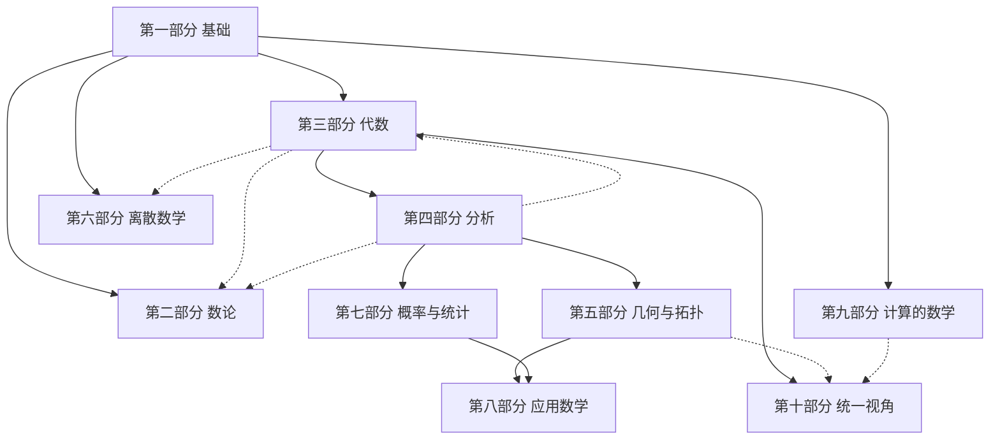

import { Aside } from '@astrojs/starlight/components';
import Figure from '../../components/Figure.astro';

<Aside type="note" title="怎样读这一章">

- **速览层（约 15 分钟）**：读引子、每节开头的“本节速览”和结尾。
- **标准层**：通读正文。
- **延伸层**：展开标有“延伸”的折叠块。

</Aside>

## 引子：一行看不懂的式子

假设你在读一篇介绍大语言模型的技术文章，或者请 AI 帮你推导一个训练目标，屏幕上出现了这样一行式子：

$$
\max_{\theta}\ \mathbb{E}_{x\sim p_{\text{data}}}\big[\log p_{\theta}(x)\big]
$$

它的意思是：调整参数 $\theta$，让模型 $p_\theta$ 给真实数据打出的“对数概率”在平均意义下尽可能大。许多生成模型的训练目标，包括今天的语言模型，都可以写成这种形式。

这一行不长，却同时用到了好几片数学：

- $\mathbb{E}$ 和 $\sim$ 来自概率论：$x\sim p_{\text{data}}$ 表示 $x$ 按真实数据的分布抽取，$\mathbb{E}$ 表示求平均（期望）；
- $\log$ 以及期望背后的积分来自分析；
- $\max_\theta$ 是一个优化问题：在所有可能的参数里找出最好的那一组。

AI 可以替你推导它，也可以写代码实现它。但推导对不对、代码有没有算错，最终要由你判断，而判断的前提是读懂它。

读懂一行式子需要两样东西：一是认识符号，二是知道这些符号来自哪片数学、那片数学在研究什么。本章先解决第二件事，给整个数学画一张地图。我们从一个老问题开始：数学到底研究什么？

## 一、数学研究的六类对象

<Aside type="tip" title="本节速览">

数学研究六类对象：**数、形、结构、变化、不确定性、计算**。逻辑与集合是六类共用的“语法”。看下面的总表和图 1 即可。

</Aside>

| 对象     | 核心问题                     | 日常例子                       | 代表符号                                                   | 本书位置                      |
| -------- | ---------------------------- | ------------------------------ | ---------------------------------------------------------- | ----------------------------- |
| 数       | 数有哪些？有什么规律？       | 素数、银行卡校验码、密码       | $\mathbb{N},\ \mathbb{Z},\ \mathbb{R}$；$a\equiv b \pmod{n}$ | 第 3 章，第二部分             |
| 形       | 空间与形状有什么性质？       | 地图投影、卫星定位、咖啡杯与甜甜圈 | $\mathbb{R}^n$；$d(x,y)$；$\cong$                         | 第五部分                      |
| 结构     | 运算与关系有哪些抽象模式？   | 魔方、时钟算术、对称图案       | $(G,\cdot)$；$V$；$\le$                                    | 第三部分，第 29 章，第十部分  |
| 变化     | 量如何随时间和空间变化？     | 速度、人口增长、热传导         | $\lim$；$\dfrac{dx}{dt}$；$\int$                           | 第四部分                      |
| 不确定性 | 如何描述可能性、从数据推断？ | 天气预报、A/B 测试、保险       | $P$；$\mathbb{E}$；$X\sim\mathcal{N}(\mu,\sigma^2)$        | 第七部分                      |
| 计算     | 什么能算？算多快？算多准？   | 搜索、加密、数值模拟           | $O(\cdot)$；$\mathrm{P}$ 与 $\mathrm{NP}$                  | 第 35 章，第九部分            |

<Figure
  name="prologue/six-objects"
  alt="六类对象环形图：中心是逻辑与集合，周围是数、形、结构、变化、不确定性、计算，各自标出对应的部分与章"
>
  图 1　数学研究的六类对象。中心的逻辑与集合是六类共用的“语法”；离散数学（第六部分）和应用数学（第八部分）横跨多类，未单独画出。
</Figure>

### 答案是怎样变化的

最早的回答是“数与形”。欧几里得（Euclid）约公元前 300 年写成的《几何原本》以几何为主，也包含比例论和数论；中国汉代成书的《九章算术》研究田亩测量、粮食交换、赋税摊派、工程土方中的计算。这个回答流传了两千多年。恩格斯（Friedrich Engels）在《反杜林论》（1878）中写道：“纯数学的对象是现实世界的空间形式和数量关系。”这大概是中文读者最熟悉的定义。

19 世纪，情况开始变化。非欧几何表明，几何的公理可以有不同的选择；伽罗瓦（Évariste Galois）用方程各根之间的置换来判断方程能否用根式求解；康托尔（Georg Cantor）开始比较无穷集合的“大小”。数学家越来越多地研究对象之间的关系和运算规则，而不只是某个具体的数或图形。到了 20 世纪，人们说数学研究的是“结构”；后来又有人说数学是“模式的科学”，斯蒂恩（Lynn Arthur Steen）1988 年的文章和德夫林（Keith Devlin）1994 年的书都用了这个说法。计算机出现以后，“计算”本身也成了研究对象：哪些问题能算，算得多快，算得多准。

这些回答不是互相取代，而是一次次扩张。把它们合在一起，就是本书使用的六类对象。

### 三点说明

**逻辑与集合是底座。** 它们不属于六类中的任何一类，而是六类共用的语言：逻辑规定证明怎样一步步推进，集合论为书写定义提供了通用的语言。本书第一部分先讲它们。

**六类是视角，不是互斥的分类。** 同一个问题常常同时涉及几类对象。素数的分布既是“数”的问题，又要用研究“变化”的工具（解析数论，第 5 章）。训练一个神经网络，要用到结构（参数是向量和矩阵）、变化（沿梯度调整参数）、不确定性（损失是对数据分布求期望）和计算（在计算机上数值求解）。

**有些部分本来就是跨类的。** 离散数学（第六部分）横跨数、结构和计算；应用数学（第八部分）横跨变化、不确定性和计算。本书不硬把它们塞进某一类。

### 小练习

下面五个现实问题，主要涉及哪几类对象？

1. 视频网站的推荐系统
2. 大桥在风中的振动
3. 传染病在城市中的传播
4. 网上支付时的加密
5. 地图导航寻找最短路线

<details>
<summary>参考答案</summary>

1. **结构、不确定性、计算**：用户与视频的评分可以排成一个矩阵，用线性代数做分解；用户偏好用概率模型描述；数据规模很大，求解靠高效的数值优化。
2. **变化、结构、计算**：振动由微分方程描述；桥的固有频率是一个矩阵的特征值；真实桥梁的计算靠有限元等数值方法。
3. **变化、不确定性、结构**：经典的 SIR 模型是一组微分方程；感染过程有随机性，模型参数要从数据中估计；人与人的接触关系可以画成一张图。
4. **数、计算**：RSA 等算法建立在模运算和素数之上；能分解出模数的素因子就能攻破 RSA，而在普通计算机上至今没有已知的高效分解算法。
5. **结构、计算**：道路网是一张带权重的图；最短路线由算法求出。如果考虑路况预测，还会涉及不确定性。

</details>

<details>
<summary>延伸：布尔巴基的三种母结构</summary>

布尔巴基（Nicolas Bourbaki）是一批法国数学家共用的笔名。从 20 世纪 30 年代起，他们以这个名字撰写多卷本的《数学原本》（Éléments de mathématique），试图用统一的语言重写数学的主要分支。在《数学的建筑》（法文 1948 年发表，英译 1950 年）一文中，他们把以下三类结构称为“母结构”：

- **代数结构**：集合上的运算，如群、环、域（第三部分）；
- **序结构**：元素之间的比较，如偏序、格（第 29 章）；
- **拓扑结构**：“邻近”与“连续”（第 23 章）。

许多重要对象是几种结构的组合。例如实数集 $\mathbb{R}$ 既能做加减乘除（代数），又能比较大小（序），还能谈论“越来越接近”（拓扑）。这种“结构主义”的观点深刻影响了 20 世纪的数学写作。但它对概率与计算这两类对象着墨不多，这也是本书在“结构”之外单列它们的原因。

</details>

## 二、数学地图：纯数学与应用数学

<Aside type="tip" title="本节速览">

纯数学与应用数学按动机区分，而且两者经常互相转化。国际上用 **MSC（数学主题分类）** 给数学划分区域。下面的对照表把本书十个部分对应到 MSC 的主要大类，图 2 是本书的地图。

</Aside>

### 纯数学与应用数学

纯数学（pure mathematics）和应用数学（applied mathematics）的区别主要在**动机**：前者为了理解数学对象本身，后者为了解决数学以外的问题。区别不在内容：同一个定理可以出于好奇被证明，几十年后又成为某项技术的核心。历史上，这种转化在两个方向上都反复发生。

**从纯到应用。** 哈代（G. H. Hardy）在 1940 年出版的《一个数学家的辩白》中写道：“还没有人发现数论或相对论能服务于任何战争目的，而且看来许多年内也不大可能有人发现。”三十多年后的 1977 年，RSA 公钥密码算法问世：能分解出它的模数的素因子，就能攻破它，而在普通计算机上至今没有已知的高效分解算法。数论从此成为公钥密码学的重要基础，支撑着许多网上支付和加密通信协议（第 4 章）。

另一个例子是几何。黎曼（Bernhard Riemann）1854 年在哥廷根大学的教授资格讲演《论作为几何学基础的假设》中，提出了任意维“弯曲空间”的几何。约六十年后，爱因斯坦（Albert Einstein）发现描述引力恰好需要这种几何：广义相对论（1915）的数学框架是黎曼几何的推广：把时间也纳入几何，度量不再处处为正的“洛伦兹几何”（第 25、37 章）。

**从应用到纯。** 傅里叶（Joseph Fourier）为了研究热传导，把函数写成三角函数的无穷级数。这个实用工具引出一个纯理论问题：一个函数的三角级数展开是否唯一？康托尔在 1870 年前后研究这个问题。为了处理“在某些点上允许例外”的情形，他开始研究这些例外点组成的点集，这条路最终把他引向了集合论（第 2、18 章）。

同样，庞加莱（Henri Poincaré）在 19 世纪末研究天体力学中的三体问题和微分方程，把注意力从求精确解转向轨道的定性性质，比如轨道是否周期、是否稳定。他在这项研究中发现了一种极其复杂的轨道结构（同宿缠结），后来被视为混沌现象的先声；他在另一些工作中奠定了代数拓扑的基础。定性的、整体的眼光由此进入数学（第 21、24 章）。

为什么为纯粹好奇而发展的数学，常常恰好能描述自然？物理学家维格纳（Eugene Wigner）1960 年写过一篇文章讨论这个问题，题为《数学在自然科学中不合理的有效性》（The Unreasonable Effectiveness of Mathematics in the Natural Sciences）。这个问题留到第 37 章再谈。

### 国际数学分类 MSC

数学文献浩如烟海，需要一套分类体系。**MSC**（Mathematics Subject Classification，数学主题分类）由美国数学会的《数学评论》（Mathematical Reviews）和 zbMATH Open 共同维护，大约每十年修订一次（MSC2000、MSC2010、MSC2020）。当前版本 MSC2020 有 **63 个两位数的顶层类**。

MSC 的编码分三级：两位数字、一个字母、再两位数字。例如：

- `11` 数论
  - `11A` 初等数论
    - `11A41` 素数

这张地图也会更新。`68T07`（人工神经网络与深度学习）就是 MSC2020 新增的条目。

MSC 的用法很简单。许多论文首页会标注 MSC 代码，看代码就知道它属于哪片数学；在 zbMATH Open 等数据库中，可以按代码检索同一方向的文献；遇到一个陌生术语，也可以直接问 AI：“这个术语属于 MSC 的哪个分类？”

下表把本书十个部分对应到 MSC 的主要大类（只列主要的，不是全部；类名为简称，完整名称见 [zbMATH Open 的 MSC2020 页面](https://zbmath.org/classification/)）：

| 本书部分       | 主要 MSC 大类                                                                                          |
| -------------- | ------------------------------------------------------------------------------------------------------ |
| 一、基础       | 03 数理逻辑与基础                                                                                      |
| 二、数论       | 11 数论                                                                                                |
| 三、代数       | 12 域论与多项式，13 交换代数，15 线性代数，20 群论，22 拓扑群与李群                                    |
| 四、分析       | 26 实函数，28 测度与积分，30 复变函数，34 常微分方程，35 偏微分方程，37 动力系统，42 调和分析，46 泛函分析 |
| 五、几何与拓扑 | 14 代数几何，51 几何，53 微分几何，54 一般拓扑，55 代数拓扑，57 流形                                     |
| 六、离散数学   | 05 组合数学，06 序与格                                                                                 |
| 七、概率与统计 | 60 概率论与随机过程，62 统计学，94 信息与通信理论                                                      |
| 八、应用数学   | 65 数值分析，81 量子理论，83 相对论，90 运筹与数学规划，91 博弈论与经济                                |
| 九、计算的数学 | 03 数理逻辑与基础（可计算性、类型论），68 计算机科学（计算复杂性）                                     |
| 十、统一视角   | 18 范畴论与同调代数                                                                                    |

### 本书的地图

图 2 画出本书十个部分之间的依赖关系。实线表示“先读前者，才好读后者”，虚线表示只有个别章节需要；可以由其他箭头推出的依赖不再重复画出（例如基础 → 代数 → 分析，就不再画基础 → 分析）。



<p style="text-align: center; font-size: var(--sl-text-sm); color: var(--sl-color-gray-2);">图 2　本书十个部分之间的依赖关系</p>

几条虚线值得说明。代数数论（第 6 章）要用到第三部分的理想，解析数论（第 5 章）要用到第四部分的复分析，李群（第 11 章）要用到第四部分的多元微积分。这几章的速览层可以按顺序读，标准层最好在读完前置章节后回读。各章之间更细的关系，写在每章的“地图位置”一段里。

<details>
<summary>延伸：另外两张“官方地图”</summary>

**arXiv 分类。** 数学、物理和计算机科学的新论文大多先发布在预印本网站 arXiv 上。它把数学分成三十多个类别，代码形如 `math.NT`（数论）、`math.AG`（代数几何）、`math.PR`（概率论）。与机器学习有关的论文常放在 `stat.ML` 和 `cs.LG`。

**中国的学科目录。** 中国长期沿用的研究生学科目录（1997 年版）在“数学”一级学科下设五个二级学科：基础数学、计算数学、概率论与数理统计、应用数学、运筹学与控制论。这五个名字也是一种划分方式，与本书的十个部分可以互相对照。

</details>

## 三、三大主干：代数、分析、几何/拓扑

<Aside type="tip" title="本节速览">

- **代数**研究运算与结构，关键词是等式、对称、结构。
- **分析**研究极限与逼近，关键词是不等式、估计、无穷小。
- **几何/拓扑**研究空间与形状，关键词是不变量、形变、局部与整体。

许多深刻的成果出现在三者的交汇处，见下面的交汇表和图 4。

</Aside>

### 三种看问题的方式

**代数**起源于解方程。后来数学家发现，比解出某个具体方程更重要的，是弄清运算本身遵守什么规则：交换律、结合律、有没有逆元。于是代数从“解方程”变成了“研究结构”。

**分析**起源于微积分。它要回答的是：怎样严格地谈论“无限接近”“瞬时变化率”和“无穷求和”。分析的日常工作是估计：一个量比另一个量小多少，误差能不能控制住。

**几何与拓扑**研究空间与形状。几何关心长度、角度、曲率；拓扑放宽要求，只关心连续形变下保持不变的性质，比如一个曲面上有几个“洞”。

数学界有一句流传的说法：“代数学家喜欢等式，分析学家喜欢不等式。”这话不全面，但抓住了两种思维习惯的差别。

### 一个对象，三种看法：单位圆

复平面上的单位圆，就是所有满足 $\lvert z\rvert = 1$ 的复数 $z$。三大主干看它的方式各不相同：

| 视角      | 单位圆是什么                                                                                        | 详见         |
| --------- | --------------------------------------------------------------------------------------------------- | ------------ |
| 代数      | 集合 $\{z\in\mathbb{C} : \lvert z\rvert = 1\}$ 在乘法下构成一个群；方程 $z^n = 1$ 的 $n$ 个根是圆上正 $n$ 边形的顶点 | 第 3、8 章   |
| 分析      | 用 $e^{i\theta}=\cos\theta+i\sin\theta$ 描述圆上的点；圆上的函数可以展开成傅里叶级数                | 第 15、18 章 |
| 几何/拓扑 | 拓扑空间 $S^1$；一条闭曲线绕它转了几圈，可以用一个整数记录，记作 $\pi_1(S^1)\cong\mathbb{Z}$        | 第 23、24 章 |

<Figure
  name="prologue/unit-circle"
  alt="单位圆的三种看法：代数上，六次单位根构成正六边形；分析上，圆上的点写成 e 的 i theta 次方；拓扑上，圆可以任意形变而仍是同一个 S1"
>
  图 3　同一个单位圆，三种看法。三条线索在欧拉恒等式 $e^{i\pi}+1=0$ 处交汇。
</Figure>

三条线索在欧拉恒等式 $e^{i\pi}+1=0$ 处交汇：取 $\theta=\pi$，就是从 $1$ 出发沿单位圆转半圈，到达 $-1$。（第 24 章还有一个“欧拉多面体公式” $V-E+F=2$，那是另一个结果，不要混淆。）

这里只求你认出这些符号，它们的含义会在后面的章节逐一展开。

### 交汇处

| 交汇        | 结合方式                   | 代表人物与成果                                                                                          | 章节       |
| ----------- | -------------------------- | ------------------------------------------------------------------------------------------------------- | ---------- |
| 代数 + 几何 | 用方程描述图形             | 笛卡尔（René Descartes）1637 年的《几何学》与费马（Pierre de Fermat）同时期的工作开创解析几何，后来发展为代数几何 | 26         |
| 代数 + 拓扑 | 用代数工具数“洞”           | 庞加莱 1895 年的《位置分析》开创代数拓扑                                                                | 24         |
| 分析 + 几何 | 在弯曲空间上做微积分       | 高斯（Carl Friedrich Gauss）的绝妙定理（1827）；黎曼几何（1854）                                        | 25         |
| 三者合一    | 连续的对称                 | 李群：既是群，又是可以做微积分的光滑空间                                                                | 11         |
| 分析 + 数论 | 用复函数研究素数           | 黎曼 1859 年关于 ζ 函数与素数分布的论文                                                                 | 5          |
| 分析 + 拓扑 | 解析量等于拓扑量           | 阿蒂亚（Michael Atiyah）与辛格（Isadore Singer）的指标定理（1963）；佩雷尔曼（Grigori Perelman）用里奇流证明庞加莱猜想（2002–2003） | 24、25、43 |
| 大统一      | 数论、几何、表示论互相翻译 | 朗兰兹（Robert Langlands）纲领                                                                          | 43         |

<Figure
  name="prologue/three-trunks"
  alt="三大主干的维恩图：代数与分析交汇处是泛函分析、调和分析；代数与几何拓扑交汇处是代数几何、代数拓扑；分析与几何拓扑交汇处是微分几何、几何分析；三者交汇处是李群和朗兰兹纲领"
  maxWidth={520}
>
  图 4　三大主干与它们的交汇处（只列代表方向）。
</Figure>

### 两点说明

**其余领域依靠三大主干。** 概率论建立在测度论（分析）之上；数论同时借用代数和分析的工具；范畴论（第 41 章）则试图为各种交汇提供一套共同的语言。

**“三大主干”是常见划分，不是唯一划分。** 也有人把逻辑或组合数学单独列为主干。分类是为了帮助理解，不必拘泥。

<details>
<summary>延伸：两个“大交汇”</summary>

**指标定理。** 阿蒂亚与辛格在 1963 年宣布的指标定理说：对紧流形上的一类（椭圆型）微分算子，它的“解析指标”（核与余核的维数之差，大致是“解空间的维数”减去“方程有解所需条件的个数”，是分析量）等于“拓扑指标”（只依赖于空间的拓扑，可以用拓扑不变量算出）。方程的这一解析特征，可以通过“形状”算出来。这是分析与拓扑深度统一的典范。

**朗兰兹纲领。** 1967 年，朗兰兹在给韦伊（André Weil）的一封信中提出一系列猜想，预言数论中的对象（如伽罗瓦群的表示）与分析中的对象（如自守形式）之间存在系统的对应。这组猜想至今只部分得到证明，被许多人看作现代数学最宏大的统一蓝图。费马大定理的证明（见第四节），就用到了这种对应的一个特例。第 43 章会再回到这里。

</details>

## 四、数学语言的特点

<Aside type="tip" title="本节速览">

数学语言由四种基本语句组成：**定义、公理、定理、证明**，见下表。数学语言的两个特点是**精确**（术语在给定语境中含义明确）和**抽象**（有选择地忽略细节）。

</Aside>

### 四种基本语句

| 语句 | 作用                               | 例子                                                                           |
| ---- | ---------------------------------- | ------------------------------------------------------------------------------ |
| 定义 | 给概念起名字；必须明确无歧义，但无所谓真假，只有好用与否 | “大于 1、且只能被 1 和自身整除的整数叫素数。”为什么 1 不算素数？见下文 |
| 公理 | 约定的出发点，不加证明             | 欧几里得的五条公设；集合论的 ZFC 公理                                         |
| 定理 | 从公理和已有结果推出的结论         | 费马大定理：$n\ge 3$ 时，$x^n+y^n=z^n$ 没有正整数解                            |
| 证明 | 把结论和出发点连起来的逻辑链       | 欧几里得对“素数有无穷多个”的证明（见本节末的延伸）                             |

**定义无所谓真假，只有好用与否。** 当然，定义本身必须明确、无歧义。把 1 排除在素数之外，不是因为 1“本来”不是素数，而是因为这样定义更好用：算术基本定理说“每个大于 1 的整数都能唯一地分解成素数的乘积”。如果 1 算素数，$6=2\times3=1\times2\times3=1\times1\times2\times3$，“唯一”就不成立了。定义服务于定理。

**定理家族。** 读论文时会遇到好几种“结论”，它们的区别主要在地位，而不在真假：

| 名称 | 英文        | 含义                                                         |
| ---- | ----------- | ------------------------------------------------------------ |
| 定理 | theorem     | 重要的、已证明的结论                                         |
| 命题 | proposition | 已证明的结论，重要性次于定理                                 |
| 引理 | lemma       | 为证明别的结论而准备的辅助结论；有些引理本身很有名，如舒尔引理、米田引理 |
| 推论 | corollary   | 由某个定理很快推出的结论                                     |
| 猜想 | conjecture  | 被相信为真、但尚未证明的陈述                                 |

猜想可能变成定理，也可能被推翻。费马在 1637 年前后写下费马大定理，此后三百多年无人能证。怀尔斯（Andrew Wiles）1994 年完成证明（其中一步与泰勒（Richard Taylor）合作），1995 年正式发表。它虽然一直被叫作“定理”，但在被证明之前其实是猜想。哥德巴赫（Christian Goldbach）1742 年在给欧拉（Leonhard Euler）的信中提出了一个关于素数和的猜想，经欧拉改述，成为今天的形式：每个大于 2 的偶数都是两个素数之和。它至今仍未被证明。

### 公理：从“自明的真理”到“选定的出发点”

欧几里得从五条公设出发，推出了《几何原本》中的数百个命题。前四条简单直观；第五条，也就是平行公设，又长又不那么显然。两千多年里，许多人试图用前四条证明它，都失败了。

19 世纪 20–30 年代，罗巴切夫斯基（Nikolai Lobachevsky）和鲍耶（János Bolyai）各自发现：把平行公设换成它的否定，同样可以推出一整套内容丰富的几何。后来贝尔特拉米（Eugenio Beltrami）等人证明：只要欧氏几何没有矛盾，这种非欧几何也没有矛盾。从此，公理不再被看作“不证自明的真理”，而是“我们选定的出发点”。1899 年，希尔伯特（David Hilbert）在《几何基础》中把这种观点系统化（第 1、22 章）。

### 验证不等于证明

看这个式子：$n^2+n+41$。

取 $n=0,1,2,3,\dots$，得到 $41,43,47,53,\dots$，都是素数。一直验证到 $n=39$，结果全是素数。验证了 40 个例子，很容易相信它对所有 $n$ 都成立。但取 $n=40$：

$$
40^2+40+41=1681=41^2,
$$

不是素数。

这个例子说明：**举例可以推翻一个“对所有……都成立”的命题，一个反例就够；但举再多的例子，也不能证明它。** 这正是检验 AI 结果时应有的态度：用小例子代入，可以很快发现错误；但几个例子都对，不等于结论一定对。终章会专门讨论怎样检验。

### 精确：术语在语境中只有一种意思

日常语言允许含糊，数学语言不允许：同一个词在不同领域可以有不同的意思，但在给定的语境中，它的含义必须是唯一的、明确的。几个常用词在数学中的意思与日常略有不同：

| 说法          | 数学中的意思                                         | 例子                                                       |
| ------------- | ---------------------------------------------------- | ---------------------------------------------------------- |
| 或            | 至少一个成立，两个都成立也算（相容的或）             | “$x>0$ 或 $x<1$”对 $x=0.5$ 成立                            |
| 若 $P$ 则 $Q$ | 只排除“$P$ 真而 $Q$ 假”这一种情形；$P$ 假时整句为真  | “若 $1=2$，则 $3=5$”是真命题                               |
| 存在          | 至少有一个；不说明有几个，也不说明是哪个             | “存在偶素数”：有，就是 2                                   |
| 任意、所有    | 每一个都满足，没有例外                               | 一个反例就能推翻                                           |
| 当且仅当      | 两个方向都成立：$P\Rightarrow Q$ 且 $Q\Rightarrow P$ | “$n$ 是偶数当且仅当 $n^2$ 是偶数”                          |
| 唯一          | 存在，并且只有一个                                   | 记作 $\exists!$                                            |

**量词的顺序很重要。** 比较这两句话：

- “每个人都有一位母亲。”写成符号：$\forall x\ \exists y\ (y \text{ 是 } x \text{ 的母亲})$。
- “有一位母亲是每个人的母亲。”写成符号：$\exists y\ \forall x\ (y \text{ 是 } x \text{ 的母亲})$。

两句话用的词几乎一样，只是“任意”（$\forall$）和“存在”（$\exists$）的顺序换了，意思就完全不同：前一句为真，后一句为假。第 1 章会系统地讲量词，第 12 章的 ε–δ 语言则把这种精确性用到了极致。

### 抽象：有选择地忽略

抽象就是有选择地忽略细节，只保留关心的结构。下面是一条抽象的阶梯：

> 3 个苹果 → 数 3 → 变量 $x$ → 群中的元素 $g$ → 范畴中的对象 $A$

每上一级，忽略的东西更多，适用的范围更广。“3”忽略了苹果是苹果；$x$ 忽略了它具体是几；群的元素连“它是不是数”都不管，只管它能和别的元素做一种满足某些规则的运算。

抽象的收益是**证明一次，处处适用**。时钟上的加法、正方形的旋转、魔方的转动看起来毫不相干，但它们都构成“群”。关于群证明的每一个定理，对它们同时成立。抽象的代价是入门门槛更高：你得先接受一个“看不见摸不着”的定义。本书的做法是先给直觉和例子，再给定义。

### 符号：压缩的语言

下面是“函数 $f$ 在点 $a$ 连续”的两种说法：

- 中文：无论给定多么小的正数 $\varepsilon$，总能找到一个正数 $\delta$，使得只要 $x$ 与 $a$ 的距离小于 $\delta$，$f(x)$ 与 $f(a)$ 的距离就小于 $\varepsilon$。
- 符号：$\forall\varepsilon>0\ \exists\delta>0\ \forall x\ \big(\lvert x-a\rvert<\delta \Rightarrow \lvert f(x)-f(a)\rvert<\varepsilon\big)$

符号版短得多，而且没有歧义。代价是你得认识每个符号。好在数学符号有很强的命名习惯：$\varepsilon$、$\delta$ 通常表示很小的正数，$n$、$m$、$k$ 通常表示整数，$f$、$g$ 通常表示函数，$\theta$ 在机器学习中通常表示参数。熟悉了这些习惯，读式子会快很多。第五节会介绍读符号的方法，附录 B 有完整的字母表。

### AI 时代的意义

今天，AI 已经能写出相当复杂的证明。但有三件事仍然需要你来判断：

1. **定义对不对**：AI 用的定义，是不是你心里想的那个概念？
2. **前提满不满足**：定理有前提条件，你的问题满足这些条件吗？
3. **结论是否回答了原问题**：AI 证明的，是不是你真正要问的？

另一方面，计算机也能帮人检查证明。在 Lean 这样的“证明助手”里，每一步推理都写成机器可以验证的形式。只要通过检查，就能确定结论确实由所采用的定义和公理推出；但形式化的陈述是否准确表达了原来的问题，仍然要由人来核对。第 40 章和终章会讨论这方面的进展。

<details>
<summary>延伸：一个完整的短证明（可跳过）</summary>

本书不做证明，但值得看一次证明长什么样。下面是欧几里得对“素数有无穷多个”的证明，用现代常见的反证法写出。

**命题**：素数有无穷多个。

**证明**：假设素数只有有限多个，记为 $p_1,p_2,\dots,p_n$。考虑

$$
N=p_1p_2\cdots p_n+1.
$$

$N$ 大于 1，所以它至少有一个素因子，记为 $p$。按假设，$p$ 必是 $p_1,\dots,p_n$ 中的某一个，因此 $p$ 整除乘积 $p_1p_2\cdots p_n$。$p$ 既整除 $N$，又整除 $p_1p_2\cdots p_n$，于是整除它们的差，也就是 1。但没有素数能整除 1，矛盾。所以素数有无穷多个。$\blacksquare$

两点注意：

- 证明并没有说 $N$ 本身是素数。例如 $2\times3\times5\times7\times11\times13+1=30031=59\times509$，它不是素数，但它的素因子 59 和 509 都不在原来的名单里。
- 欧几里得原书的写法略有不同：他证明的是“任给有限个素数，总能找到一个不在其中的素数”，并不需要反证。

</details>

## 五、本书用法与阅读路线

<Aside type="tip" title="本节速览">

从下面的阅读路线表中选一条适合你的路线。每进入一个新领域，都可以问五个问题：对象是什么？有什么结构？什么映射保持结构？什么不变？怎样分类？

</Aside>

| 路线              | 适合谁                       | 章节顺序                                                                                              |
| ----------------- | ---------------------------- | ----------------------------------------------------------------------------------------------------- |
| 全景速览          | 所有人，约 2 周              | 序章，再读全书各章的速览层                                                                            |
| AI / 机器学习     | 算法工程师、数据科学家       | 序章 → 1–3 → 7 → 12–14 → 30、32、33 → 34 → 35 → 18 → 28 → 31 → 36 → 23、25 → 终章                   |
| 工程 / 物理       | 工程师、物理与工科学生       | 序章 → 1–3 → 7 → 8 → 12–21 → 23 → 25 → 11 → 35 → 37 → 终章                                          |
| 软件 / 算法       | 软件工程师、计算机专业学生   | 序章 → 1–3 → 4 → 7–9 → 27–29 → 38–40 → 41 → 终章                                                     |
| 纯数学好奇心      | 想看完整幅地图的人           | 序章 → 按章节顺序读完全书，重点读第 42、43 章                                                         |

这些路线都满足各章的前置要求。如果按章节顺序阅读，第 5、6、11 章有“前向依赖”：先读它们的速览层，读完前置章节后再回读标准层。

### 每章长什么样

第 1–41 章介绍各个领域，统一分成十段。每段属于哪个阅读层次，也是固定的：

| 段                       | 回答什么问题                       | 层次               |
| ------------------------ | ---------------------------------- | ------------------ |
| 1　一句话                | 这个领域研究什么？                 | 速览               |
| 2　起源问题              | 它为何诞生，又怎样发展？           | 标准               |
| 3　核心对象与概念        | 研究什么对象，有哪些核心概念？     | 速览（概念名称）、标准（概念卡） |
| 4　符号体系              | 用什么符号说话，怎么读？           | 速览（核心符号）、标准（完整符号表） |
| 5　标志性结果与著名问题  | 最重要的结论和未解之谜是什么？     | 标准、延伸         |
| 6　直觉与图像            | 怎样“看见”这些概念？               | 标准               |
| 7　地图位置              | 先读什么，接着读什么，和谁相连？   | 速览               |
| 8　主要子领域            | 领域内部又分哪些方向？             | 延伸               |
| 9　主要实际应用          | 它在现实中解决什么问题？           | 标准               |
| 10　延伸阅读             | 想深入该读什么？                   | 延伸               |

序章、第 42–43 章（综合章）和终章不套用这个模板。

### 五问框架

每进入一个新领域，都用同一组问题去看它：


<p style="text-align: center; font-size: var(--sl-text-sm); color: var(--sl-color-gray-2);">图 5　五问框架</p>

用平面图形演示两遍，一遍用欧氏几何的眼光，一遍用拓扑的眼光：

| 五问   | 欧氏几何                                     | 拓扑                                               |
| ------ | -------------------------------------------- | -------------------------------------------------- |
| 对象   | 平面图形                                     | 曲面                                               |
| 结构   | 距离                                         | “邻近”关系（开集）                                 |
| 映射   | 保距变换：平移、旋转、反射                   | 同胚：连续形变，不撕开、不粘合                     |
| 不变量 | 长度、角度、面积                             | 洞的个数                                           |
| 分类   | 三角形在全等意义下由三边长决定（“边边边”）   | 连通的可定向闭曲面按洞的个数（亏格）分类；咖啡杯 ≅ 甜甜圈 |

同样是“图形”，换了允许的映射，不变量和分类就全变了。在欧氏几何里，圆和正方形不一样；在拓扑里，它们是一回事。这正是克莱因（Felix Klein）1872 年在爱尔兰根纲领中提出的思想：**一种几何，就是研究某个变换群作用下的不变量**。第 22 章会展开。

并不是每个领域都能把五问回答得同样整齐。遇到某一问不太适用时，各章会如实说明。

### 读符号

数学符号看着乱，其实除了数字和运算、关系符号，用来命名对象的字母主要只有三套（拉丁字母、希腊字母、希伯来字母），再加上同一字母的不同字体，比如 $\mathbb{R}$（黑板粗体）、$\mathcal{F}$（花体）、$\mathfrak{g}$（哥特体）。几条建议：

- **用英文读法。** $x$ 念 /eks/，$\alpha$ 念 alpha，$\mathbb{R}$ 念“R”或“实数集”。LaTeX 命令名通常就是读法：`\alpha` 念 alpha。
- **先学常用的希腊字母。** 小写 α β γ δ ε ζ η θ κ λ μ ξ π ρ σ τ φ χ ψ ω，大写 Γ Δ Θ Λ Π Σ Φ Ω，其余用到再查。
- **留意形近字。** ε 与 ∈、ν 与 v、ρ 与 p 形状相近，含义不同。
- **会查。** 遇到不认识的符号，可以用 [Detexify](https://detexify.kirelabs.org/classify.html) 手绘查出它的 LaTeX 命令，也可以直接把截图发给 AI，问“这个符号怎么读、在这里是什么意思”。

每章都有符号表，附录 B 有完整的字母表与字体约定，附录 E 汇总了同一个符号在不同章节的不同含义。

### 与 AI 一起读

AI 是很好的陪读者。三种常用的方式：

**请它解释一个符号或一行式子。**

```text
下面这行式子来自一篇机器学习论文：
\max_\theta \mathbb{E}_{x\sim p_{\text{data}}}[\log p_\theta(x)]
请逐个符号说明怎么读、是什么意思，并指出每个符号来自哪个数学领域。
```

**请它举例或找反例。**

```text
我理解的“连续函数”是“图像能一笔画出来的函数”。
请给出一个反例或边界情形，说明这个理解哪里不准确。
```

**请它出题检验你。**

```text
我刚读完一本数学入门书的序章。请出 5 道判断题，
检查我是否分清了定义、公理、定理和猜想。先不要给答案。
```

AI 也会出错，尤其是在细节上。它给出的解释和例子，最好用小例子代入、和书中的定义对照来核实。终章会系统地介绍检验方法。

<details>
<summary>延伸：里程碑自测</summary>

读完每个部分，可以用下面的任务检验自己：

| 阶段             | 自测任务                                                                                                                                                       |
| ---------------- | -------------------------------------------------------------------------------------------------------------------------------------------------------------- |
| 完成基础部分     | 能读出并解释 $\forall x\in\mathbb{R}\ \exists n\in\mathbb{N}\ (n>x)$，能说出从 $\mathbb{N}$ 到 $\mathbb{C}$ 的每一步扩张解决了什么问题                       |
| 完成数论部分     | 能读懂 $a^{p-1}\equiv 1 \pmod{p}$（$p$ 为素数且 $p\nmid a$），并说出 RSA 依赖了哪些数论事实                                                                    |
| 完成代数部分     | 能用群的语言描述一个对称现象，能解释 $G/N$ 的含义                                                                                                              |
| 完成分析部分     | 能读出并解释 $\forall\varepsilon>0\ \exists\delta>0\ \forall x\ (\lvert x-a\rvert<\delta \Rightarrow \lvert f(x)-f(a)\rvert<\varepsilon)$，能逐个符号解释 $\nabla_\theta \lVert X\theta-y\rVert^2$ 和 $\hat f(\xi)=\int f(x)e^{-2\pi i x\xi}\,dx$ |
| 完成几何拓扑部分 | 能解释为什么“咖啡杯 ≅ 甜甜圈”，能读懂 $\pi_1(S^1)\cong\mathbb{Z}$                                                                                             |
| 完成离散数学部分 | 能把一个网络问题写成 $G=(V,E)$，并判断它是路径、匹配、着色还是网络流问题                                                                                        |
| 完成概率统计部分 | 能读懂 $\mathbb{E}_{x\sim p_{\text{data}}}[\log p_\theta(x)]$，并说出最大化它等价于最小化哪个 KL 散度                                                          |
| 完成应用数学部分 | 能把一个资源分配问题写成 $\min_x f(x)\ \text{s.t.}\ g_i(x)\le 0$，并判断它是不是凸优化问题                                                                     |
| 完成计算部分     | 能区分“不可判定”与“NP-完全”，能读懂 $\mathrm{SAT}\in\mathrm{NP}$ 和 $A\le_p B$                                                                                 |
| 完成统一视角部分 | 能用“对象与态射”的语言说出群同态、线性映射、连续映射的共同点                                                                                                  |
| 完成全书         | 拿到一个现实问题，能说出它属于哪个领域，并用该领域的符号写出它的数学描述                                                                                      |

</details>

## 结尾：再看那行式子

回到引子中的式子：

$$
\max_{\theta}\ \mathbb{E}_{x\sim p_{\text{data}}}\big[\log p_{\theta}(x)\big]
$$

现在可以给它的每个部分在地图上标出位置了：

- $p_{\text{data}}$、$\sim$ 和 $\mathbb{E}$ 属于**不确定性**：数据来自一个分布，我们对它求平均（第七部分）；
- $\log$ 和期望背后的积分属于**变化**（第四部分）；
- $\theta$ 是一组参数，通常排成向量和矩阵，属于**结构**（第三部分）；
- $\max_\theta$ 是一个优化问题，实际靠梯度方法在计算机上数值求解，属于**计算**与应用数学（第八、九部分）。

你还不必读懂它的全部含义。到第七部分，你会看到：在适当的条件下，最大化这个式子，等价于最小化真实分布与模型分布之间的 KL 散度 $D_{\mathrm{KL}}(p_{\text{data}}\,\Vert\,p_\theta)$，也就是让模型的分布尽量接近真实数据的分布。读完全书，你应该能逐个符号说清它在说什么，也能判断 AI 对它的推导是否可靠。

地图已经画好。所有领域共用一套语法：证明要按逻辑规则一步步推进。我们的旅程就从第 1 章数理逻辑开始。

## 本章符号表

序章只要求你认出这些符号，不要求掌握。每个符号都注明了详细讲解的章节。

| 符号                                                             | LaTeX                             | 读法                   | 含义                                 | 详见              |
| ---------------------------------------------------------------- | --------------------------------- | ---------------------- | ------------------------------------ | ----------------- |
| $\mathbb{N}$ $\mathbb{Z}$ $\mathbb{Q}$ $\mathbb{R}$ $\mathbb{C}$ | `\mathbb{N}` 等                   | N、Z、Q、R、C          | 自然数、整数、有理数、实数、复数集   | 第 3 章           |
| $\in$                                                            | `\in`                             | in；属于               | 元素属于集合                         | 第 2 章           |
| $\forall$ / $\exists$                                            | `\forall` / `\exists`             | for all / there exists | 任意 / 存在                          | 第 1 章           |
| $\Rightarrow$ / $\Leftrightarrow$                                | `\Rightarrow` / `\Leftrightarrow` | implies / if and only if | 蕴含（若……则……）/ 当且仅当       | 第 1 章           |
| $\cong$                                                          | `\cong`                           | is isomorphic to       | 同构；在不同章节也表示同胚、全等     | 第 8、22、23 章   |
| $S^1$                                                            | `S^1`                             | S one                  | 圆周                                 | 第 24 章          |
| $e^{i\theta}$                                                    | `e^{i\theta}`                     | e to the i theta       | 单位圆上辐角为 $\theta$ 的点         | 第 3、15 章       |
| $\pi_1$                                                          | `\pi_1`                           | pi one                 | 基本群                               | 第 24 章          |
| $\mathbb{E}$                                                     | `\mathbb{E}`                      | E；expectation         | 期望                                 | 第 30 章          |
| $\sim$                                                           | `\sim`                            | is distributed as      | 服从某分布；在不同章节另有他义       | 第 30 章，附录 E  |
| $O(\cdot)$                                                       | `O(\cdot)`                        | big O                  | 渐近上界：增长不快于某个量级         | 第 12、39 章      |
